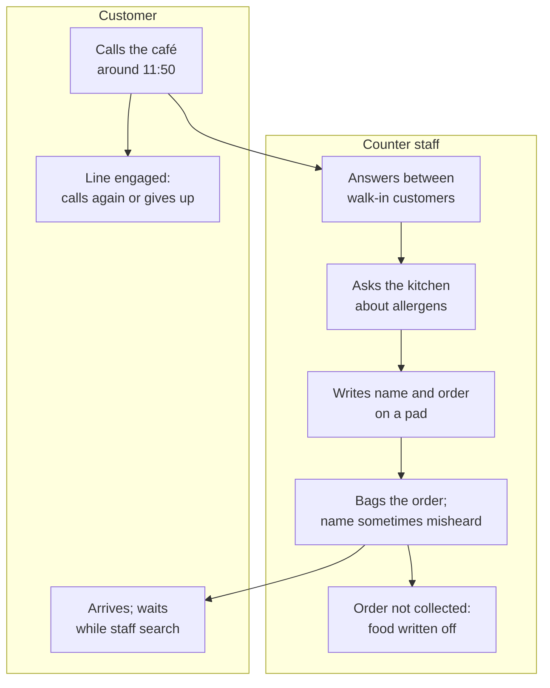
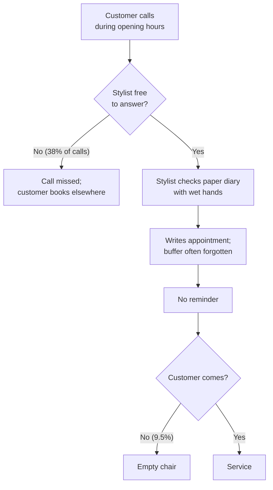

# Current vs Future State: Local Commerce & Booking Platform

## Document control

| Field | Value |
|---|---|
| Document ID | LC-DIS-ASIS-TOBE |
| Version | 1.1 |
| Status | Approved |
| Owner | Business Analyst |
| Last updated | 2026-02-27 |
| Reviewers | Product Owner; Partner Success Lead; pilot business owners |

**Purpose and scope.** How pilot businesses take orders and bookings today (AS-IS), with measured pain points, and how the platform changes it (TO-BE). Evidence comes from discovery between 2026-01-12 and 2026-02-20:
- interviews with 14 business owners and 22 customers;
- observation of 12 lunch services at 3 cafés;
- a 6-week audit of 4 salon diaries;
- an audit of 312 menu items at 8 food businesses;
- a survey of 410 residents of Neubau and Mariahilf.

## 1. AS-IS: lunch pickup by phone

## 2. AS-IS: salon booking by phone and paper diary

## 3. Pain points with evidence

| # | Pain point | Evidence | Affected | Objective |
|---|---|---|---|---|
| P1 | Uncollected phone orders | 96 of 1,412 phone orders (6.8%) over 4 weeks at 3 cafés | Food businesses | OBJ-01 |
| P2 | No-shows | 175 of 1,846 appointments (9.5%) over 6 weeks at 4 salons; 61% of them "forgot" | Salons | OBJ-02 |
| P3 | Missed booking calls | 38% of calls unanswered during treatments (call logs, 2 salons) | Salons, customers | OBJ-03 |
| P4 | Incomplete allergen information | 181 of 312 menu items (58%) with complete letter codes; 23 items with letters that no longer matched the recipe | Customers with allergies | OBJ-04 |
| P5 | Slow set-up on existing tools | Median 11 business days for 6 businesses on comparable tools | Businesses | OBJ-05 |
| P6 | Counter time on the phone | 38 minutes per lunch service (11:30 to 13:30), observed over 12 services | Counter staff, walk-in customers | OBJ-06 |
| P7 | Price and VAT confusion on vouchers | 3 of 8 food businesses could not say how a voucher affects VAT | Businesses | BR-035 |

## 4. TO-BE

| Area | Future state | Key requirements |
|---|---|---|
| Ordering | The customer orders in the app any time before pickup and chooses a 15-minute slot the kitchen can handle; payment is reserved and charged when the business accepts | BR-017 to BR-020, BR-033 |
| Counter | One order board with alerts, codes, sold-out and pause; no order taken by phone at lunch | BR-024, BR-040 |
| Allergens | Declared per item and per choice before publishing, versioned, visible within 60 seconds, re-confirmed at checkout if changed | BR-010 to BR-013, NFR-DAT-02 |
| Booking | Customers book 24/7; only start times that fit, including buffers; reminders and free self-service changes | BR-026 to BR-031 |
| Onboarding | Online application, verification queue, hosted payment onboarding, checklist; Live in 5 business days or fewer | BR-042 to BR-044 |

## 5. Gap analysis

| Gap | From | To | Closed by |
|---|---|---|---|
| Order channel | Phone and pad | App with slots and an order board | EP-03, EP-05 |
| Payment | At the counter, or never for uncollected orders | Reserved at order, charged at acceptance | EP-03, ADR-003 |
| Allergen source of truth | Printed sheet, hand-maintained | Versioned declarations with a publication gate | EP-02, EP-05 |
| Diary | Paper | Staff hours, services with buffers, appointments in one system | EP-04, EP-05 |
| Customer reminders | None | Email and push 24 hours before | EP-04 |
| Supply onboarding | Manual, weeks | Self-service with verification, days | EP-06 |

## Related documents

- [Business Requirements Document](../02-requirements/BRD.md)
- [Process flows (TO-BE detail)](../03-design/diagrams/process-flows.md)
- [Personas](personas.md)
- [Market and competitor scan](market-and-competitor-scan.md)
