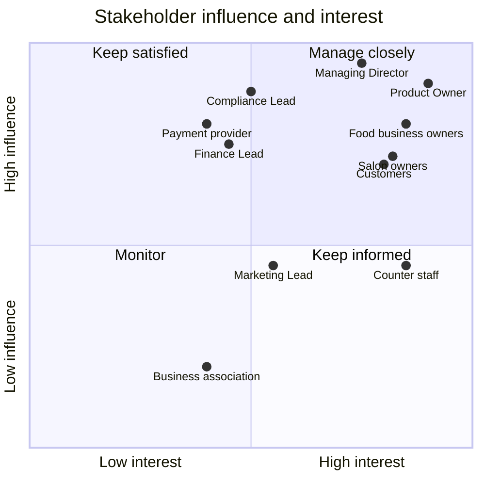

# Stakeholder Register and RACI: Local Commerce & Booking Platform

## Document control

| Field | Value |
|---|---|
| Document ID | LC-DIS-STK |
| Version | 1.2 |
| Status | Active |
| Owner | Business Analyst |
| Last updated | 2026-09-25 |
| Reviewers | Product Owner; Partner Success Lead |

**Purpose and scope.** Who has a stake in the platform R1, how much influence and interest they have, how the team engages them, and who is responsible, accountable, consulted and informed for the main deliverables and decisions.

## 1. Stakeholder register

| ID | Stakeholder | Group | Interest | Influence | Attitude at start | Engagement | Main concerns |
|---|---|---|---|---|---|---|---|
| SH-01 | Managing Director | The operator | High | High | Champion | Steering fortnightly | Pilot evidence for funding |
| SH-02 | Product Owner | The operator | High | High | Champion | Daily | Scope, priorities, objectives |
| SH-03 | Engineering Lead and team | The operator | High | High | Supportive | Daily | Feasibility, operability |
| SH-04 | Partner Operations Lead | The operator | High | Medium | Supportive | Weekly refinement | Verification workload, OBJ-05 |
| SH-05 | Partner Success Lead | The operator | High | Medium | Supportive | Weekly; sprint reviews | Pilot adoption and training |
| SH-06 | Compliance Lead, external data protection officer, legal counsel | The operator and advisers | Medium | High (veto) | Cautious | Rule clinics; document review | Allergen information, GDPR, consumer and platform rules |
| SH-07 | Finance Lead | The operator | Medium | High | Neutral | Rule clinics | VAT, commission, payouts |
| SH-08 | Marketing Lead | The operator | Medium | Medium | Supportive, wants ratings | Monthly | Growth after launch (CR-007) |
| SH-09 | Food business owners (Café Mohnblume, Konditorei Pomeranze, Nudelbar Sesam, Kaffeebar Zimtstern) | Pilot businesses | High | High | Interested but wary of fees | Sprint reviews; UAT | Commission, workload, allergen liability |
| SH-10 | Counter staff | Pilot businesses | High | Medium | Skeptical of "another screen" | Lunch observations; UAT-05 | Noise, speed, no phone |
| SH-11 | Salon and spa owners (Haarstudio Linde, Massageatelier Ruhepol) | Pilot businesses | High | High | Enthusiastic about reminders | Sprint reviews; UAT | No-shows, accurate diary |
| SH-12 | Customers, including people with food allergies | Customers | High | High collectively | Curious | Interviews; survey; customer panel | Trust in allergens, simple payment |
| SH-13 | Card payment provider | Supplier | Medium | High (contract) | Supportive | Monthly account meeting | Compliant marketplace set-up |
| SH-14 | District business association (Neubau) | Community | Medium | Low | Supportive | Two presentations | Fair treatment of small shops |

## 2. RACI

R = Responsible, A = Accountable, C = Consulted, I = Informed.

| Deliverable or decision | PO | BA | Eng Lead | QA Lead | UX | Partner Ops | Partner Success | Compliance | Finance | Pilot businesses | Sponsor |
|---|---|---|---|---|---|---|---|---|---|---|---|
| BRD and objectives | A | R | C | C | I | C | C | C | C | C | C |
| SRS and business rules | A | R | C | C | C | C | I | C | C | I | I |
| Allergen rules (BR-010 to BR-013) | A | R | C | C | C | I | C | C | I | C | I |
| VAT, commission and refund rules | A | R | C | C | I | I | I | C | C | I | I |
| Architecture and ADRs | C | C | A/R | C | I | I | I | C | C | I | I |
| Wireframes | C | C | C | I | A/R | I | C | C | I | C | I |
| User stories and acceptance criteria | A | R | C | C | C | I | I | C | I | I | I |
| Test strategy and test cases | C | R | C | A/R | I | I | I | C | C | I | I |
| UAT | A | R | I | C | C | C | R | I | I | R | I |
| Change requests | A | R | C | C | C | C | C | C | C | I | I |
| Go-live decision | A | C | R | R | I | C | C | C | C | C | C |
| Post-incident reviews | C | R | A | C | I | C | C | C | C | I | I |
| Business verification process | C | C | I | I | I | A/R | C | C | I | I | I |

## 3. Engagement notes

- **Counter staff** were won over by seeing their own lunch measured: 38 minutes on the phone in a two-hour service. They became the strongest advocates in UAT-05.
- **Food business owners** worried about commission. The answer was transparency: commission only on in-app paid orders, none on appointments, and the incremental-orders argument in the BRD.
- **Compliance** was involved from the first week, which turned allergen rules from a late veto into a design input (DEC-03).

## Related documents

- [Project charter](project-charter.md)
- [Personas](personas.md)
- [Business Requirements Document](../02-requirements/BRD.md)
- [Change request log](../05-delivery/change-request-log.md)
