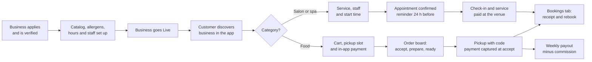

# Business Requirements Document (BRD): Platform release 1

## Document control

| Field | Value |
|---|---|
| Document ID | QT-REQ-BRD |
| Version | 1.2 |
| Status | Approved |
| Owner | Business Analyst |
| Last updated | 2026-09-25 |
| Reviewers | Managing Director (sponsor); Product Owner; Engineering Lead; Partner Operations Lead; Compliance Lead; Finance Lead; QA Lead |
| Approval | See [section 13](#13-approval-and-sign-off) |

| Version | Date | Change |
|---|---|---|
| 1.0 | 2026-02-27 | Baseline at the end of discovery. |
| 1.1 | 2026-04-24 | CR-001 (pre-orders with item lead time, BN-03) and CR-002 (spa classes and events moved to Release 2, BN-04). |
| 1.2 | 2026-09-25 | Post-pilot update. CR-005 and CR-006 sharpen BN-02 and BN-03 after INC-2026-006 and INC-2026-011. CR-003, CR-004 and CR-007 recorded as rejected in section 5.3. |

**Purpose.** This document states why Platform release 1 (R1) exists, which business outcomes it must achieve and which business needs the solution must meet. In ISO/IEC/IEEE 29148:2018 terms it is the business requirements specification. It says little about *how*; the [SRS](SRS.md) specifies the system behavior that satisfies each need.

**Scope of this document.** The R1 product for the Vienna pilot (Neubau and Mariahilf) and the Vienna launch, plus the boundary to Release 2 (R2). Audience: Managing Director, Product Owner, delivery team, pilot businesses, Compliance Lead and Finance Lead.

## 1. Executive summary

Independent cafés, bakeries, restaurants, salons and massage studios in Vienna run their day on the phone, a paper diary and a printed allergen sheet. At lunchtime a café owner takes orders by phone with one hand while serving with the other. A hair stylist stops a cut to answer a booking call, or misses it. A customer with a nut allergy has to ask at the counter, because the letter codes on the menu are incomplete or out of date.

Discovery with 14 businesses and 22 customers in Wien-Neubau and Mariahilf put numbers on it:

| Pain point | Baseline (discovery) |
|---|---|
| Phone pickup orders never collected | 6.8% |
| Salon appointments ending as no-shows | 9.5% |
| Booking calls unanswered during treatments | 38% |
| Menu items with complete allergen letter codes | 58% |
| Business days to get a business set up on a booking or ordering tool | 11 |
| Counter staff minutes spent on phone orders per lunch service | 38 |

The platform R1 gives these businesses one platform and their customers one app. Food businesses take **pickup orders paid in the app** into slots their kitchen can handle. Salons and spas take **appointments around the clock** that fit each stylist's day. All three apps run on one backend:
- the Customer Mobile App;
- the Business Web Portal with a staff POS view;
- the Platform Admin portal.

R1 went live for 38 pilot businesses on 2026-07-01 and for all of Vienna on 2026-09-01. R1.1 (2026-10-07) carries the two incident-driven changes, CR-005 and CR-006.

Five scope decisions shape the solution:
- **Pickup only.** Delivery is out of scope. Pickup needs no courier logistics and covers the lunch use case that hurts most.
- **Appointments are paid at the venue.** No deposits or no-show fees in R1 (CR-004 rejected). Reminders and free self-service cancellation carry OBJ-02.
- **The POS view is an order board, not a cash register.** Counter payments stay on each business's certified register (CR-003 rejected, Austrian cash register rules).
- **Allergens are a publishing gate.** No food item can be ordered in the app without a complete declaration (BR-011). This is stricter than discovery asked for and is the basis of OBJ-04.
- **No public ratings.** Ranking is neutral; feedback is private (CR-007 rejected).

## 2. Business context

the operator is a Vienna start-up. It runs the platform as a two-sided platform for independent local businesses in three categories:

| Category | Business types | What the customer does in R1 |
|---|---|---|
| Essen & Trinken (`FOOD`) | Restaurant, café, bakery or patisserie | Pre-orders food and drinks to collect, paying in the app or on collection |
| Haare & Beauty (`SALON`) | Hairdresser, beauty or nail salon | Reserves a time for a service and pays on site |
| Wellness & Massage (`SPA`) | Massage, wellness or day-spa studio | Reserves a treatment and pays on site (classes and events in R2, CR-002) |

Four external pressures make the current way of working hard to sustain:
- **Allergen information is mandatory before the purchase.** Regulation (EU) No 1169/2011 requires allergen information for non-prepacked food. For distance sales, the information must be available before the purchase is concluded. A phone call or a printed sheet does not scale to an app.
- **Prices must include VAT, and two rates apply.** Austrian consumer prices are shown gross. Food is taxed at the reduced 10% rate, while most drinks and all salon and spa services are taxed at the standard 20% rate. So one basket can hold two rates, and every discount and refund must be split correctly.
- **Card payments need strong customer authentication.** Under PSD2, customers confirm online card payments with their bank, sometimes in a banking app that takes minutes. Any slot or appointment held during payment has to survive that wait.
- **Personal data is regulated, and the digital age of consent is 14.** GDPR applies. In Austria a person can give valid consent to an online service from the age of 14 (DSG section 4). Allergy preferences can reveal health data, which needs special handling.

The current and future state, with discovery evidence, is in [current-vs-future-state.md](../01-discovery/current-vs-future-state.md). The competitive landscape is in [market-and-competitor-scan.md](../01-discovery/market-and-competitor-scan.md).

## 3. Problem statement

> **The problem of** running orders and bookings by phone, paper diary and printed allergen sheets **affects** independent food, salon and wellness businesses and their customers. **The impact of which is**:
> - uncollected orders;
> - no-shows;
> - missed bookings;
> - incomplete allergen information;
> - staff pulled away from the customer in front of them.
>
> **A successful solution would** let customers order and book when it suits them, with complete allergen and price information. It would let businesses accept only what they can deliver, and it would put the day's work on one screen.

| Problem | Evidence (baseline) | Business impact at a reference business (illustrative) | Root cause found in discovery |
|---|---|---|---|
| Uncollected pickup orders | 6.8% of phone orders (96 of 1,412 over 4 weeks at 3 cafés) | Café Mohnblume: about 24 uncollected orders a month at about EUR 11 each, written off | No prepayment; name and phone number misheard; no reminder |
| Appointment no-shows | 9.5% (175 of 1,846 appointments over 6 weeks at 4 salons) | Haarstudio Linde: about 46 empty slots a month at about EUR 48 each | No reminder; canceling means calling during opening hours |
| Missed booking calls | 38% of calls unanswered while staff were with a client | Customers book elsewhere; owners call back after hours | One phone, no self-service channel |
| Incomplete allergen information | 58% of 312 audited menu items carried complete letter codes | Customers with allergies avoid the business or must ask every time | Allergen sheet maintained by hand and not updated when recipes change |
| Slow set-up on existing tools | 11 business days median for 6 pilot businesses | Owners give up during set-up | Manual onboarding; separate payment set-up; no checklist |
| Counter time lost to the phone | 38 staff minutes per lunch service (12 observed services) | Queue grows while staff are on the phone | Phone is the only remote order channel |

## 4. Business objectives

Objectives map one-to-one, in order, to the discovery pain points. Targets are measured over the first full calendar quarter after the Vienna launch, Q4 2026 (2026-10-01 to 2026-12-31).

| ID | Objective | KPI | Baseline | Target | Measurement method | Owner role |
|---|---|---|---|---|---|---|
| OBJ-01 | Cut uncollected pickup orders | Ready orders marked Not collected | 6.8% | 2.0% or less | Not collected divided by (Completed plus Not collected) for the platform orders. Source: order status history (FR-POS-08). | Product Owner |
| OBJ-02 | Cut appointment no-shows | No-show rate of app-booked appointments | 9.5% | 5.0% or less | No-show divided by (Completed plus No-show). Source: appointment status history (FR-APT-07). | Partner Success Lead |
| OBJ-03 | Take bookings when the phone cannot | Share of app appointments created outside the location's opening hours | 0% (phone only) | 30% or more | Appointment `created_at` outside the location's opening intervals for that day, divided by all app appointments. | Product Owner |
| OBJ-04 | Complete and current allergen information | (a) Orderable food items with a complete allergen declaration; (b) orders placed on outdated allergen information | (a) 58%; (b) not measured | (a) 100%; (b) 0 | (a) Nightly count of published food items and choices without a confirmed declaration (BR-011 makes the target structural). (b) Orders containing a line whose declaration version differs from the version current at payment (FR-ORD-12). | Compliance Lead |
| OBJ-05 | Onboard businesses quickly | Median business days from application to Live | 11 | 5 or fewer | Application `submitted_at` to business `live_at`, Austrian public holidays excluded. Source: onboarding records (FR-ONB-04). | Partner Operations Lead |
| OBJ-06 | Free counter staff at lunch | Staff minutes on phone orders per lunch service (11:30 to 13:30) | 38 | 15 or fewer | Repeat structured observation at the same 3 cafés (12 services) in November 2026, cross-checked with the businesses' call logs. | Partner Success Lead |

Leading indicators tracked weekly but not objectives:
- share of orders accepted within 2 minutes;
- auto-rejections per 100 orders;
- 3-D Secure challenge completion time;
- reminder open rate;
- share of salon appointments rescheduled rather than canceled.

## 5. Scope

### 5.1 Epics in scope

| Epic | Name | Modules | Release | Functional requirements | User stories |
|---|---|---|---|---|---|
| EP-01 | Customer Account & Privacy | ACC | R1 | 9 | US-001 to US-005 |
| EP-02 | Discovery, Menus & Allergens | DSC | R1 | 9 | US-006 to US-010 |
| EP-03 | Ordering, Pickup & Payments | ORD, PAY | R1 (US-020 in R1.1) | 21 | US-011 to US-020 |
| EP-04 | Appointment Booking | APT | R1 | 10 | US-021 to US-025 |
| EP-05 | Business Portal & POS | CAT, POS | R1 | 18 | US-026 to US-032 |
| EP-06 | Business Onboarding & Platform Administration | ONB | R1 | 9 | US-033 to US-038 |
| **Total** |  |  |  | **76** | **38 stories** |

### 5.2 Release split

| Release | Date | Content | Basis |
|---|---|---|---|
| R1 pilot | 2026-07-01 | EP-01 to EP-06 for 38 businesses in Wien-Neubau and Mariahilf | SRS v1.2 |
| R1 Vienna launch | 2026-09-01 | EP-01 to EP-06 open to businesses across Vienna | SRS v1.2 |
| R1.1 | 2026-10-07 | CR-005 (allergen freshness and re-confirmation at checkout, after INC-2026-006). CR-006 (slot capacity re-check at payment authorization, after INC-2026-011). The server-side half of CR-005 went live as a hotfix on 2026-08-21. | SRS v1.3 |
| R2 | 2027 (see [release plan](../05-delivery/release-and-sprint-plan.md)) | Spa classes and events (CR-002); online payment for appointments; table reservations | Deferred scope |

### 5.3 Out of scope

| Item | Decision | Reason | What happens instead |
|---|---|---|---|
| Delivery by courier | Later phase (R3 candidate) | Courier logistics, delivery zones and fees add a second operation that the pilot businesses do not run today | Pickup only (FR-ORD-02) |
| Table reservations for restaurants | R2 | Different capacity model (tables and seatings); low demand in discovery compared with lunch pickup | Restaurants list their phone number |
| Spa classes and events | R2 (CR-002) | Group capacity, waitlists and cancellation rules need their own design; only 2 of 14 businesses run classes | Treatments are bookable like salon services |
| Online payment, deposits and no-show fees for appointments | Rejected for R1 (CR-004) | A fee charged to a saved card is a merchant-initiated transaction. It needs a stored mandate and a cancellation policy that customers have accepted in advance. Since July, pilot data has shown that reminders and free cancellation alone halved no-shows. | Pay at the venue (FR-APT-09); free cancellation until the cutoff (BR-029) |
| Taking cash or card payments at the counter in the POS view | Rejected (CR-003) | Recording counter sales would make the platform a cash register under the Austrian cash register rules (BAO section 131b and the cash register security regulation): signed receipts, a signature unit and data export. Every pilot business already has a certified register. | Pay-at-pickup orders are paid on the business's own register; staff confirm "Bezahlt an der Kassa" (BR-024) |
| Public star ratings and reviews | Rejected (CR-007) | Product principle of neutral ranking. Publishing reviews would also oblige the platform to state whether and how it checks they come from real customers (Omnibus Directive). | Private feedback to the platform only (FR-ONB-08) |
| Gift cards and stored value | R2 | Stored value raises payment-regulation questions that need legal review | Promo vouchers only (BR-036) |
| Loyalty programs and stamp cards | R2 | Not needed to reach the R1 objectives | None |
| Multi-business baskets | Not planned | Each business is the seller; one basket per business keeps receipts, VAT and refunds simple | One cart per location (BR-016) |
| Integrations with existing cash registers and booking tools | Later phase | Each vendor interface is a project in itself; pilot volumes do not justify it | Staff work from the POS view |
| Split services with processing gaps (for example color development) | R2 | The stylist is free during processing, so availability needs a two-segment model | The service is booked for its full duration |
| Cities outside Vienna | 2027 | Partner operations capacity | Waitlist for businesses outside Vienna |

## 6. Stakeholder summary

The full register, with RACI, is in [stakeholder-register-raci.md](../01-discovery/stakeholder-register-raci.md). Personas are in [personas.md](../01-discovery/personas.md).

| Stakeholder group | Represented by | Primary interest | Influence | What they need from R1 |
|---|---|---|---|---|
| Customers | PER-01 Sophie Wallner, PER-02 Daniela Costa (CUS) | Order and book without calling; trust allergen and price information | High collectively | Reach a business in two taps; allergens before adding; total including VAT before paying |
| Food business owners | PER-03 Elif Aydin (BIZ-ADM) | Fewer phone calls; only orders the kitchen can handle; money paid out reliably | High: supply side of the platform | Slot capacity; pause; allergen editor that prevents mistakes; weekly payout |
| Counter staff | PER-04 Tobias Gruber (BIZ-STF) | One screen at the counter; no surprises at lunch | Medium: daily users who drive adoption | Order board with clear alerts; pickup code; sold-out toggle |
| Salon and spa owners | PER-05 Martina Leitner (BIZ-ADM) | Full diary without answering the phone; fewer no-shows | High | Accurate availability with buffers; reminders; working hours that cannot orphan appointments |
| The platform partner operations | PER-06 Paul Haider (PLT-ADM) | Verify businesses fast and safely | Medium | One queue; register and UID checks; go-live checklist |
| The platform management | Managing Director (sponsor) | Pilot evidence for the Vienna launch and funding | Decisive | Objectives with baselines and a measurement method |
| Compliance Lead and external data protection officer | Compliance Lead | Food information, GDPR, consumer and platform rules | Veto on compliance | Allergen gate, data minimization, statements of reasons |
| Finance Lead | Finance Lead | Correct VAT, commission invoices, reconciled payouts | High on payment rules | BR-035 and BR-037 implemented exactly; daily reconciliation |
| Card payment provider | External | Compliant marketplace set-up | High (contractual) | Connected accounts; KYC before payouts; webhooks handled once |

## 7. Business needs

Each business need maps to one epic (BN-01 to EP-01, and so on). The functional requirements that satisfy each need are listed per module in [SRS section 3.2](SRS.md#32-functional-requirements), and the full chain is in the [traceability matrix](requirements-traceability-matrix.md).

| ID | Need statement | Business value | Epic | Objectives |
|---|---|---|---|---|
| BN-01 | Customers need to browse freely, create an account in under a minute with only the data a business needs, and stay in control of their consents and data. | Low-friction acquisition; GDPR and age-of-consent compliance by design | EP-01 Customer Account & Privacy | Enabler for OBJ-01 and OBJ-02 |
| BN-02 | Customers need to reach a business near them fast, see it with its own look and without paid ranking, and read complete, current allergen information before choosing an item. | Trust; fewer questions at the counter; distance-selling food information met | EP-02 Discovery, Menus & Allergens | OBJ-03, OBJ-04 |
| BN-03 | Customers need to order food for a pickup time the kitchen can handle, pay securely, see the VAT they paid and collect without queueing; businesses need to receive only orders they accept. | Prepaid orders are collected; lunch rush is smoothed; correct VAT and receipts | EP-03 Ordering, Pickup & Payments | OBJ-01, OBJ-06 |
| BN-04 | Customers need to book salon and spa appointments at any hour, with only times that really fit, and change them without calling; businesses need fewer no-shows. | Fuller diaries; no missed calls; fewer empty slots | EP-04 Appointment Booking | OBJ-02, OBJ-03 |
| BN-05 | Businesses need to maintain their catalog, allergens, services and staff hours themselves, and run pickup orders and the appointment day from one POS view. | Owners keep information current without help; staff stop answering the phone at peak | EP-05 Business Portal & POS | OBJ-04, OBJ-06 |
| BN-06 | The platform needs to verify each business's identity, onboard it with the card payment provider and publish it quickly, and to suspend it with reasons when needed. | Time to Live in days; trustworthy supply; platform-to-business rules met | EP-06 Business Onboarding & Platform Administration | OBJ-05 |

## 8. Business process overview

The two value chains share discovery, the Bookings tab and the business portal. Detailed flows, with swimlanes and exception paths, are in [process-flows.md](../03-design/diagrams/process-flows.md).

Design consequences the business has agreed to:
- **The business decides.** An order is not confirmed until the business accepts it, and an order not accepted within 5 minutes is auto-rejected and the payment voided (BR-022). Capturing only at acceptance means a rejected order never needs a refund.
- **Capacity is a promise.** A slot or an appointment time is offered only if it can be honored. Holds protect a choice during payment. The database, not the hold, makes the final decision (ADR-002, BR-020, BR-028).
- **Allergen information is part of the product, not decoration.** It is mandatory to publish, versioned when it changes and re-confirmed at checkout when it changed under the customer (BR-011, BR-013).
- **The business is the seller.** Receipts are issued in the business's name and payouts go directly from the card payment provider. The platform never holds customer funds (ADR-003).

## 9. Constraints

| Type | Constraint |
|---|---|
| Regulatory | Food information to consumers (Regulation (EU) No 1169/2011) and the Austrian allergen information rules; GDPR and the Austrian Data Protection Act (age of consent 14); PSD2 strong customer authentication; Austrian VAT Act (rates, invoice content); Austrian distance selling act (FAGG) and E-Commerce Act (ECG); platform-to-business regulation (EU) 2019/1150; BAO retention. See [compliance-mapping.md](compliance-mapping.md). |
| Contractual | Marketplace agreement with the card payment provider (connected accounts, KYC by the provider). Business terms accepted at application (BR-042). |
| Schedule | Seven two-week sprints (S1 from 2026-03-09 to S7 ending 2026-06-12), hardening and UAT from 2026-06-15 to 2026-06-26, pilot go-live 2026-07-01. |
| Team | One cross-functional team: Product Owner, Business Analyst, Engineering Lead, 2 backend developers, 2 Flutter developers, 1 web developer, QA Lead and 1 QA engineer, UX Designer. Scope is cut, not stretched. |
| Technical | Flutter customer app, React and TypeScript portals, NestJS API, PostgreSQL, Redis for holds ([system architecture](../03-design/architecture/system-architecture.md)). EU hosting only (NFR-PRIV-01). |
| Commercial | 8% commission on in-app paid food orders only (BR-037). Appointments free of commission during R1. |
| Language | German (de-AT) first, English available (NFR-I18N-01). |

## 10. Assumptions and dependencies

These are tracked, with owners and review dates, in the [RAID log](../05-delivery/raid-log.md).

**Assumptions**
- Customers in the pilot districts carry a smartphone and a card enabled for 3-D Secure, or Apple Pay or Google Pay.
- Food business owners can name the allergens in their own recipes. The platform provides the list and the gate; it does not check recipes.
- The right of withdrawal does not apply to perishable food prepared to order, or to appointments for a specific date, under the FAGG exceptions. External legal counsel confirmed this for the pilot.
- Each pilot business keeps its own certified cash register for counter sales.
- Austrian VAT rates for food (10%) and drinks and services (20%) apply at launch; any change is a data change (NFR-MNT-02).

**Dependencies**
- Card payment provider: marketplace contract, hosted onboarding and webhooks (IF-01).
- Maps and geocoding provider for addresses and distances (IF-02).
- Firebase Cloud Messaging for push (IF-03) and a transactional email provider (IF-04).
- EU VAT number validation service (VIES) for UID checks (IF-07).
- Pilot business availability for UAT in June 2026 ([UAT plan](../06-quality/uat-plan-and-scripts.md)).

## 11. Business model and benefits

All figures are fictional and illustrative. They show the logic of the business case, not a forecast.

**Revenue model.** the platform earns an 8% commission on the paid gross of in-app food orders, plus 20% VAT on the commission (BR-037). The commission is deducted at capture, and the platform bears the card processing fee. Appointments carry no commission in R1. A salon subscription is an R2 decision, to be taken on pilot evidence.

**Per-order example.** This is the canonical basket from [SRS Appendix B](SRS.md#appendix-b-worked-examples). Café Mohnblume, 2 x Topfengolatsche, 1 x Schinken-Käse-Sandwich and 1 x Hausgemachte Limonade 0,5 l, with the business-funded voucher MOHN3:

| Item | Amount |
|---|---|
| Basket gross before discount | EUR 18.70 |
| Voucher MOHN3 (business-funded) | EUR -3.00 |
| Paid by the customer (VAT 10%: EUR 1.05; VAT 20%: EUR 0.70) | EUR 15.70 |
| Commission 8% | EUR 1.26 |
| VAT 20% on commission | EUR 0.25 |
| Paid out to Café Mohnblume | EUR 14.19 |

**Benefits for reference businesses.**

| # | Benefit | Driver | Calculation | Value per month |
|---|---|---|---|---|
| B1 | Counter time freed at lunch | OBJ-06: 38 to 15 minutes | 23 minutes x 22 lunch services = 8.4 h x EUR 18.00 loaded staff cost | About EUR 150 per café |
| B2 | No more unpaid, uncollected pickup orders | OBJ-01 | About 350 orders a month move from phone to app; at the 6.8% phone baseline about 24 of them went unpaid and uncollected; app orders are prepaid. 24 x EUR 11.00 | About EUR 265 per café |
| B3 | Fewer empty salon slots | OBJ-02: 9.5% to 5.0% | About 480 appointments a month x 4.5 points = about 22 appointments x EUR 48.00 | About EUR 1,050 per salon |
| B4 | Bookings that used to be missed calls | OBJ-03 | Not monetized; 41% of pilot app appointments were booked outside opening hours | n/a |
| B5 | Allergen information customers can rely on | OBJ-04 | Customers with allergies return; compliance risk falls | Not monetized |

**Sensitivity.**
- **Café.** On cost savings alone the case is roughly neutral. B1 and B2 come to about EUR 415 a month. Commission on 350 orders at an average of EUR 12.40 is about EUR 347 net of VAT. The case turns positive with incremental orders: pilot cafés reported that 31% of app customers were new to them. That is why "orders from new customers" is tracked weekly as a leading indicator.
- **Salon.** B3 alone outweighs the cost, because appointments carry no commission in R1. This keeps the salon side growing while the R2 pricing decision is open.

## 12. Success criteria and acceptance

**Release acceptance (R1).** All of the following must hold:
1. Every Must functional requirement for EP-01 to EP-06 has passed system test, and every business rule has at least one passing automated test (NFR-MNT-01). Evidence: [traceability matrix](requirements-traceability-matrix.md), [test plan](../06-quality/test-strategy-and-plan.md).
2. UAT scripts are signed off by at least one food business, one salon and the customer panel, with no open Critical or High defect ([UAT plan](../06-quality/uat-plan-and-scripts.md)).
3. There is no open Critical or High security finding (NFR-SEC-01), and the Compliance Lead has reviewed the [compliance mapping](compliance-mapping.md).
4. Both canonical worked examples (VAT basket and salon start times) reproduce exactly in the system ([SRS Appendix B](SRS.md#appendix-b-worked-examples)).

**Business acceptance (post launch).**
1. OBJ-01 to OBJ-06 meet their targets over Q4 2026, or each miss has a corrective plan agreed with the Product Owner.
2. Payouts reconcile with orders, refunds and commission every week without manual correction (Finance Lead).
3. No SEV-1 incident in the measurement quarter has a root cause in a requirement gap. If one does, it produces a CR within 10 business days, as INC-2026-006 and INC-2026-011 did (CR-005 and CR-006).

## 13. Approval and sign-off

| Role | Responsibility in approval | v1.0 | v1.2 |
|---|---|---|---|
| Managing Director (sponsor) | Business case and funding | Approved 2026-03-02 | Approved 2026-09-29 |
| Product Owner | Accountable for scope, priorities and objectives | Approved 2026-03-02 | Approved 2026-09-28 |
| Business Analyst | Author; completeness and traceability | Submitted 2026-02-27 | Submitted 2026-09-25 |
| Engineering Lead | Feasibility and constraints | Approved 2026-03-02 | Approved 2026-09-28 |
| Compliance Lead | Food information, GDPR, consumer and platform rules | Approved 2026-03-02 | Approved 2026-09-29 |
| Finance Lead | VAT, commission and payout rules | Approved 2026-03-02 | Approved 2026-09-28 |
| QA Lead | Testability of the success criteria | Reviewed 2026-02-27 | Reviewed 2026-09-28 |
| Pilot business representatives (Café Mohnblume, Haarstudio Linde) | Business endorsement | Endorsed 2026-03-02 | Endorsed 2026-09-30 |

## Related documents

- [Project charter](../01-discovery/project-charter.md)
- [Stakeholder register and RACI](../01-discovery/stakeholder-register-raci.md)
- [Personas](../01-discovery/personas.md)
- [Current vs future state](../01-discovery/current-vs-future-state.md)
- [Market and competitor scan](../01-discovery/market-and-competitor-scan.md)
- [Software Requirements Specification](SRS.md)
- [Business rules](business-rules.md)
- [Non-functional requirements](non-functional-requirements.md)
- [Compliance mapping](compliance-mapping.md)
- [Requirements traceability matrix](requirements-traceability-matrix.md)
- [Change request log](../05-delivery/change-request-log.md)
- [RAID log](../05-delivery/raid-log.md)
