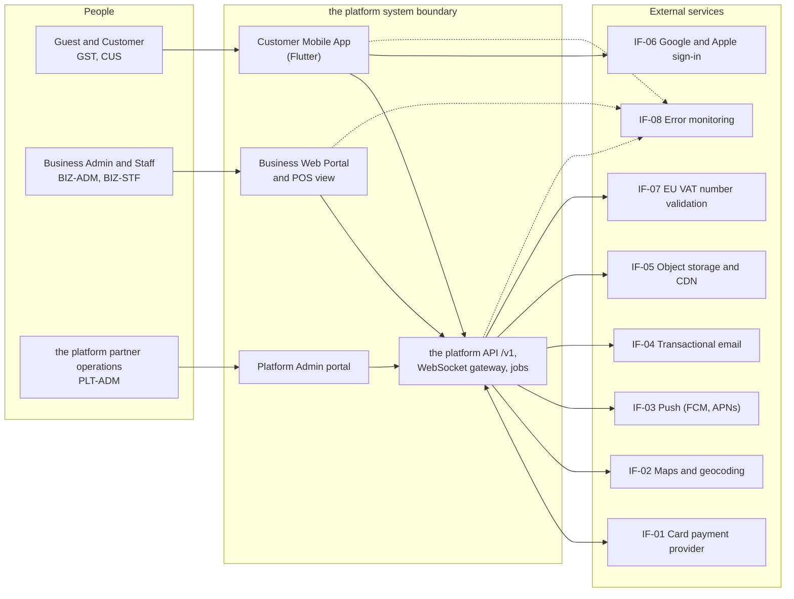

# Software Requirements Specification (SRS): Local Commerce & Booking Platform

## Document control

| Field | Value |
|---|---|
| Document ID | LC-REQ-SRS |
| Version | 1.3 |
| Status | Approved (baselined) |
| Owner | Business Analyst |
| Last updated | 2026-09-25 |
| Reviewers | Product Owner; Engineering Lead; QA Lead; UX Designer; Compliance Lead; Finance Lead; Partner Operations Lead |
| Change control | After a baseline, this document changes only through the [change request log](../05-delivery/change-request-log.md). Each approved CR updates this SRS, the [traceability matrix](requirements-traceability-matrix.md) and the affected user stories in the same pull request. |

**Purpose and scope.** This SRS specifies what the platform does, how it interfaces with people and other systems, and the quality and constraints it must meet for Release 1 (R1) and R1.1. It is the contract between the Product Owner and the delivery team and the basis for test design. Every requirement is meant to be verifiable, and section 4 says how.

## 1. Introduction

### 1.1 Purpose

This SRS turns the business needs BN-01 to BN-06 in the [BRD](BRD.md) into verifiable software requirements. Its audiences are:
- Developers and the Engineering Lead, who design against it.
- QA, who derive test cases from it.
- The UX Designer, who builds screens to the field-level specifications.
- The Compliance Lead and Finance Lead, who check that rules with legal or financial weight are stated precisely.

The layout follows the SRS information item in ISO/IEC/IEEE 29148:2018, with the overall description kept as its own section (section 2) for readability.

### 1.2 Scope

The platform is a multi-business local commerce platform for Vienna. Independent restaurants, cafés and bakeries; hair, beauty and nail salons; and massage, wellness and spa studios run their daily operation on it. Customers discover them and order or book through one mobile app.

This version specifies 76 functional requirements in 8 modules, 45 business rules (detailed in [business-rules.md](business-rules.md)) and 27 non-functional requirements (detailed in [non-functional-requirements.md](non-functional-requirements.md)).

Out of scope:
- delivery by courier;
- table reservations;
- spa classes and events (CR-002);
- online payment, deposits and fees for appointments (CR-004);
- counter payments in the POS view (CR-003);
- public ratings (CR-007).

The reasons are in [BRD section 5.3](BRD.md#53-out-of-scope). The business outcomes the platform must move are OBJ-01 to OBJ-06 ([BRD section 4](BRD.md#4-business-objectives)).

### 1.3 Product overview

| Application | Users | Technology | Release |
|---|---|---|---|
| Customer Mobile App | GST, CUS | Flutter (iOS and Android) | R1 |
| Business Web Portal, including the POS view | BIZ-ADM, BIZ-STF | React with TypeScript (single-page app); POS view optimized for 10-inch tablets in landscape | R1 |
| Platform Admin portal | PLT-ADM | React with TypeScript | R1 |
| Public business application form | Prospective businesses (become BIZ-ADM) | Part of the Business Web Portal, public route | R1 |

All front ends use one REST API under `/v1` (OpenAPI-first) and one WebSocket gateway for live updates. They are backed by a Node.js/NestJS modular monolith whose modules match the SRS modules in section 3.2 ([ADR-001](../03-design/architecture/adr/ADR-001-one-backend-modular-monolith.md)). PostgreSQL is the system of record. Redis holds pickup-slot and appointment holds ([ADR-002](../03-design/architecture/adr/ADR-002-slot-holds-redis-database-guard.md)).

### 1.4 Definitions, acronyms and conventions

Terms and acronyms are defined in the [glossary](glossary.md). Conventions used in this document:

| Convention | Meaning |
|---|---|
| shall | A mandatory, verifiable requirement. Prose without "shall" is explanatory. |
| Priority | MoSCoW: Must, Should, Could, Won't (this release). |
| Release | R1 (pilot 2026-07-01, Vienna launch 2026-09-01) or R1.1 (2026-10-07, carries the v1.3 changes). |
| IDs | FR-<MOD>-NN, BR-NNN, US-NNN, NFR-<CAT>-NN, IF-NN (interfaces, section 3.1.3), TBD-NN (open issues, Appendix A). IDs are never reused. |
| Time | 24-hour clock in Europe/Vienna; stored in UTC (NFR-DAT-01). Documents use ISO 8601 dates; the UI shows DD.MM.YYYY. |
| Money | EUR. Documents write "EUR 15.70"; the UI shows "€ 15,70" (NFR-I18N-01); the API carries integer cents (`amountCents`). All consumer prices include VAT. |
| UI text | German (de-AT) is the source language; English is a full translation. The customer app addresses the user as "du", the portals as "Sie". Messages in this SRS are given in both languages. |
| Defaults | Numbers in requirements are defaults. Section 2.7 lists them and who can change them. |

### 1.5 References

| Reference | Use in this SRS |
|---|---|
| [BRD](BRD.md), [business-rules.md](business-rules.md), [non-functional-requirements.md](non-functional-requirements.md), [compliance-mapping.md](compliance-mapping.md), [glossary.md](glossary.md) | Companion volumes of this specification |
| [Requirements traceability matrix](requirements-traceability-matrix.md) | BN to FR to BR to US to test case |
| [ERD](../03-design/data/erd.md), [data dictionary](../03-design/data/data-dictionary.md) | Entity and field definitions |
| [openapi.yaml](../04-api/openapi.yaml), [API guidelines](../04-api/api-guidelines.md), [realtime events](../04-api/realtime-events.md) | API contract, error catalog and live updates |
| [State machines](../03-design/diagrams/state-machines.md), [sequence diagrams](../03-design/diagrams/sequence-diagrams.md), [wireframes](../03-design/wireframes/README.md) | Behavior and screen design |
| ISO/IEC/IEEE 29148:2018; ISO/IEC 25010 | Requirements engineering; quality model for NFRs |
| Regulation (EU) No 1169/2011 Annex II | The 14 allergens (BR-010) |
| Regulation (EU) 2016/679 (GDPR); Austrian DSG section 4 | Personal data; age of consent 14 (BR-002) |
| Commission Delegated Regulation (EU) 2018/389 | Strong customer authentication (BR-032) |
| Austrian UStG sections 10 and 11 | VAT rates; small-amount invoice content (BR-035, BR-038) |
| FAGG section 8; ECG section 5; Regulation (EU) 2019/1150 | Order button wording; business identity; ranking transparency and statements of reasons |
| WCAG 2.2; OWASP ASVS 4.0.3; RFC 9457 | Accessibility; security verification; API error format |

### 1.6 Revision history

| Version | Date | Change |
|---|---|---|
| v1.0 | 2026-03-02 | Baseline. |
| v1.1 | 2026-04-24 | CR-001: pre-orders with item lead time (FR-ORD-11, BR-017, FR-CAT-03). CR-002: spa classes and events moved to R2. |
| v1.2 | 2026-06-19 | UAT clarifications: messages aligned to NFR-USE-02 in both languages; order board auto-pause when no board is connected (BR-040); "until end of day" sold-out reset defined as the next opening (BR-014); no-show only from 15 minutes after start (BR-030); small-business VAT exemption category added (BR-015). |
| v1.3 | 2026-09-25 | CR-005: allergen declaration versions, 60-second freshness and re-confirmation at checkout (BR-013, FR-CAT-04, FR-ORD-12, NFR-DAT-02; from INC-2026-006). CR-006: capacity re-check at payment authorization, hold extension during 3-D Secure, alternative slots (BR-019, BR-020, FR-ORD-12; from INC-2026-011). NFR-OBS-02 extended with business anomaly alerts. Appendix A refreshed. |

## 2. Overall description

### 2.1 Product perspective

The platform is a new product. For the businesses it replaces the phone order pad, the paper diary and the printed allergen sheet described in [current-vs-future-state.md](../01-discovery/current-vs-future-state.md). It owns the order and appointment record and the published catalog. It does not own:
- card processing and payouts, which belong to the card payment provider;
- counter sales, which go through each business's certified cash register;
- the business's bookkeeping.

Container-level views and the technology stack are in [system-architecture.md](../03-design/architecture/system-architecture.md).

### 2.2 Product functions

| Module | Epic and module name | Release | Functional requirements | Must | Should | Could |
|---|---|---|---|---|---|---|
| ACC | EP-01 Customer Account & Privacy | R1 | FR-ACC-01 to FR-ACC-09 | 7 | 2 | 0 |
| DSC | EP-02 Discovery, Menus & Allergens | R1 | FR-DSC-01 to FR-DSC-09 | 8 | 1 | 0 |
| ORD | EP-03 Ordering & Pickup | R1, R1.1 | FR-ORD-01 to FR-ORD-12 | 11 | 1 | 0 |
| PAY | EP-03 Payments & Receipts | R1 | FR-PAY-01 to FR-PAY-09 | 8 | 1 | 0 |
| APT | EP-04 Appointment Booking | R1 | FR-APT-01 to FR-APT-10 | 9 | 1 | 0 |
| CAT | EP-05 Catalog & Business Setup | R1 | FR-CAT-01 to FR-CAT-09 | 8 | 1 | 0 |
| POS | EP-05 Order Board & Day Operations (POS view) | R1 | FR-POS-01 to FR-POS-09 | 8 | 1 | 0 |
| ONB | EP-06 Business Onboarding & Platform Administration | R1 | FR-ONB-01 to FR-ONB-09 | 7 | 2 | 0 |
| **Total** |  |  | **76** | **66** | **10** | **0** |

The two chains run through the modules:
- **Food:** DSC (discovery and allergens), then ORD (cart, slot, checkout), then PAY (authorize at placement, capture at acceptance), then POS (order board, handover).
- **Appointments:** DSC, then APT (staff, start times, hold, confirmation), then POS (day view).
- **Supply:** CAT (catalog, allergens, services and staff hours) feeds both chains. ONB decides who is Live.
- **Cross-cutting:** ACC governs who may act. BR-041 governs notifications.

### 2.3 User classes and characteristics

| Code | Role | Description | Primary interface | Second factor | Data scope |
|---|---|---|---|---|---|
| GST | Guest | Visitor without an account. Browses Home, Search, listings, business pages, menus with prices and allergens. | Customer Mobile App | n/a | Public catalog only; nothing stored server-side |
| CUS | Customer | Person with a the platform account, using the app on a personal phone. Orders, books, saves locations and manages the profile. | Customer Mobile App | Not required in R1; password or Google or Apple | Own profile, consents, cart, orders, appointments |
| BIZ-ADM | Business Admin | Runs a business, typically as owner. Manages everything for that business: profile, locations, catalog, allergens, team, orders, appointments, refunds and statements. | Business Web Portal | Mandatory (TOTP) | Own business, all its locations |
| BIZ-STF | Staff | Works at a business. Uses an individual login to the same portal, which shows only the POS view: order board, sold-out toggles, pause, today's appointments. | Business Web Portal (POS view) | Optional on shared POS tablets | POS view of assigned locations only |
| PLT-ADM | Platform Admin | The operator partner-operations staff. Verifies, publishes, suspends and reinstates businesses; maintains VAT rates and platform vouchers; reads private feedback and the audit trail. | Platform Admin portal | Mandatory (TOTP) | All businesses for verification and lifecycle; customer data only through audited export |
| SYS | System | Timeouts, hold expiry, reminders, webhook processing, payouts reconciliation. | Background jobs and event handlers | n/a (service identity) | Business context set per job; row-level security still applies |

What the user classes are like, and what that means for design:
- **Customers (PER-01, PER-02)** order on the way to lunch, with one hand, often on a tram. Most use German; a large minority of Vienna residents prefer English. Some have allergies and cannot afford a wrong answer. Speed, legible allergen information and prices that do not change at the last step matter more than features (NFR-USE-01, NFR-I18N-01).
- **Counter staff (PER-04)** look at the POS tablet between customers, with flour on their hands and noise around them. Alerts must be impossible to miss and actions must be one tap (NFR-ACC-01).
- **Business Admins (PER-03, PER-05)** are owners who maintain the catalog at night after closing. They are not technical and fear making a mistake that hurts a customer. The allergen editor must make the safe path the easy path.
- **Platform Admins (PER-06)** verify a few businesses a day and need evidence on one screen.
- **Business scoping.** Business Admins and Staff see only their own business and, for Staff, only their assigned locations (NFR-SEC-05).

### 2.4 Operating environment

| Component | Environment |
|---|---|
| Customer Mobile App | iOS 16 or later and Android 9 (API 28) or later (NFR-CMP-01); 40 MB or smaller (NFR-MOB-01); location permission optional; camera not required |
| Business Web Portal and POS view | Current and previous major versions of Chrome, Edge, Firefox and Safari; POS view on tablets of 10 inches or larger in landscape, 1280 x 800 minimum; audio output for new-order alerts |
| Platform Admin portal | Same browsers, desktop 1280 x 720 minimum |
| Hosting | EU-region managed cloud: containers for API, WebSocket gateway and workers; managed PostgreSQL 16 with PostGIS; managed Redis; object storage with CDN for images; all data stored in the EU (NFR-PRIV-01) |
| Observability | Error monitoring on all apps and services (IF-08); metrics and business anomaly alerts (NFR-OBS-02) |
| Time zone | Europe/Vienna for all businesses in R1 |

### 2.5 Design and implementation constraints

| Constraint | Source |
|---|---|
| One API and one modular monolith serve all three apps; role-scoped route groups `/v1`, `/v1/business`, `/v1/platform`. | [ADR-001](../03-design/architecture/adr/ADR-001-one-backend-modular-monolith.md) |
| Holds live in Redis with a time-to-live; the database decides. Appointments are protected by an exclusion constraint per staff member; pickup capacity by a locked counter row per slot. | [ADR-002](../03-design/architecture/adr/ADR-002-slot-holds-redis-database-guard.md) |
| Marketplace payments through the card payment provider's connected accounts; the platform never holds customer funds; authorize at placement, capture at acceptance. | [ADR-003](../03-design/architecture/adr/ADR-003-marketplace-payments-authorize-capture.md) |
| Business-scoped tables carry `business_id` and are protected by row-level security (NFR-SEC-05). | ADR-001 |
| REST under `/v1`, JSON with camelCase, cursor pagination, RFC 9457 problem details, `Idempotency-Key` on unsafe POSTs. | [API guidelines](../04-api/api-guidelines.md) |
| Menu and allergen responses are never cached by shared caches for more than 60 seconds (NFR-DAT-02, CR-005). | [INC-2026-006](../07-operations/incidents/INC-2026-006-stale-allergen-information.md) |
| Allergen filter selections stay on the customer's device; they are never sent to the API, analytics or error monitoring. | [Spec 001](../08-ai-assisted-ba/specs/001-allergen-filter-on-menus/spec.md) |

### 2.6 Assumptions and dependencies

These are tracked with owners in the [RAID log](../05-delivery/raid-log.md). The ones that change the meaning of a requirement if they turn out false:
- The business is the seller of every order and appointment; the platform acts as an intermediary. If a tax authority treated the platform as the seller, receipts (BR-038) and VAT handling would change (TBD-01).
- Business owners declare allergens correctly for their own recipes. The platform enforces completeness and change control, not recipe accuracy.
- The card payment provider performs identity and bank checks on businesses and holds the payout relationship (IF-01).
- Straight-line distance is a sufficient sort key in a dense city. Walking distance is an R2 candidate.

### 2.7 Configuration defaults

The values below are the defaults referred to throughout this SRS and in [business-rules.md](business-rules.md). "Business" means a Business Admin can change the value per location within the range; "Platform" means a Platform Admin can change it; "Fixed" means it changes only through a release.

| Setting | Default | Range | Changed by |
|---|---|---|---|
| Pickup slot length | 15 min | n/a | Fixed |
| Pickup slot capacity | 6 orders | 1 to 30 | Business |
| Preparation lead time | 20 min | 5 to 120 min | Business |
| Pickup slot hold | 10 min, extended once by 5 min when a 3-D Secure challenge starts | n/a | Platform |
| Alternative slot offer after a full slot at authorization | 3 min, next 3 free slots | n/a | Platform |
| Order acceptance timeout | 5 min; pre-order placed while closed: 30 min after next opening | n/a | Platform |
| Customer order cancellation cutoff | 30 min before slot start | 0 to 120 min | Business |
| Pre-order item lead time; horizon | 0 h; 7 days | 0 to 72 h per item | Business (lead time) |
| Not collected allowed from | Slot end plus 60 min | n/a | Fixed |
| Cart inactivity expiry | 24 h | n/a | Fixed |
| In-app payment limit per order | EUR 400.00 gross | n/a | Fixed (BR-038) |
| Minimum payable after voucher | EUR 0.50 | n/a | Fixed |
| Commission | 8% plus 20% VAT on the commission | per contract | Platform |
| Payout schedule | Weekly, Mondays | n/a | Card payment provider contract |
| Appointment grid | 15 min | n/a | Fixed |
| Minimum notice for online booking | 2 h | 0 to 48 h | Business |
| Booking horizon | 8 weeks | 1 to 12 weeks | Business |
| Appointment hold | 10 min | n/a | Platform |
| Free cancellation and reschedule cutoff | 24 h before start | 2 to 48 h | Business |
| No-show allowed from | Start plus 15 min | n/a | Fixed |
| Appointment reminder | 24 h before start | n/a | Fixed |
| Service duration; buffer after | n/a | 15 to 480 min in 5-min steps; 0 to 60 min | Business |
| Password | 8 characters minimum, upper, lower, digit, not breached | n/a | Fixed |
| Sign-in lockout | 5 failures, 15 min | n/a | Fixed |
| Password reset code | 6 digits, 10 min, resend after 60 s, 5 attempts | n/a | Fixed |
| Customer tokens | Access 15 min; refresh 30 days, rotated | n/a | Fixed |
| Portal sessions | Business Admin and Platform Admin idle timeout 30 min; Staff on POS 12 h | n/a | Fixed |
| Allergen and price freshness | 60 s maximum | n/a | Fixed (NFR-DAT-02) |
| Order board disconnect auto-pause | 2 min | n/a | Platform |
| Account erasure | 30 days | n/a | Fixed |
| Order, payment and audit retention | 7 years | n/a | Fixed |
| VAT rates | Reduced 10%; Standard 20%; Exempt 0% (small-business exemption) | effective-dated | Platform |
| Search | from 2 characters; 20 results per group | n/a | Fixed |
| Locale | de-AT default; en selectable | n/a | Customer |

## 3. Specific requirements

### 3.1 External interface requirements

#### 3.1.1 User interfaces

Screen designs are in the [wireframes](../03-design/wireframes/README.md). These conventions apply to every screen:
- **Language and format.** Every label and message exists in de-AT and en (NFR-I18N-01). Dates DD.MM.YYYY; times HH:mm; amounts "€ 12,40"; distances "2,4 km".
- **Messages.** Each message states the problem and the fix; no raw codes are shown (NFR-USE-02).
- **Status never by color alone.** Open state, order status, appointment status and allergens always carry words or letters (NFR-ACC-01).
- **Business identity.** On a business page, the business's logo, cover and brand color are used; the brand color applies only within that business's pages (FR-DSC-05).
- **Targets.** Tap targets at least 44 x 44 pt on mobile; POS actions at least 48 px high.

| Screen | App | Guest access | Requirements | Wireframe |
|---|---|---|---|---|
| Sign-in, registration and password reset (3 steps) | Customer | Yes | FR-ACC-02 to FR-ACC-05 | n/a |
| Home, Search | Customer | Yes | FR-DSC-01, FR-DSC-02 | n/a |
| Category Listing | Customer | Yes | FR-DSC-03, FR-DSC-04 | n/a |
| Business Detail and Item Details | Customer | Yes (cannot add) | FR-DSC-05 to FR-DSC-09 | [m-01](../03-design/wireframes/m-01-menu-and-item-details.svg) |
| Cart and Checkout | Customer | No | FR-ORD-01 to FR-ORD-04, FR-ORD-12, FR-PAY-01, FR-PAY-06 | [m-02](../03-design/wireframes/m-02-checkout-and-status.svg) |
| Service, staff and start time | Customer | Browse only | FR-APT-01 to FR-APT-04 | [m-03](../03-design/wireframes/m-03-appointment-start-times.svg) |
| Bookings and Booking Details | Customer | No | FR-ORD-06, FR-ORD-08 to FR-ORD-10, FR-APT-06 | [m-02](../03-design/wireframes/m-02-checkout-and-status.svg) |
| Profile | Customer | Sign-in prompt | FR-ACC-06 to FR-ACC-08, FR-DSC-08 | n/a |
| Order board (POS view) | Business portal | n/a | FR-POS-01 to FR-POS-05, FR-POS-08, FR-POS-09 | [w-01](../03-design/wireframes/w-01-pos-order-board.svg) |
| Appointment day view (POS view) | Business portal | n/a | FR-POS-06 | n/a |
| Item editor with allergen declaration | Business portal | n/a | FR-CAT-03 to FR-CAT-05 | [w-02](../03-design/wireframes/w-02-item-editor-allergens.svg) |
| Verification queue | Platform Admin | n/a | FR-ONB-02, FR-ONB-04 | n/a |

#### 3.1.2 Hardware interfaces

- **POS tablet.** Audio output for the new-order alert (BR-040). Optional front camera for scanning the pickup QR code (BR-024); typing the 4-character code is always available.
- **Customer phone.** Location services are optional; without them lists sort by name (BR-006). Biometric unlock is not used in R1.

#### 3.1.3 Software interfaces

| ID | Interface | Direction | Data exchanged | Personal data | Failure behavior |
|---|---|---|---|---|---|
| IF-01 | Card payment provider (PSP) | Both | Hosted card fields and wallet sheets; payment authorization, capture, void, refund; connected accounts for businesses; hosted business onboarding (KYC); payouts; signed webhooks | Customer email for receipts at the PSP; no card data at the platform | Placement fails with "Die Zahlung konnte nicht gestartet werden" and no order is created; webhooks are retried by the provider and reconciled hourly (FR-PAY-09) |
| IF-02 | Maps and geocoding provider | Out | Business and location addresses for geocoding; the customer's device opens its own maps app for directions | No customer data sent | Address saved unverified and flagged for the Platform Admin; distance hidden until geocoded |
| IF-03 | Firebase Cloud Messaging (with APNs for iOS) | Out | Push tokens; push title and body; deep link | Device token only; no allergen or health data (BR-041) | Email is always sent for transactional messages, so push failure loses no information |
| IF-04 | Transactional email provider | Out | Confirmations, receipts, reminders, password reset codes, statements of reasons | Name and email address | Retried 3 times; failures listed for support |
| IF-05 | Object storage and CDN | Out | Business logos, covers, item images | None | Image placeholder shown; menu data is not served from the CDN (CR-005) |
| IF-06 | Google and Apple sign-in (OpenID Connect) | In | ID token with verified email and name | Name and email | Email and password sign-in remains available |
| IF-07 | EU VAT number validation service (VIES) | Out | UID number | Business data only | Application accepted with "UID check pending"; the Platform Admin repeats the check before approval |
| IF-08 | Error monitoring | Out | Errors with release, device and route | Scrubbed before sending (NFR-OBS-01) | No user impact |

#### 3.1.4 Communications interfaces

- HTTPS with TLS 1.2 or later for all traffic; HSTS on all web origins.
- WebSocket (Socket.IO protocol) for the order board and Booking Details live status; the board falls back to polling (NFR-AVL-03). Events are in [realtime-events.md](../04-api/realtime-events.md).
- Inbound webhooks from IF-01 are verified by signature and timestamp, then processed once per event ID (BR-033).

### 3.2 Functional requirements

Each module lists its requirements, then the field-level validation and messages for its key screens. Business rules are referenced by ID; their full wording and decision tables are in [business-rules.md](business-rules.md).

#### 3.2.1 ACC: Customer Account & Privacy

| ID | Requirement | Priority | Release | Roles | Business rules | Stories |
|---|---|---|---|---|---|---|
| FR-ACC-01 | The system shall let a guest use Home, Search, Category Listing, Business Detail and Item Details without an account, open the sign-in prompt when a guest tries to add an item, order, book, save a location or open the Bookings tab, and bring the customer back to the blocked action after sign-in. | Must | R1 | GST, CUS | BR-001 | US-001 |
| FR-ACC-02 | The system shall register a customer with first and last name, email, mobile number (+43 preselected), a password and the self-declaration "I am at least 14 years old", plus separate optional marketing consents that start unticked, and shall ask for nothing else at sign-up. | Must | R1 | GST | BR-002, BR-003 | US-002 |
| FR-ACC-03 | The system shall sign a customer in with email and password, with Google, or with Apple (offered on iOS only), and shall lock password sign-in for 15 minutes after 5 consecutive failed attempts. | Must | R1 | CUS | BR-004 | US-003 |
| FR-ACC-04 | The system shall let a customer reset a forgotten password with a 6-digit code sent by email, valid for 10 minutes and resendable after 60 seconds, and shall end every other session on the account when the new password is saved. | Must | R1 | CUS | BR-004 | US-004 |
| FR-ACC-05 | The system shall refuse a sign-up whose email address or mobile number already belongs to a customer account, or whose email address belongs to a Business Web Portal or Platform Admin account, and shall state which field conflicts. | Must | R1 | GST | BR-002 | US-002 |
| FR-ACC-06 | The system shall let a customer edit first name, last name and mobile number, choose the app language (German or English) and switch push notifications for order and appointment updates on or off in Profile. | Should | R1 | CUS | BR-041 | US-005 |
| FR-ACC-07 | The system shall let a customer delete their account in the app after re-entering the password or re-authenticating with Google or Apple, refuse the request while an order is open or an appointment is upcoming, and erase or pseudonymize personal data within 30 days. | Must | R1 | CUS, SYS | BR-005 | US-005 |
| FR-ACC-08 | The system shall record every consent (terms version, privacy notice version, marketing email, marketing push, analytics) with timestamp, source and version, let the customer withdraw any optional consent in Profile, and start analytics collection only after opt-in. | Must | R1 | CUS | BR-003 | US-002, US-005 |
| FR-ACC-09 | The system shall let a Platform Admin produce a machine-readable export (JSON) of a customer's personal data, orders, appointments and consents for a verified access or portability request within 30 days. | Should | R1 | PLT-ADM | BR-005 | US-005 |

**Sign Up: field-level validation (FR-ACC-02, FR-ACC-05, BR-002, BR-004).** Validation runs when a field loses focus and again on submit. The server repeats every check.

| Field | Required | Validation | Message (de-AT) | Message (en) |
|---|---|---|---|---|
| Vorname (first name) | Yes | 2 to 50 characters; letters including umlauts and accents, spaces, hyphens and apostrophes | Bitte gib deinen Vornamen ein (mindestens 2 Buchstaben). | First name: use at least 2 letters. |
| Nachname (last name) | Yes | Same rule as first name | Bitte gib deinen Nachnamen ein (mindestens 2 Buchstaben). | Last name: use at least 2 letters. |
| E-Mail-Adresse | Yes | Valid address, at most 254 characters; stored lower-case | Bitte gib eine gültige E-Mail-Adresse ein. | Enter a valid email address, for example name@example.com. |
| Mobilnummer | Yes | +43 is preselected in the country picker; the number must be a valid mobile number for the chosen country; stored in E.164 | Bitte gib eine gültige Mobilnummer ein. | Enter a mobile number we can reach you on, for example +43 664 1234567. |
| Passwort | Yes | 8 or more characters mixing upper- and lower-case letters with at least one digit; a strength meter updates while typing | Das Passwort braucht mindestens 8 Zeichen, einen Groß- und einen Kleinbuchstaben und eine Zahl. | Use 8 or more characters, with upper- and lower-case letters and at least one number. |
| Passwort (breached) | n/a | Not found in the breached-password range check | Dieses Passwort ist aus einem Datenleck bekannt. Bitte wähle ein anderes. | This password has appeared in a data breach. Please choose another one. |
| Passwort bestätigen | Yes | Equal to the password | Die Passwörter stimmen nicht überein. | The passwords do not match. |
| "Ich bin 14 Jahre oder älter." | Yes | Empty tick box the customer must tick; a self-declaration that is not verified | Bitte bestätige, dass du mindestens 14 Jahre alt bist. | Tick the box to confirm you are at least 14. |
| Marketing-E-Mails | No | Optional, empty when the screen opens, independent of accepting the terms | n/a | n/a |

| Condition at submit | System behavior | Message (de-AT) | Message (en) |
|---|---|---|---|
| Email already used by a customer account | Not created; link to Sign In | Mit dieser E-Mail-Adresse gibt es bereits ein Konto. Bitte melde dich an. | An account with this email address already exists. Please sign in. |
| Mobile number already used | Not created | Diese Mobilnummer gehört bereits zu einem anderen Konto. | This mobile number belongs to another account. |
| Email used by a portal account | Not created | Diese E-Mail-Adresse kann in der App nicht verwendet werden. | This email address is registered for a business account. Use a different one for the app. |
| No connection | Nothing submitted; values kept | Keine Internetverbindung. Bitte versuche es erneut. | No internet connection. Please try again. |
| Server error | Values kept | Wir konnten dein Konto nicht anlegen. Bitte versuche es erneut. | Your account was not created. Try again in a moment; your entries are kept. |

Below the button: "Mit der Registrierung akzeptierst du unsere Nutzungsbedingungen und die Datenschutzerklärung" with both as links. The accepted versions are stored as consents (FR-ACC-08).

**Sign In: outcomes (FR-ACC-03, BR-004).** Discovery asked for a message saying that no account exists for the address. That wording lets anyone test which addresses have accounts. R1 uses one message for an unknown email and a wrong password; sign-up still reveals existing emails, so attempts are rate-limited per IP and device (NFR-SEC-01).

| Condition | System behavior | Message (de-AT) | Message (en) |
|---|---|---|---|
| Unknown email or wrong password | Stay on screen; password cleared | E-Mail-Adresse oder Passwort ist falsch. | Incorrect email address or password. |
| Fifth consecutive failure | Password sign-in locked for 15 min; Google and Apple still work | Zu viele Versuche. Bitte versuche es in 15 Minuten erneut oder setze dein Passwort zurück. | Password sign-in is paused for 15 minutes. Reset your password or continue with Google or Apple. |
| Account created with Google or Apple only | Offer the right button | Du hast dich mit Google angemeldet. Bitte nutze „Weiter mit Google“. | You signed up with Google. Please use "Continue with Google". |
| Account deactivated | Refused | Dieses Konto ist deaktiviert. Bitte kontaktiere den Platform-Support. | This account is no longer active. Contact the platform support for help. |
| Success after a blocked action | Return to the blocked screen with the action available (BR-001) | n/a | n/a |

**Forgot Password: three steps (FR-ACC-04, BR-004).** Step 1 answers the same way for known and unknown addresses.

| Step | Condition | Behavior | Message (de-AT) | Message (en) |
|---|---|---|---|---|
| 1 Enter email | Valid address submitted | Code sent if an account exists | Wenn es ein Konto mit dieser E-Mail-Adresse gibt, haben wir dir einen Code geschickt. | If this email address has an account, a code is on its way. |
| 2 Verify code | Fewer than 6 digits | Verify disabled | n/a | n/a |
| 2 Verify code | Wrong code (attempts 1 to 4) | Boxes cleared; attempts left shown | Der Code ist nicht korrekt. Noch {n} Versuche. | The code does not match. {n} attempts left. |
| 2 Verify code | Fifth wrong attempt | Code invalidated | Zu viele Versuche. Bitte fordere einen neuen Code an. | That was the last attempt for this code. Request a new one. |
| 2 Verify code | Expired (after 10 min) | Stay on screen | Der Code ist abgelaufen. Bitte fordere einen neuen an. | This code is no longer valid. Request a new code. |
| 2 Verify code | Resend before 60 s | Control disabled with countdown | Neuer Code in 0:{ss} | New code in 0:{ss} |
| 2 Verify code | Resend after 60 s | New code; earlier code stops working | Wir haben dir einen neuen Code geschickt. | A new code is on its way to your inbox. |
| 3 New password | Same as current | Not saved | Bitte wähle ein Passwort, das du derzeit nicht verwendest. | Choose a password that differs from your current one. |
| 3 New password | Saved | Other sessions ended; Sign In opens | Dein Passwort wurde geändert. Bitte melde dich an. | Password updated. Sign in with your new password. |

#### 3.2.2 DSC: Discovery, Menus & Allergens

| ID | Requirement | Priority | Release | Roles | Business rules | Stories |
|---|---|---|---|---|---|---|
| FR-DSC-01 | The system shall show on Home, in order: a greeting with the customer's first name (signed in only), a location chip, a search bar, three category cards (Essen & Trinken, Haare & Beauty, Wellness & Massage), an Ongoing card for an order or appointment in progress (signed in only) and a Near you list of businesses ordered by distance. | Must | R1 | GST, CUS | BR-006, BR-007 | US-006 |
| FR-DSC-02 | The system shall search from the second character typed, update results as the customer types, match business name, business type, menu item name and service name, group results under Businesses, Dishes and Services, and open a dish or service result on its business page scrolled to that entry. | Must | R1 | GST, CUS | BR-009 | US-007 |
| FR-DSC-03 | The system shall show a Category Listing with a horizontally scrolling row of business-type chips (for food: Alle, Restaurant, Café, Bäckerei), a "Jetzt geöffnet" filter, the number of results with a plain-language statement of the sort order, and the matching business cards. | Must | R1 | GST, CUS | BR-006, BR-007 | US-008 |
| FR-DSC-04 | The system shall render every business card with logo (or an initials tile), business name, business type, distance in kilometers with a decimal comma, the open state in words and a save control, and shall show no star ratings, review totals or sponsored markers. | Must | R1 | GST, CUS | BR-007, BR-008 | US-006 |
| FR-DSC-05 | The system shall show a Business Detail page with cover image, header (logo, name, type, open state with today's hours, distance, address that opens the maps app), a location selector for businesses with several locations, an About section with the business's legal information, sticky catalog category chips, and the menu or service list in the business's own order, using the business's brand color for headings and actions. | Must | R1 | GST, CUS | BR-006 | US-009 |
| FR-DSC-06 | The system shall show each menu row with name, short description, VAT-inclusive price, optional image and the allergen letter codes, show sold-out items dimmed with the label "Ausverkauft" and without an add action, and never show items that are hidden from the app. | Must | R1 | GST, CUS | BR-010, BR-014, BR-015 | US-009 |
| FR-DSC-07 | The system shall show an Item Details popup with image, name, VAT-inclusive price, description, ingredients where entered, allergens with letter code and name above the options (never collapsed), an information control listing all 14 allergens, option groups with required flag, price change and allergen letters per choice, a note field, a quantity stepper and an Add button labeled with the running total. | Must | R1 | GST, CUS | BR-010, BR-011, BR-012 | US-010 |
| FR-DSC-08 | The system shall let a signed-in customer save and unsave a business location from any business card or business page and list saved locations in Profile. | Must | R1 | CUS | BR-001 | US-001 |
| FR-DSC-09 | The system shall let a customer choose allergens to avoid and mark, on every menu, items that contain them and items whose choices may add them, keeping the selection on the device only and never presenting an item as safe. | Should | R1 | GST, CUS | BR-010, BR-012 | US-010 |

**Allergen display states (FR-DSC-06, FR-DSC-07, BR-010 to BR-012).** The letter codes and names are those of BR-010; the German names are A Glutenhaltiges Getreide, B Krebstiere, C Eier, D Fisch, E Erdnüsse, F Soja, G Milch oder Laktose, H Schalenfrüchte, L Sellerie, M Senf, N Sesam, O Sulfite, P Lupinen, R Weichtiere.

| Declaration | Menu row | Item Details (de-AT) | Item Details (en) |
|---|---|---|---|
| Item contains A, C, G; no choice adds allergens | "A C G" | Enthält: A Glutenhaltiges Getreide, C Eier, G Milch oder Laktose | Contains: A Cereals containing gluten, C Eggs, G Milk or lactose |
| Item contains none of the 14 (confirmed) | No letters | Enthält keines der 14 Hauptallergene. | Contains none of the 14 main allergens. |
| Item contains L; choice "Cashew-Topping" adds H | "L + je nach Auswahl" | Enthält: L Sellerie. Je nach Auswahl zusätzlich: H Schalenfrüchte. The choice row shows "H" | Contains: L Celery. Depending on your choice also: H Tree nuts. |
| Declaration incomplete | Not possible on a published item (BR-011) | n/a | n/a |

The information control opens a sheet listing all 14 allergens with letter, name and examples. The sheet ends with a line telling customers with a severe allergy to also speak to the business about cross-contact, because traces are not declared in R1 (TBD-04).

**Item Details: validation (FR-DSC-07, FR-ORD-01).**

| Condition | System behavior | Message (de-AT) | Message (en) |
|---|---|---|---|
| Required option group without a choice | Add disabled; group marked | Bitte wähle eine Option für „{Gruppe}“. | Choose a "{group}" option to continue. |
| Guest taps Add | Sign-in prompt; nothing added | Melde dich an, um zu bestellen. | Sign in to order. |
| Item sells out while the customer is looking at it | Add disabled | Dieser Artikel ist gerade ausverkauft. | Sold out a moment ago; it can no longer be added. |
| Item from a different location than the open cart | Dialog before anything is added (BR-016) | Dein Warenkorb enthält Artikel von {Geschäft}. Neuen Warenkorb mit diesem Artikel starten? | Your cart is for {business}. Replace it with a new cart for this item? |
| Note longer than 200 characters | Input stops at 200 | Bitte kürze deine Anmerkung auf 200 Zeichen. | Please shorten your note to 200 characters. |
| Quantity above 20 | Stepper stops at 20 | Höchstens 20 Stück pro Artikel. | No more than 20 of one item. |

#### 3.2.3 ORD: Ordering & Pickup

| ID | Requirement | Priority | Release | Roles | Business rules | Stories |
|---|---|---|---|---|---|---|
| FR-ORD-01 | The system shall keep one cart per customer for one business location, ask before replacing it when an item from another location is added, show a cart bar with item count and running total on the business page, let the customer change quantity, edit a configured line or remove it, and discard a cart after 24 hours without activity. | Must | R1 | CUS | BR-016 | US-011 |
| FR-ORD-02 | The system shall offer 15-minute pickup slots computed from the location's ordering hours, the preparation lead time, the pause state and the remaining slot capacity, and show the earliest slot first. | Must | R1 | CUS | BR-017, BR-018 | US-012 |
| FR-ORD-03 | The system shall hold one unit of capacity in the chosen pickup slot for 10 minutes, show the remaining hold time at checkout, and release the hold when the order is placed, the slot is changed, checkout is left or the hold expires. | Must | R1 | CUS, SYS | BR-019 | US-012 |
| FR-ORD-04 | The system shall show a checkout summary with lines, choices and notes, the pickup slot, a voucher field, the payment method, subtotal, discount, total including VAT and the VAT contained per rate, the business's identity, and an order button labeled "Zahlungspflichtig bestellen". | Must | R1 | CUS | BR-035, BR-036 | US-014 |
| FR-ORD-05 | The system shall create an order in status Placed with a 4-character pickup code, show it on the location's order board, and confirm it to the customer in the app and by email. | Must | R1 | CUS, SYS | BR-021, BR-024 | US-015 |
| FR-ORD-06 | The system shall show the customer a live status timeline (Placed, Accepted, Preparing, Ready, Completed, or the terminal status reached) and send a push notification on Accepted, Ready, Rejected, delay and Canceled by the business; only the business or a system timeout changes a status. | Must | R1 | CUS | BR-021, BR-041 | US-015 |
| FR-ORD-07 | The system shall auto-reject an order that the business has not accepted within 5 minutes of placement (for a pre-order placed while the location is closed, within 30 minutes of the next opening), void its payment authorization and tell the customer. | Must | R1 | SYS | BR-022 | US-015 |
| FR-ORD-08 | The system shall show Cancel order only while cancellation is allowed, state in the confirmation dialog how the money is returned, and cancel the order, release the slot and void or refund the payment on confirmation. | Must | R1 | CUS | BR-023 | US-016 |
| FR-ORD-09 | The system shall list the customer's orders and appointments under Upcoming (soonest first) and Past (most recent first) with business, status in words, one-line summary, date and time and total, and show Booking Details with status timeline, pickup code, lines, payment summary with VAT per rate and the available actions. | Must | R1 | CUS | BR-021 | US-015 |
| FR-ORD-10 | The system shall rebook a completed or canceled order by copying its items, choices and quantities into a fresh cart at the same location, priced from the current menu, and list any item that is no longer available. | Must | R1 | CUS | BR-025 | US-017 |
| FR-ORD-11 | The system shall let a customer pre-order items that carry a lead time (for example whole cakes, 48 hours) for a pickup slot at least that lead time and at most 7 days ahead, using the largest lead time in the cart. | Should | R1 | CUS | BR-017 | US-018 |
| FR-ORD-12 | The system shall re-check slot capacity, item availability, prices and allergen declaration versions when payment authorization succeeds, require the customer to review and confirm any line whose allergens or price changed after it was added, and offer the next 3 free slots when the chosen slot filled while the bank confirmed the payment. | Must | R1.1 | CUS, SYS | BR-013, BR-019, BR-020 | US-020 |

**Checkout: field-level validation and messages (FR-ORD-02 to FR-ORD-04, FR-ORD-12, FR-PAY-06, BR-017 to BR-020, BR-036, BR-038).**

| Field or condition | Rule | Message (de-AT) | Message (en) |
|---|---|---|---|
| Abholzeit (pickup slot) | Required; one of the offered slots | Bitte wähle eine Abholzeit. | Please choose a pickup time. |
| Slot full when chosen | Not held; list refreshed | Diese Abholzeit ist gerade ausgebucht. Bitte wähle eine andere. | This pickup time has just filled up. Please choose another. |
| Hold expired before payment started | Slot list reopens | Deine reservierte Abholzeit ist abgelaufen. Bitte wähle sie erneut. | Your reserved pickup time has expired. Please choose it again. |
| Location paused or no slots left today | Order button disabled | {Geschäft} nimmt gerade keine Bestellungen an. Nächste Abholzeit: {HH:mm}. | {business} is not taking orders right now. Next pickup time: {HH:mm}. |
| Gutscheincode unknown | Not applied | Diesen Gutscheincode gibt es nicht. | This voucher code does not exist. |
| Gutscheincode expired or not yet valid | Not applied | Dieser Gutschein ist derzeit nicht gültig. | This voucher is not valid right now. |
| Minimum order value not reached | Not applied | Dieser Gutschein gilt ab einem Bestellwert von € {Betrag}. | This voucher applies from an order value of € {amount}. |
| Redemption limit reached | Not applied | Dieser Gutschein wurde bereits eingelöst. | This voucher has already been redeemed. |
| Voucher for another business | Not applied | Dieser Gutschein gilt nicht für {Geschäft}. | This voucher is not valid for {business}. |
| Second voucher code | Replaces the first after confirmation | Pro Bestellung ist ein Gutschein möglich. Diesen statt „{Code}“ verwenden? | One voucher per order. Use this one instead of "{code}"? |
| Anmerkung (order note) | Optional, at most 200 characters | Bitte kürze deine Anmerkung auf 200 Zeichen. | Please shorten your note to 200 characters. |
| Sold-out line in the cart | Order button disabled | Entferne „{Artikel}“, er ist ausverkauft. | Remove "{item}"; it is sold out. |
| Total above EUR 400.00 with in-app payment | Order button disabled | In der App kannst du Bestellungen bis € 400,00 bezahlen. | In the app you can pay for orders up to € 400.00. |
| Allergen declaration of a line changed (R1.1) | Line expanded with old and new allergens; confirm required | Die Allergenangaben für „{Artikel}“ haben sich geändert. Bitte prüfe sie und bestätige. | The allergen information for "{item}" has changed. Please check it and confirm. |
| Price of a line changed (R1.1) | New total shown; confirm required | Der Preis für „{Artikel}“ hat sich geändert: jetzt € {Preis}. | The price of "{item}" has changed: now € {price}. |
| Payment declined or 3-D Secure failed | No order; hold kept while it lasts | Die Zahlung wurde nicht bestätigt. Es wurde nichts abgebucht. | The payment was not confirmed. Nothing has been charged. |
| Slot filled while the bank confirmed (R1.1) | Next 3 free slots offered for 3 min; authorization kept, then voided if none chosen | Deine Abholzeit ist inzwischen ausgebucht. Wähle eine neue Zeit, deine Zahlung bleibt reserviert. | Your pickup time filled up while your bank confirmed the payment. Choose a new time; your payment stays reserved. |

The order button reads "Zahlungspflichtig bestellen · € {Gesamt}" ("Place order and pay · € {total}") for in-app payment and pay at pickup alike, because both create an obligation to pay (FAGG section 8). Above the button the checkout shows the business's legal name and address as the seller.

#### 3.2.4 PAY: Payments & Receipts

| ID | Requirement | Priority | Release | Roles | Business rules | Stories |
|---|---|---|---|---|---|---|
| FR-PAY-01 | The system shall take in-app payments by Visa or Mastercard and by Apple Pay or Google Pay through the card payment provider's hosted components, with strong customer authentication by 3-D Secure 2, without card data reaching the platform systems. | Must | R1 | CUS | BR-032 | US-013 |
| FR-PAY-02 | The system shall authorize the payment when the order is placed, capture it when the business accepts, and void it when the order is rejected, auto-rejected or canceled before acceptance. | Must | R1 | SYS | BR-033 | US-013 |
| FR-PAY-03 | The system shall offer "Bezahlung bei Abholung" (pay at pickup) where the business enables it, mark such orders as due at the business, and require staff to confirm payment at the counter before completing them. | Should | R1 | CUS, BIZ-ADM | BR-032, BR-024 | US-013 |
| FR-PAY-04 | The system shall let a Business Admin refund a captured order in full or in part with a reason, refund automatically when a customer cancels an accepted order within the cutoff, and never refund more than the captured amount. | Must | R1 | BIZ-ADM, SYS | BR-034, BR-023 | US-016, US-032 |
| FR-PAY-05 | The system shall compute order totals from VAT-inclusive prices, allocate discounts to VAT-rate groups and compute the VAT contained per rate as defined in BR-035, identically in the quote, the order, the receipt and refunds. | Must | R1 | SYS | BR-035, BR-015 | US-014 |
| FR-PAY-06 | The system shall validate a voucher code at checkout (exists, active, within validity, redemptions left, minimum order value reached, valid for the business), allow one code per order, and show its effect before the order is placed. | Must | R1 | CUS | BR-036 | US-014 |
| FR-PAY-07 | The system shall issue an itemized receipt in the business's name after capture, email it and show it in Booking Details, and refuse in-app payment for orders above EUR 400.00 gross. | Must | R1 | CUS, SYS | BR-038 | US-019 |
| FR-PAY-08 | The system shall deduct the platform's commission at capture, have the card payment provider pay out the balance to the business weekly, and show the Business Admin payout statements and a monthly commission invoice. | Must | R1 | BIZ-ADM, SYS | BR-037 | US-032 |
| FR-PAY-09 | The system shall verify the signature of every card payment provider webhook, process each event ID exactly once, and reconcile payment state hourly against the provider for orders older than 15 minutes in a non-final state. | Must | R1 | SYS | BR-033 | US-013 |

**Payment outcomes shown to the customer (FR-PAY-01 to FR-PAY-04, BR-033).**

| Event | Booking Details payment line (de-AT) | (en) |
|---|---|---|
| Authorised, waiting for the business | Zahlung reserviert, wird bei Annahme abgebucht | Payment reserved, charged when the business accepts |
| Captured | Bezahlt mit {Karte •••• 3155 / Apple Pay / Google Pay} | Paid with {card •••• 3155 / Apple Pay / Google Pay} |
| Voided (rejected, auto-rejected, canceled before acceptance) | Reservierung aufgehoben, es wurde nichts abgebucht | Reservation released, nothing was charged |
| Refunded in full or in part | € {Betrag} erstattet am {Datum}, Gutschrift in 5 bis 10 Werktagen | € {amount} refunded on {date}, credited in 5 to 10 working days |
| Pay at pickup | Bezahlung bei Abholung | Pay at pickup |
| Paid at the counter | Bezahlt an der Kassa | Paid at the counter |

**Receipt content (FR-PAY-07, BR-038).** Seller name, address and UID number (or "Umsatzsteuerbefreit, Kleinunternehmer"); receipt number; date; each line with quantity, description, choices and gross amount; discount; total; for each VAT rate the gross, net and VAT amounts; the payment method; "Vermittelt über die Plattform" (arranged through the platform).

#### 3.2.5 APT: Appointment Booking

| ID | Requirement | Priority | Release | Roles | Business rules | Stories |
|---|---|---|---|---|---|---|
| FR-APT-01 | The system shall list a salon's or spa's bookable services with name, duration, VAT-inclusive price (or a price-from), description and the staff who perform them. | Must | R1 | GST, CUS | BR-015 | US-021 |
| FR-APT-02 | The system shall let the customer choose a staff member or "Beliebig" (any available) and show, per day for the booking horizon, only the start times at which the whole service and its buffer fit the staff member's day. | Must | R1 | CUS | BR-026, BR-027 | US-021, US-022 |
| FR-APT-03 | The system shall hold the selected start time for 10 minutes with a visible countdown and release it on expiry, on a different choice or when the customer leaves the booking. | Must | R1 | CUS, SYS | BR-028 | US-023 |
| FR-APT-04 | The system shall confirm an appointment only after re-validating the staff member's time in the database, assign a staff member for "Beliebig", and send a confirmation in the app and by email with a calendar file. | Must | R1 | CUS, SYS | BR-027, BR-028 | US-023 |
| FR-APT-05 | The system shall send an appointment reminder 24 hours before the start by email, and by push where enabled, with links to reschedule or cancel while that is still allowed. | Must | R1 | SYS | BR-041 | US-024 |
| FR-APT-06 | The system shall let the customer cancel or reschedule an appointment in the app until the business's free-cancellation cutoff, and after the cutoff show the business's phone number instead. | Must | R1 | CUS | BR-029 | US-024 |
| FR-APT-07 | The system shall manage appointment status Confirmed, Checked in, Completed, Canceled and No-show, and show the current status in words to the customer. | Must | R1 | BIZ-ADM, BIZ-STF | BR-030 | US-025 |
| FR-APT-08 | The system shall let the customer add a note of up to 300 characters to an appointment and show it to the business in the day view. | Should | R1 | CUS | n/a | US-023 |
| FR-APT-09 | The system shall show the service price and "Bezahlung vor Ort" (paid at the venue) before confirmation, label the confirm button "Zahlungspflichtig buchen", and take no payment in the app for appointments. | Must | R1 | CUS | BR-032 | US-023 |
| FR-APT-10 | The system shall require a reason when the business cancels an appointment and notify the customer immediately with a link to book again. | Must | R1 | BIZ-ADM, BIZ-STF | BR-031 | US-025 |

**Appointment booking: validation and messages (FR-APT-02 to FR-APT-06, FR-APT-09, BR-026 to BR-029).**

| Field or condition | Rule | Message (de-AT) | Message (en) |
|---|---|---|---|
| Mitarbeiterin or Mitarbeiter (staff) | Required: a named staff member or "Beliebig" | Bitte wähle, bei wem du buchen möchtest. | Please choose who you would like to book with. |
| Uhrzeit (start time) | Required; one of the offered start times | Bitte wähle eine Uhrzeit. | Please choose a time. |
| No start times on the chosen day | Next day with free times suggested | An diesem Tag ist leider nichts frei. Nächster freier Tag: {Wochentag}, {TT.MM.}. | Nothing is free on this day. Next free day: {weekday}, {DD.MM.}. |
| Hold expired | Time list reopens | Deine Reservierung ist abgelaufen. Bitte wähle die Uhrzeit erneut. | Your reservation has expired. Please choose the time again. |
| Time lost at confirmation | Not booked; 3 nearest free times shown (BR-028) | Dieser Termin ist leider nicht mehr frei. Nächste freie Zeiten: {Zeiten}. | This time is no longer free. Next free times: {times}. |
| Anmerkung (note) | Optional, at most 300 characters | Bitte kürze deine Anmerkung auf 300 Zeichen. | Please shorten your note to 300 characters. |
| Cancel or reschedule after the cutoff | Controls hidden; phone shown | Online-Änderungen sind bis {n} Stunden vor dem Termin möglich. Bitte ruf {Geschäft} an: {Telefon}. | Online changes are possible until {n} hours before the appointment. Please call {business}: {phone}. |

The confirm button reads "Zahlungspflichtig buchen" ("Book with obligation to pay"); above it the screen shows the price and "Bezahlung vor Ort" (FR-APT-09).

#### 3.2.6 CAT: Catalog & Business Setup

| ID | Requirement | Priority | Release | Roles | Business rules | Stories |
|---|---|---|---|---|---|---|
| FR-CAT-01 | The system shall let a Business Admin maintain the business profile: display name, description, logo, cover, gallery, brand color (accepted only with at least 4.5:1 contrast against white) and the legal information shown on the business page. | Must | R1 | BIZ-ADM | BR-043 | US-036 |
| FR-CAT-02 | The system shall let a Business Admin maintain each location: geocoded address, phone, weekly opening and ordering hours with several intervals per day, dated closures, slot capacity, preparation lead time, order cancellation cutoff and whether pay at pickup is offered. | Must | R1 | BIZ-ADM | BR-007, BR-017, BR-018, BR-023 | US-036 |
| FR-CAT-03 | The system shall let a Business Admin maintain menu categories and items with name (German, optional English), description, VAT-inclusive price, tax category, image, ingredients, visibility in the app, pre-order lead time, sort order and per-location availability. | Must | R1 | BIZ-ADM | BR-014, BR-015 | US-030 |
| FR-CAT-04 | The system shall require a complete allergen declaration for every food item and option choice before it can be published, record each change as a new declaration version confirmed by a Business Admin, and make the confirmed version live for customers within 60 seconds. | Must | R1 | BIZ-ADM | BR-010, BR-011, BR-013 | US-029 |
| FR-CAT-05 | The system shall let a Business Admin define option groups (name, required or optional, minimum and maximum choices) with choices that carry a VAT-inclusive price change and their own allergen declaration. | Must | R1 | BIZ-ADM | BR-012 | US-029 |
| FR-CAT-06 | The system shall let a Business Admin maintain services with duration (15 to 480 minutes in 5-minute steps), buffer after (0 to 60 minutes), price or price-from, tax category, qualified staff and whether the service can be booked online. | Must | R1 | BIZ-ADM | BR-026 | US-031 |
| FR-CAT-07 | The system shall let a Business Admin invite users by email with the role Business Admin or Staff, mark staff as bookable, and deactivate a user, which ends that user's sessions immediately. | Must | R1 | BIZ-ADM | BR-039 | US-031 |
| FR-CAT-08 | The system shall let a Business Admin maintain weekly working hours, breaks and absences for bookable staff, and refuse to save a change that overlaps confirmed appointments until each one is reassigned or canceled with a reason. | Must | R1 | BIZ-ADM | BR-031 | US-031 |
| FR-CAT-09 | The system shall let a Business Admin create business-funded voucher codes with fixed or percentage value, minimum order value, validity window and redemption limits. | Should | R1 | BIZ-ADM | BR-036 | US-030 |

**Item editor with allergen declaration: validation (FR-CAT-03 to FR-CAT-05, BR-011, BR-013, BR-015).** The portal addresses the user as "Sie".

| Field | Required | Validation | Message (de-AT) | Message (en) |
|---|---|---|---|---|
| Name (Deutsch) | Yes | 2 to 80 characters | Bitte geben Sie einen Namen ein (2 bis 80 Zeichen). | Please enter a name (2 to 80 characters). |
| Name (English) | No | Up to 80 characters; German name shown when empty | n/a | n/a |
| Preis inkl. USt. | Yes | EUR 0.10 to 999.99, two decimals | Bitte geben Sie einen Preis zwischen € 0,10 und € 999,99 ein. | Please enter a price between € 0.10 and € 999.99. |
| Steuerkategorie | Yes | Reduced 10% or Standard 20%; Exempt 0% only for small-business exempt businesses | Bitte wählen Sie die Steuerkategorie. | Please choose the tax category. |
| Zutaten (ingredients) | No | Up to 500 characters | n/a | n/a |
| Allergene | Yes, to publish | One or more of the 14, or "Enthält keines der 14 Allergene"; choosing "none" clears and disables the list | Bitte wählen Sie die enthaltenen Allergene aus oder bestätigen Sie „Enthält keines der 14 Allergene“. | Please select the allergens it contains or confirm "Contains none of the 14 allergens". |
| Allergens of each option choice | Yes, to publish | Same rule per choice | Die Auswahl „{Auswahl}“ hat noch keine Allergenangaben. | The choice "{choice}" has no allergen information yet. |
| Bestätigung (confirmation) | Yes, on every publish that changes allergens or ingredients | "Ich bestätige, dass die Allergenangaben der aktuellen Rezeptur entsprechen." | Bitte bestätigen Sie die Allergenangaben. | Please confirm the allergen information. |
| Vorlaufzeit (pre-order lead time) | No | 0 to 72 hours in whole hours | Bitte geben Sie 0 bis 72 Stunden ein. | Please enter 0 to 72 hours. |
| Bild (image) | No | JPG, PNG or HEIC, at most 10 MB, at least 800 x 600 px | Das Bild muss JPG, PNG oder HEIC sein und darf höchstens 10 MB haben. | The image must be JPG, PNG or HEIC and at most 10 MB. |

After a confirmed publish the editor shows "Live in der App in spätestens 1 Minute" ("Live in the app within 1 minute") and the new declaration version number (BR-013).

**Location settings: validation (FR-CAT-02).** Ordering hours must lie inside opening hours ("Bestellzeiten müssen innerhalb der Öffnungszeiten liegen."). Slot capacity 1 to 30, lead time 5 to 120 minutes and cutoff 0 to 120 minutes are enforced with range messages. A dated closure that overlaps accepted pre-orders shows the affected orders and requires each to be canceled with a refund before the closure is saved.

#### 3.2.7 POS: Order Board & Day Operations (POS view)

| ID | Requirement | Priority | Release | Roles | Business rules | Stories |
|---|---|---|---|---|---|---|
| FR-POS-01 | The system shall show a live order board per location with columns New, In preparation and Ready, alert audibly and visually on each new order until it is accepted or rejected, and show the countdown to auto-rejection. | Must | R1 | BIZ-STF, BIZ-ADM | BR-040, BR-022 | US-026 |
| FR-POS-02 | The system shall let staff accept an order or reject it with a reason, capture the payment on acceptance and void it on rejection. | Must | R1 | BIZ-STF, BIZ-ADM | BR-022, BR-033 | US-026 |
| FR-POS-03 | The system shall let staff move an order to Preparing and Ready, delay an accepted order by 10, 15 or 30 minutes with a customer notification, and complete it only after the pickup code is matched. | Must | R1 | BIZ-STF, BIZ-ADM | BR-024, BR-021 | US-027 |
| FR-POS-04 | The system shall let staff mark an item sold out for a location until the end of the day or until reset, and mark it available again. | Must | R1 | BIZ-STF, BIZ-ADM | BR-014 | US-028 |
| FR-POS-05 | The system shall let staff pause new orders for a location for 15, 30 or 60 minutes or until resumed. | Must | R1 | BIZ-STF, BIZ-ADM | BR-040 | US-028 |
| FR-POS-06 | The system shall show today's appointments per bookable staff member and let staff check a customer in, complete an appointment, mark a no-show or cancel with a reason. | Must | R1 | BIZ-STF, BIZ-ADM | BR-030, BR-031 | US-025 |
| FR-POS-07 | The system shall limit the Staff role to the POS view and deny catalog, price, allergen, staff, refund, statement and settings functions in the user interface and in the API. | Must | R1 | BIZ-STF | BR-039 | US-026 |
| FR-POS-08 | The system shall let staff mark a Ready order Not collected from 60 minutes after the end of its pickup slot. | Should | R1 | BIZ-STF, BIZ-ADM | BR-024 | US-027 |
| FR-POS-09 | The system shall show on each order ticket the lines with their choices, the allergens of each configured line, the customer's note, the customer's first name and the pickup slot. | Must | R1 | BIZ-STF | BR-012 | US-026 |

**Order board actions by status (FR-POS-02, FR-POS-03, FR-POS-08, BR-021, BR-022, BR-024).**

| Current status | Action | Who | Precondition | Result |
|---|---|---|---|---|
| Placed | Annehmen (accept) | Staff, Business Admin | Within the acceptance timeout | Accepted; payment captured (in-app) |
| Placed | Ablehnen (reject) | Staff, Business Admin | Reason chosen | Rejected; authorization voided; reason shown to the customer |
| Accepted | In Zubereitung (preparing) | Staff, Business Admin | None | Preparing; customer can no longer cancel |
| Accepted or Preparing | Verzögern (delay) +10, +15, +30 min | Staff, Business Admin | Not already delayed more than 60 min in total | New ready time shown; customer notified |
| Preparing | Fertig (ready) | Staff, Business Admin | None | Ready; customer notified |
| Ready | Übergeben (hand over) | Staff, Business Admin | Pickup code matched; for pay at pickup also "Bezahlt an der Kassa" confirmed | Completed |
| Ready | Nicht abgeholt (not collected) | Staff, Business Admin | Now at or after slot end plus 60 min | Not collected |

A wrong pickup code shows "Code stimmt nicht. Bitte noch einmal prüfen." and changes nothing. Five wrong codes for one order in 10 minutes lock the hand-over action for that order for 5 minutes.

#### 3.2.8 ONB: Business Onboarding & Platform Administration

| ID | Requirement | Priority | Release | Roles | Business rules | Stories |
|---|---|---|---|---|---|---|
| FR-ONB-01 | The system shall accept a business application through a public web form (applicant, legal data, category and business types, first location, contact) after the applicant verifies their email address. | Must | R1 | BIZ-ADM | BR-042 | US-033 |
| FR-ONB-02 | The system shall give Platform Admins a verification queue in which they check the register numbers, confirm the UID number through the EU VAT number validation service, request more information, and approve or reject an application with a reason. | Must | R1 | PLT-ADM | BR-042, BR-043 | US-034 |
| FR-ONB-03 | The system shall start the card payment provider's hosted onboarding (identity and bank account checks) for an approved food business and keep its status current from provider webhooks. | Must | R1 | BIZ-ADM, SYS | BR-043 | US-035 |
| FR-ONB-04 | The system shall show the business a go-live checklist and let a Platform Admin publish the business only when every go-live condition is met. | Must | R1 | BIZ-ADM, PLT-ADM | BR-043 | US-036 |
| FR-ONB-05 | The system shall let a Platform Admin suspend or reinstate a business with a statement of reasons sent to the Business Admin, remove a suspended business from discovery at once and let its open orders run to completion. | Must | R1 | PLT-ADM | BR-044 | US-037 |
| FR-ONB-06 | The system shall let a Platform Admin maintain tax categories and their VAT rates as effective-dated reference data, applied by order date without a software release. | Must | R1 | PLT-ADM | BR-015, BR-035 | US-038 |
| FR-ONB-07 | The system shall keep an append-only audit trail of allergen declarations, price changes, refunds, verification decisions, role changes and suspensions, searchable by business, actor and date. | Must | R1 | PLT-ADM, SYS | BR-045 | US-038 |
| FR-ONB-08 | The system shall let a customer send private feedback (score 1 to 5 and optional text) on a completed order or appointment, visible only to Platform Admins and never shown publicly. | Should | R1 | CUS, PLT-ADM | BR-008 | US-037 |
| FR-ONB-09 | The system shall let a Platform Admin create platform-funded voucher codes (for example a welcome voucher) with the same parameters as business vouchers. | Should | R1 | PLT-ADM | BR-036 | US-038 |

**Business application form: validation (FR-ONB-01, BR-042).**

| Field | Required | Validation | Message (de-AT) |
|---|---|---|---|
| Firmenwortlaut (legal name) | Yes | 2 to 120 characters | Bitte geben Sie den Firmenwortlaut ein. |
| Rechtsform (legal form) | Yes | Einzelunternehmen, e.U., OG, KG, GmbH, FlexCo, Verein, Sonstige | Bitte wählen Sie die Rechtsform. |
| Firmenbuchnummer | For e.U., OG, KG, GmbH, FlexCo | "FN" plus 1 to 6 digits plus a lower-case check letter, for example FN 123456a | Bitte geben Sie die Firmenbuchnummer im Format FN 123456a ein. |
| GISA-Zahl | For Einzelunternehmen not in the Firmenbuch | Digits only | Bitte geben Sie Ihre GISA-Zahl ein (nur Ziffern). |
| UID-Nummer | Unless "Kleinunternehmer ohne UID" is ticked | "ATU" plus 8 digits, then checked through IF-07 | Bitte geben Sie eine gültige UID-Nummer ein (ATU und 8 Ziffern). |
| UID check failed | n/a | IF-07 says the number is not valid | Die UID-Nummer konnte nicht bestätigt werden. Bitte prüfen Sie die Eingabe. |
| UID service unavailable | n/a | Application accepted with "UID check pending" | Wir prüfen die UID-Nummer später und melden uns bei Problemen. |
| Firmensitz (registered address) | Yes | Street, number, 4-digit postcode, city; country Austria | Bitte geben Sie eine österreichische Postleitzahl (4 Ziffern) ein. |
| Kategorie und Betriebsarten | Yes | One category and at least one business type | Bitte wählen Sie mindestens eine Betriebsart. |
| Erster Standort (first location) | Yes | Geocoded; inside the Vienna service area | Die Plattform ist derzeit nur in Wien verfügbar. Wir setzen Sie gerne auf die Warteliste. |
| Kontaktperson, Telefon | Yes | Name 2 to 80 characters; valid phone number | Bitte geben Sie eine gültige Telefonnummer ein. |
| E-Mail-Adresse | Yes | Verified by a link valid for 24 hours before the application is submitted | Bitte bestätigen Sie Ihre E-Mail-Adresse über den Link, den wir Ihnen geschickt haben. |
| Partner-Geschäftsbedingungen | Yes | Tick box; version stored | Bitte akzeptieren Sie die Geschäftsbedingungen für Partner. |

### 3.3 Performance requirements

Performance and capacity requirements are NFR-PERF-01 to NFR-PERF-04 and NFR-CAP-01 in [non-functional-requirements.md](non-functional-requirements.md). The most important for the user experience are:
- 3 seconds or less from placement to the order board (NFR-PERF-04);
- 400 ms or less for an availability computation (NFR-PERF-03).

### 3.4 Logical database requirements

The data model is in the [ERD](../03-design/data/erd.md) and the [data dictionary](../03-design/data/data-dictionary.md). Requirements on stored data:
- Orders, order lines, payments, refunds and receipts are retained for 7 years and pseudonymized when the customer deletes the account (BR-005).
- Allergen declarations are versioned and never updated in place; an order line references the declaration version it was sold with (BR-013).
- Appointments for one staff member cannot overlap in the database, buffers included (BR-028).
- Tax rates are effective-dated; an order stores the rate applied to each VAT group (BR-015).
- Audit events are append-only for 7 years (BR-045).

### 3.5 Design constraints

See section 2.5. In addition, the customer app must work for guests without any account-bound storage, and must keep the allergen filter on the device (FR-DSC-09).

### 3.6 Software system attributes

| Attribute | NFRs |
|---|---|
| Reliability and recoverability | NFR-AVL-01 to NFR-AVL-03 |
| Security and privacy | NFR-SEC-01 to NFR-SEC-05, NFR-PRIV-01, NFR-PRIV-02 |
| Usability, accessibility and localization | NFR-USE-01, NFR-USE-02, NFR-ACC-01, NFR-I18N-01 |
| Compatibility and mobile | NFR-CMP-01, NFR-MOB-01 |
| Data correctness | NFR-DAT-01, NFR-DAT-02 |
| Maintainability and observability | NFR-MNT-01, NFR-MNT-02, NFR-OBS-01, NFR-OBS-02 |

### 3.7 Business rules

The 45 business rules and their decision tables are in [business-rules.md](business-rules.md). They are part of this specification; a requirement that references a rule inherits its exact wording.

## 4. Verification

| Requirement type | Primary method | Evidence |
|---|---|---|
| Functional requirement | Test (system test cases derived by equivalence partitioning, boundary values and decision tables) | [Test cases](../06-quality/test-cases.md); traceability matrix "Verification status" |
| Business rule | Test, automated (NFR-MNT-01) | CI rule-coverage report |
| Field-level validation and messages | Test plus inspection of the de-AT and en copy | UI test assertions; copy review checklist |
| Performance and capacity NFRs | Test (load and device lab) | Load test reports |
| Security NFRs | Test (penetration test, automated scans) and inspection | Penetration test report; SAQ A |
| Compliance obligations | Inspection and analysis | [Compliance mapping](compliance-mapping.md) reviewed by the Compliance Lead |
| Usability and accessibility | Demonstration (moderated sessions) and inspection (EN 301 549 checklist) | Usability findings; accessibility audit |
| Business objectives | Analysis of production data after launch | KPI report per [BRD section 4](BRD.md#4-business-objectives) |

A requirement is **Verified** when every linked test case passes on the release candidate. A requirement whose linked case fails or is blocked stays **Open** in the [traceability matrix](requirements-traceability-matrix.md) with the defect ID.

## Appendix A. Open issues

| ID | Issue | R1 behavior | Owner | Target | Status |
|---|---|---|---|---|---|
| TBD-01 | For prepaid app orders, must the business also issue a register receipt from its own cash register, in addition to the platform receipt in its name? | The platform issues the receipt in the business's name (BR-038). Pilot businesses follow their tax advisers; a written opinion has been requested. | Compliance Lead | 2026-11-30 | Open |
| TBD-02 | Should precautionary "may contain traces" statements be structured data? | Not structured. The allergen sheet tells customers with severe allergies to speak to the business. | Compliance Lead | R2 planning | Open |
| TBD-03 | Does "Beliebig" assignment by fewest booked minutes overload junior staff? | Fewest minutes, ties by display order (BR-027). Pilot salons have raised no complaint. | Product Owner | 2026-12-15 | Open |
| TBD-04 | Should traces be shown in the allergen filter? | No; the filter evaluates declared allergens only and never says "safe" ([spec 001](../08-ai-assisted-ba/specs/001-allergen-filter-on-menus/spec.md)). | Compliance Lead | R2 planning | Open |
| TBD-05 | Should prepaid Not collected orders be refunded automatically after a period? | No automatic refund (BR-024); the business may refund. | Product Owner | 2026-11-30 | Open |
| TBD-06 | Refund by line instead of by amount? | By amount, allocated pro rata to VAT groups (BR-034). | Finance Lead | R2 planning | Open |
| TBD-07 | May customers save their allergen filter to their account across devices? | Device only. Saving to the account would process health data and need explicit consent (GDPR Article 9(2)(a)). | Compliance Lead | R2 planning | Open |
| TBD-08 | What happens to future appointments when a business ends its contract with notice? | Appointments within the 30-day notice period stay valid; later ones are canceled with notification (BR-044). | Partner Operations Lead | 2026-10-31 | Open |
| TBD-09 | Shared POS tablets: individual PINs instead of individual accounts? | Individual accounts; Staff sessions last 12 hours (NFR-SEC-04). | Engineering Lead | R2 planning | Open |
| TBD-10 | When the platform outgrows the micro-enterprise exemptions, which obligations apply first (accessibility act, DSA trader traceability)? | WCAG 2.2 AA is already the target (NFR-ACC-01). The onboarding data set already covers DSA Article 30 except an identity document copy, which the card payment provider holds. | Compliance Lead | 2027-03-31 | Open |
| TBD-11 | Pickup slots on the daylight-saving change day (2026-10-25). | Slots computed in local time; no business opens before 03:00; test case TC-NFR-011 covers both changes. | Engineering Lead | 2026-10-20 | Closed 2026-09-25 |
| TBD-12 | Should a customer be told when allergens change on an open pre-order? | Yes, added by CR-005: the customer is emailed and may cancel free of charge until preparation starts. | Product Owner | R1.1 | Closed 2026-09-25 |

## Appendix B. Worked examples

These are the canonical examples. The same numbers appear in [business-rules.md](business-rules.md), the user stories [US-014](../05-delivery/user-stories/EP-03-ordering-pickup-payments.md) and [US-022](../05-delivery/user-stories/EP-04-appointment-booking.md), and the [test cases](../06-quality/test-cases.md) TC-PAY-003 and TC-APT-002.

### B.1 VAT-inclusive basket with a voucher (BR-035, BR-036, BR-037)

Sophie Wallner orders at Café Mohnblume (L-1001) for pickup 12:15 to 12:30, with the business-funded voucher MOHN3 (EUR 3.00 off from a basket of EUR 15.00).

| Line | Qty | Unit price incl. VAT | Gross | Tax category |
|---|---|---|---|---|
| Topfengolatsche | 2 | EUR 3.40 | EUR 6.80 | Reduced 10% |
| Schinken-Käse-Sandwich | 1 | EUR 6.90 | EUR 6.90 | Reduced 10% |
| Hausgemachte Limonade, choice 0,5 l (EUR 3.90 + EUR 1.10) | 1 | EUR 5.00 | EUR 5.00 | Standard 20% |
| **Basket gross** | | | **EUR 18.70** | |

1. Group by VAT rate: 10% group EUR 13.70; 20% group EUR 5.00.
2. Voucher eligible: EUR 18.70 is at least EUR 15.00.
3. Allocate the EUR 3.00 discount pro rata, rounding half up, highest rate takes the remainder: 10% group 3.00 x 13.70 / 18.70 = 2.1979, so EUR 2.20; 20% group 3.00 - 2.20 = EUR 0.80.
4. Gross after discount: 10% group EUR 11.50; 20% group EUR 4.20; total paid EUR 15.70.
5. VAT contained: 10% group 11.50 x 10 / 110 = 1.0455, so EUR 1.05; 20% group 4.20 x 20 / 120 = EUR 0.70; total VAT EUR 1.75.
6. Net: EUR 10.45 and EUR 3.50; total net EUR 13.95.
7. Commission: 8% of EUR 15.70 = 1.256, so EUR 1.26; VAT 20% on commission EUR 0.25; deducted EUR 1.51; payout to Café Mohnblume EUR 14.19.

| VAT rate | Gross | Net | VAT |
|---|---|---|---|
| 10% | EUR 11.50 | EUR 10.45 | EUR 1.05 |
| 20% | EUR 4.20 | EUR 3.50 | EUR 0.70 |
| **Total** | **EUR 15.70** | **EUR 13.95** | **EUR 1.75** |

Treating the voucher as a negative line at 20% would give EUR 1.58 of VAT instead of EUR 1.75, which is how DEF-047 was found in S4. That is why BR-035 fixes the allocation method.

### B.2 Salon start times with a buffer (BR-026)

Haarstudio Linde (L-2001). Sophie wants "Damenhaarschnitt" (45 minutes plus a 15-minute buffer, EUR 52.00, Standard 20%, paid at the venue) with Lena Auer on Tuesday 2026-10-13. She looks on Monday 2026-10-12 at 18:00, so the 2-hour notice does not bite.
- Lena works 09:00 to 13:00.
- One appointment exists: Herrenhaarschnitt at 10:30 (30 minutes plus 15 minutes buffer), occupying 10:30 to 11:15.
- The requested service occupies 60 minutes, so a start s needs [s, s + 60) inside 09:00 to 13:00 and clear of 10:30 to 11:15.

| Candidate start | Occupies | Result | Reason |
|---|---|---|---|
| 09:00, 09:15 | to 10:00, 10:15 | Offered | Fits |
| 09:30 | 09:30 to 10:30 | Offered | Ends exactly where the booking starts (half-open intervals) |
| 09:45 to 11:00 | overlaps 10:30 to 11:15 | Not offered | Overlap |
| 11:15 | 11:15 to 12:15 | Offered | Starts exactly where the buffer ends |
| 11:30, 11:45 | to 12:30, 12:45 | Offered | Fits |
| 12:00 | 12:00 to 13:00 | Offered | Buffer ends exactly at the end of the shift |
| 12:15 | 12:15 to 13:15 | Not offered | Service would end at 13:00, but the buffer runs to 13:15, past the shift |

Result: **7 start times** (09:00, 09:15, 09:30, 11:15, 11:30, 11:45, 12:00). The free time allows only **2 more appointments** of this service (one before and one after the existing booking), so the number of start times is not the capacity. Sophie books 09:30. Lena then has **4 start times** left (11:15, 11:30, 11:45, 12:00): 09:00 and 09:15 disappear too, because the 30 minutes left before 09:30 are too short.

Notice boundary on the day itself: looking at 07:15, the earliest offered start is 09:15 (exactly 2 hours); looking at 07:16, it is 09:30.

### B.3 Earliest pickup slot (BR-017, BR-018)

Café Mohnblume: lead time 20 minutes, capacity 6 per slot.
- At 11:52 the earliest possible pickup is 12:12, so the first slot offered is 12:15 to 12:30.
- At 11:55 the earliest possible pickup is exactly 12:15, so 12:15 is still offered.
- At 11:56 the earliest possible pickup is 12:16, so the first slot is 12:30 to 12:45.
- If 12:15 holds 5 orders and 1 active hold, it is full (5 + 1 = 6) and is not offered until the hold is released or expires.

## Appendix C. Role-permission matrix

| Capability | GST | CUS | BIZ-STF | BIZ-ADM | PLT-ADM |
|---|---|---|---|---|---|
| Browse businesses, menus, allergens, services | Yes | Yes | n/a | n/a | n/a |
| Cart, order, pay, book, save, Bookings | No (sign-in prompt) | Yes | n/a | n/a | n/a |
| Order board: accept, reject, prepare, ready, hand over, delay | n/a | n/a | Yes | Yes | No |
| Sold out, pause orders, appointment day view | n/a | n/a | Yes | Yes | No |
| Catalog, prices, allergens, services, staff and hours | n/a | n/a | No | Yes | No (read-only during verification) |
| Refunds, statements, business vouchers | n/a | n/a | No | Yes | No |
| Business profile, locations, go-live request | n/a | n/a | No | Yes | Publish only |
| Verify, publish, suspend, reinstate businesses | n/a | n/a | No | No | Yes |
| VAT rates, platform vouchers, private feedback, audit trail | n/a | n/a | No | Audit trail of own business | Yes |
| Customer data export | n/a | Request via support | No | No | Yes |

## Related documents

- [Business Requirements Document](BRD.md)
- [Business rules](business-rules.md)
- [Non-functional requirements](non-functional-requirements.md)
- [Compliance mapping](compliance-mapping.md)
- [Glossary](glossary.md)
- [Requirements traceability matrix](requirements-traceability-matrix.md)
- [System architecture](../03-design/architecture/system-architecture.md)
- [Data dictionary](../03-design/data/data-dictionary.md)
- [OpenAPI specification](../04-api/openapi.yaml)
- [Epics](../05-delivery/epics.md)
- [Test cases](../06-quality/test-cases.md)
