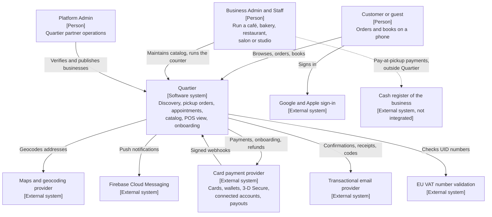
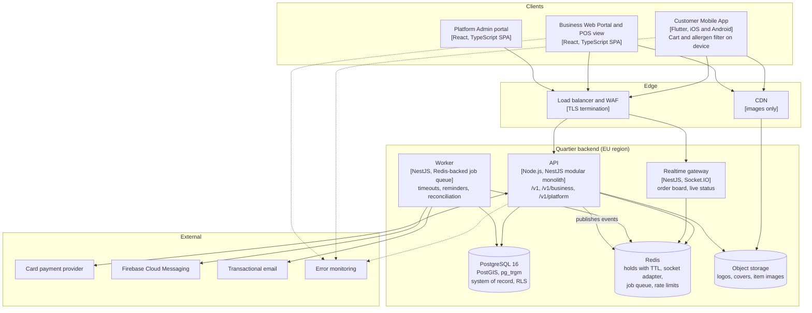

# System Architecture: Quartier

## Document control

| Field | Value |
|---|---|
| Document ID | QT-DES-ARC |
| Version | 1.3 |
| Status | Approved |
| Owner | Engineering Lead (co-authored with the Business Analyst) |
| Last updated | 2026-09-25 |
| Reviewers | Product Owner; Business Analyst; QA Lead; Compliance Lead |

**Purpose and scope.** This document describes Quartier's architecture at C4 levels 1 (system context) and 2 (containers), the chosen technology stack, and the quality tactics that meet the [non-functional requirements](../../02-requirements/non-functional-requirements.md). Significant decisions are recorded as ADRs. It is written so that a Business Analyst can trace each requirement to the container that implements it.

## 1. Architecture drivers

| Driver | Source | Architectural consequence |
|---|---|---|
| Three apps, one data set | BRD section 1 | One API and one database; role-scoped route groups ([ADR-001](adr/ADR-001-one-backend-modular-monolith.md)) |
| Capacity must be a promise | BR-018, BR-020, BR-026, BR-028 | Short holds in Redis; final decision guarded by PostgreSQL constraints ([ADR-002](adr/ADR-002-slot-holds-redis-database-guard.md)) |
| Quartier must not hold customer funds | Compliance mapping P3 | Marketplace payments with connected accounts; authorize at placement, capture at acceptance ([ADR-003](adr/ADR-003-marketplace-payments-authorize-capture.md)) |
| Orders reach the counter in 3 seconds | NFR-PERF-04 | WebSocket gateway with polling fallback (NFR-AVL-03) |
| Allergen data must be fresh | BR-013, NFR-DAT-02 | Menu data is not cached by shared caches for more than 60 seconds; images are |
| Business isolation | NFR-SEC-05 | `business_id` on every business-scoped row; PostgreSQL row-level security |
| EU data residency | NFR-PRIV-01 | EU-region hosting for every container and processor |
| Small team | BRD section 9 | Managed services; one deployable backend; no service mesh |

## 2. System context (C4 level 1)

The dotted line is deliberate. Counter payments stay on the business's certified cash register, and Quartier only records the status "Bezahlt an der Kassa" (CR-003, BR-024).

## 3. Containers (C4 level 2)

| Container | Responsibility | Main requirements |
|---|---|---|
| Customer Mobile App | Discovery, menus with allergens, cart (on the device), checkout with the card payment provider's hosted components, appointments, Bookings, Profile; allergen filter on the device | EP-01 to EP-04 |
| Business Web Portal and POS view | Business Admin: catalog, allergens, services, staff hours, settings, refunds, statements. Staff: order board, sold out, pause, appointment day view | EP-05, FR-ONB-01, FR-ONB-03 |
| Platform Admin portal | Verification queue, publish and suspend, VAT rates, platform vouchers, private feedback, audit trail | EP-06 |
| API | All business logic and rules; one NestJS module per SRS module (accounts, discovery, catalog, ordering, payments, appointments, pos, onboarding) plus notifications and audit | All FRs |
| Realtime gateway | Pushes order and appointment events to order boards and Booking Details; authenticates sockets with the same tokens as the API | FR-POS-01, FR-ORD-06, NFR-PERF-04 |
| Worker | Acceptance timeouts, hold expiry clean-up, reminders, payout reconciliation, nightly allergen completeness report, auto-pause when no board is connected | FR-ORD-07, FR-APT-05, FR-PAY-09, BR-040 |
| PostgreSQL | System of record; PostGIS for distance; trigram indexes for accent-insensitive search; exclusion constraint on staff appointments; row-level security on `business_id` | BR-009, BR-028, NFR-SEC-05 |
| Redis | Pickup and appointment holds with time-to-live; Socket.IO adapter; job queue; rate limiting of sign-in and voucher checks | BR-019, BR-028, BR-004 |
| Object storage and CDN | Images only. Menu and allergen data are served by the API (CR-005) | NFR-DAT-02 |

## 4. Technology stack

| Layer | Technology | Why this choice |
|---|---|---|
| Customer app | Flutter (Dart), one code base for iOS and Android | One mobile team of two; consistent rendering of each business's brand color; good accessibility support |
| Web portals | React with TypeScript, Vite build, component library with WCAG 2.2 AA tested components | Shared components between the Business and Platform Admin portals; typed API client generated from OpenAPI |
| API and workers | Node.js LTS with NestJS (modular monolith) | Module boundaries match SRS modules; one deployable; TypeScript shared with the portals |
| Realtime | Socket.IO over WebSocket, Redis adapter | Reconnect and fallback built in; horizontal scaling through Redis |
| Database | PostgreSQL 16 with PostGIS and pg_trgm | Transactions and constraints for capacity and money; geo distance; accent-insensitive search without a separate search engine |
| Holds, queue, cache | Redis (managed) | Time-to-live holds; job queue for timeouts and reminders |
| Push | Firebase Cloud Messaging (APNs for iOS) | One push interface for both platforms |
| Email | Transactional email provider (EU region) | Delivery and bounce tracking for receipts and codes |
| Images | Object storage with CDN | Cheap, cacheable; never used for menu data |
| Payments | Card payment provider (PSP) supporting SCA (3-D Secure 2), Apple Pay, Google Pay, connected accounts and hosted onboarding | Keeps card data and payouts out of Quartier (NFR-SEC-02, ADR-003) |
| Maps | Maps and geocoding provider | Address geocoding; the customer's own maps app for directions |
| Sign-in | Email and password (Argon2id); Google and Apple via OpenID Connect | Low-friction sign-up (FR-ACC-03) |
| Observability | Error monitoring for apps and services; metrics with business anomaly alerts | NFR-OBS-01, NFR-OBS-02 |
| Hosting | EU-region managed cloud: containers, managed PostgreSQL and Redis, WAF | EU residency, small operations team |
| CI/CD | Pipeline with unit, API contract, rule-coverage and accessibility checks; blue/green deployment of API, gateway and workers | NFR-MNT-01 |

## 5. Quality tactics

| Quality | Tactic | NFR |
|---|---|---|
| Correct capacity under concurrency | Hold in Redis for the user experience. The decision is made in PostgreSQL: a locked counter row per pickup slot, and an exclusion constraint on `tstzrange(start, occupied_until)` per staff member | BR-018, BR-020, BR-028 |
| Exactly-once money events | `Idempotency-Key` on unsafe client calls; webhook events stored with a unique provider event ID before processing | BR-033, FR-PAY-09 |
| Business isolation | Row-level security policies on `business_id`, set from the authenticated token per transaction | NFR-SEC-05 |
| Freshness of allergen data | API responses for menus carry `Cache-Control: max-age=30, must-revalidate` and an ETag per declaration version; the app revalidates on every business page open | NFR-DAT-02 |
| Live order board | WebSocket push; on disconnect, poll every 15 s and show the banner; auto-pause ordering after 2 minutes without a connected board | NFR-AVL-03, BR-040 |
| Privacy by design | Allergen filter on the device; no allergen data in push, email subjects, analytics or error events | NFR-PRIV-01, NFR-OBS-01 |
| Configurable rules | Effective-dated VAT rates; per-location settings within ranges | NFR-MNT-02 |

## 6. Deployment and environments

| Environment | Purpose | Data |
|---|---|---|
| Development | Developer work; mocked card payment provider | Synthetic |
| Staging | System test, UAT, load and accessibility tests; card payment provider sandbox; virtual clock for time-based tests | Synthetic ([test data](../../06-quality/test-data/README.md)) |
| Production | Pilot and Vienna | Real; EU region; daily backups and point-in-time recovery (NFR-AVL-02) |

Releases deploy API, realtime gateway and workers blue/green. Each scheduled job has an idempotency key, so a job that overlaps a deployment cannot act twice. Mobile releases are staged at 10%, 50% and 100% of users over 3 days, with a server-side minimum app version to retire builds that have a defect.

## Related documents

- [ADR-001 One backend as a modular monolith](adr/ADR-001-one-backend-modular-monolith.md)
- [ADR-002 Slot holds in Redis, decided by the database](adr/ADR-002-slot-holds-redis-database-guard.md)
- [ADR-003 Marketplace payments, authorize then capture](adr/ADR-003-marketplace-payments-authorize-capture.md)
- [ERD](../data/erd.md)
- [Sequence diagrams](../diagrams/sequence-diagrams.md)
- [Software Requirements Specification](../../02-requirements/SRS.md)
- [Non-functional requirements](../../02-requirements/non-functional-requirements.md)
- [API guidelines](../../04-api/api-guidelines.md)
