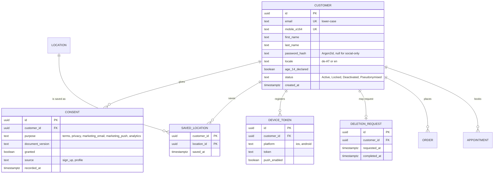
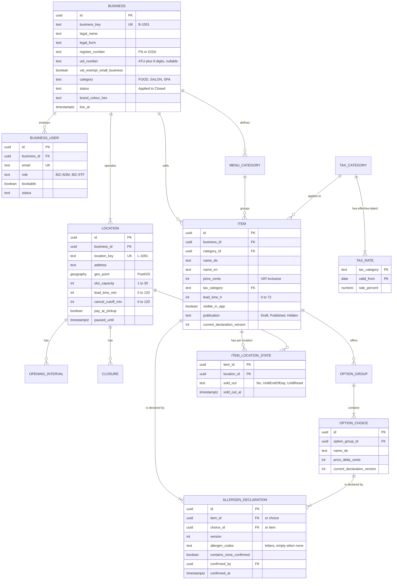
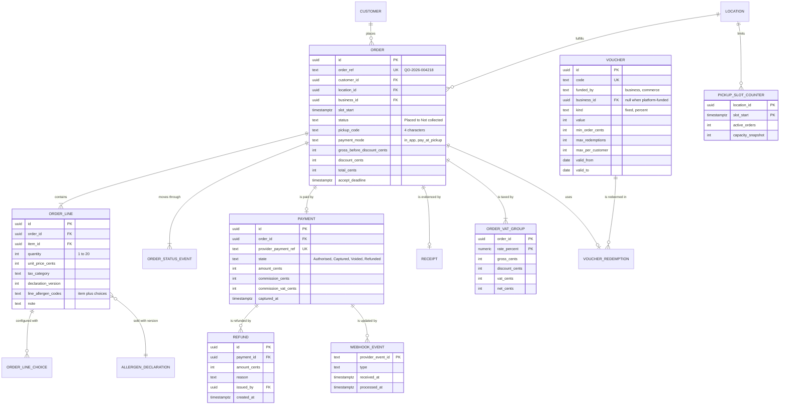
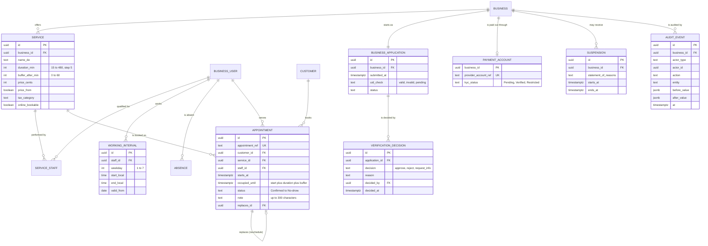

# Entity Relationship Diagram: Local Commerce & Booking Platform

## Document control

| Field | Value |
|---|---|
| Document ID | LC-DES-ERD |
| Version | 1.3 |
| Status | Approved |
| Owner | Business Analyst (co-authored with the Engineering Lead) |
| Last updated | 2026-09-25 |
| Reviewers | Engineering Lead; QA Lead; Compliance Lead; Finance Lead |

**Purpose and scope.** The logical data model of the platform in PostgreSQL, split into four subject areas so each diagram stays readable. Field-level definitions, classifications and retention are in the [data dictionary](data-dictionary.md). Holds are not tables; they live in Redis with a time-to-live ([ADR-002](../architecture/adr/ADR-002-slot-holds-redis-database-guard.md)).

Conventions:
- Primary keys are UUIDs (`id`). Human-readable keys (`B-1001`, `L-1001`, `QO-2026-004218`) are separate unique columns.
- Every business-scoped table carries `business_id` and is protected by row-level security (NFR-SEC-05).
- Money is stored as integer cents (`*_cents`); timestamps as `timestamptz` in UTC.
- Rows that carry legal or financial meaning are never updated in place: allergen declarations, status events, payments, refunds and audit events.

## 1. Customers and consent

## 2. Businesses, catalog and allergens

## 3. Orders, payments and receipts

## 4. Appointments, onboarding and audit

Constraint of note: `APPOINTMENT` carries an exclusion constraint `EXCLUDE USING gist (staff_id WITH =, tstzrange(starts_at, occupied_until, '[)') WITH &&) WHERE (status IN ('Confirmed','CheckedIn'))`. The half-open range `[)` is what makes touching appointments valid (BR-026).

## Related documents

- [Data dictionary](data-dictionary.md)
- [System architecture](../architecture/system-architecture.md)
- [State machines](../diagrams/state-machines.md)
- [Business rules](../../02-requirements/business-rules.md)
