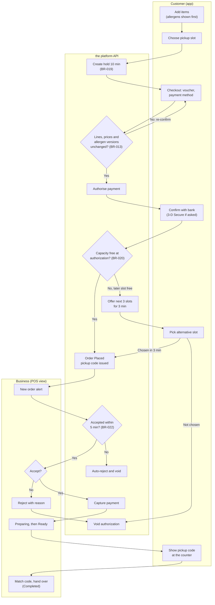
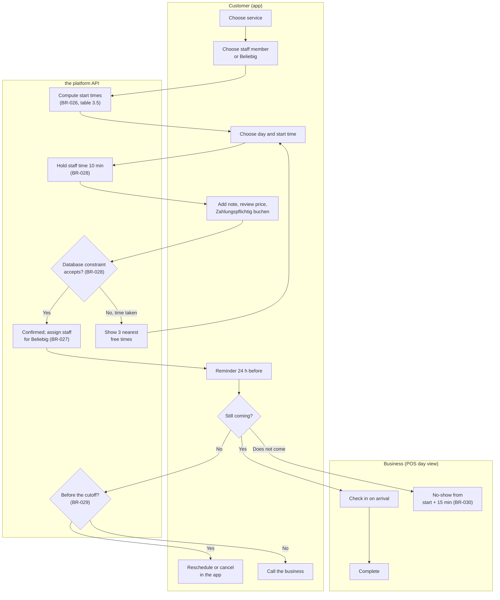
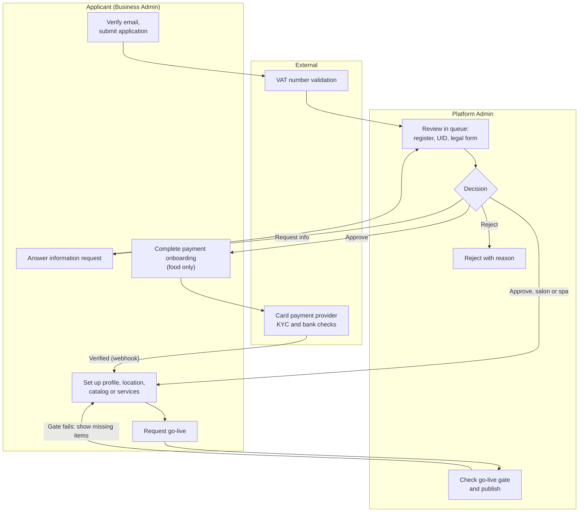
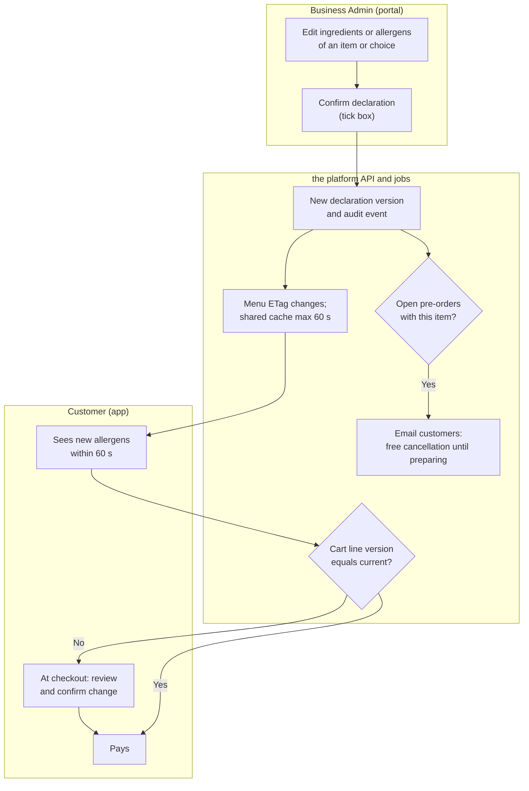
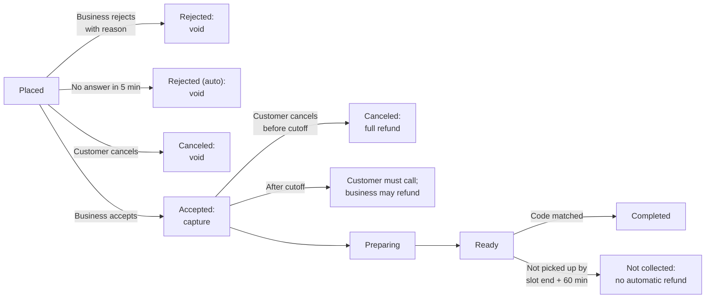

# Process Flows: Local Commerce & Booking Platform

## Document control

| Field | Value |
|---|---|
| Document ID | QT-DES-PF |
| Version | 1.3 |
| Status | Approved |
| Owner | Business Analyst |
| Last updated | 2026-09-25 |
| Reviewers | Product Owner; Partner Operations Lead; Partner Success Lead; QA Lead |

**Purpose and scope.** BPMN-style swimlane flows for the five processes where the business rules interact most. Lanes are drawn as subgraphs; diamonds are decisions with the rule that decides them. Exception paths are drawn, not footnoted. Runtime message order is in the [sequence diagrams](sequence-diagrams.md); status lifecycles are in the [state machines](state-machines.md).

## PF-1 Food order from cart to handover (TO-BE, R1.1)

Covers EP-03 and the order board side of EP-05. The flow shows the R1.1 re-check at authorization (CR-006).

Notes:
- The allergen and price check runs twice: when the customer presses the order button (before the bank step) and again inside the authorization transaction. The first check catches almost all changes before the customer confirms anything with the bank.
- Pay-at-pickup orders skip S3, S4 and S9. At B5 staff must also confirm "Bezahlt an der Kassa" (BR-024).

## PF-2 Appointment booking and the day of the appointment

Covers EP-04 and FR-POS-06.

## PF-3 Business onboarding to Live

Covers EP-06 and the setup stories in EP-05. The target is 5 business days or fewer (OBJ-05).

The gate is table 3.8 in the [business rules](../../02-requirements/business-rules.md). Salons and spas skip payment onboarding in R1 because appointments are paid at the venue.

## PF-4 Allergen change from the kitchen to the customer (after CR-005)

Covers BR-013, FR-CAT-04 and FR-ORD-12. This is the flow that failed in INC-2026-006 at step "Customer sees it".

## PF-5 Order exceptions: rejection, timeout, cancellation and non-collection

Covers BR-022 to BR-024 and table 3.6a.

## Related documents

- [Sequence diagrams](sequence-diagrams.md)
- [State machines](state-machines.md)
- [Business rules](../../02-requirements/business-rules.md)
- [Current vs future state](../../01-discovery/current-vs-future-state.md)
- [Software Requirements Specification](../../02-requirements/SRS.md)
