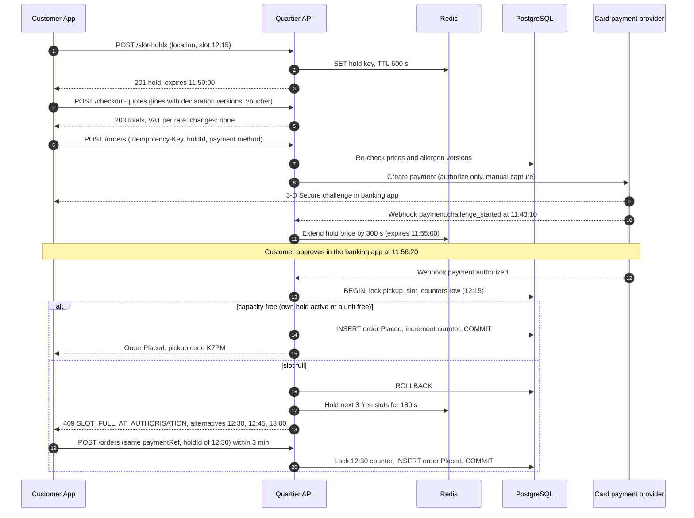
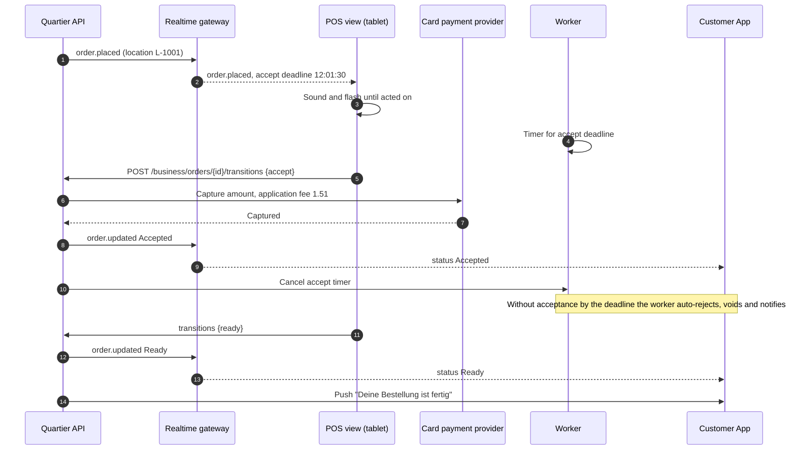
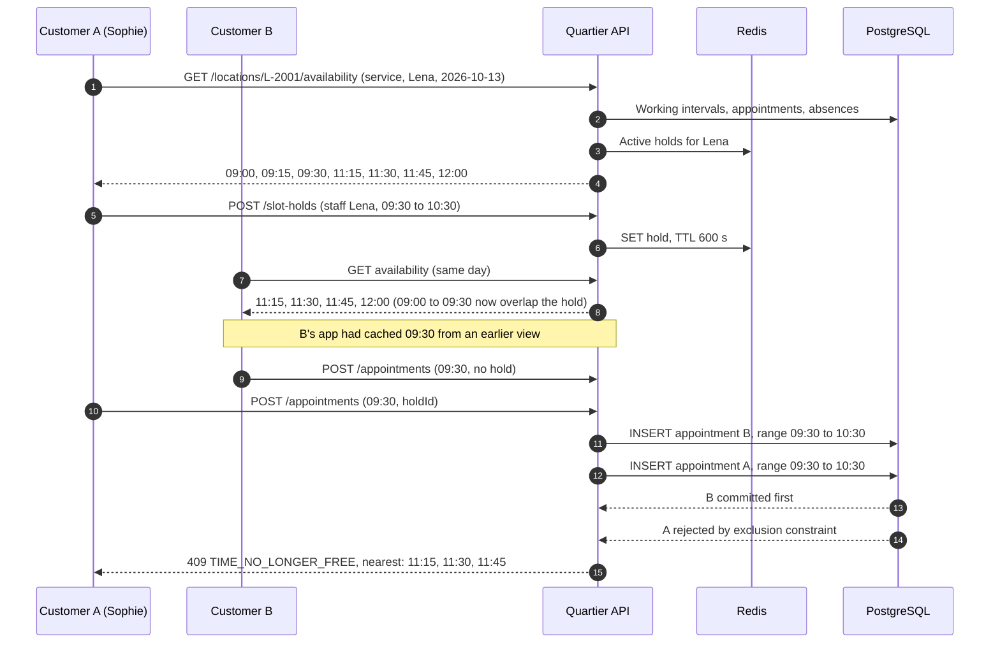
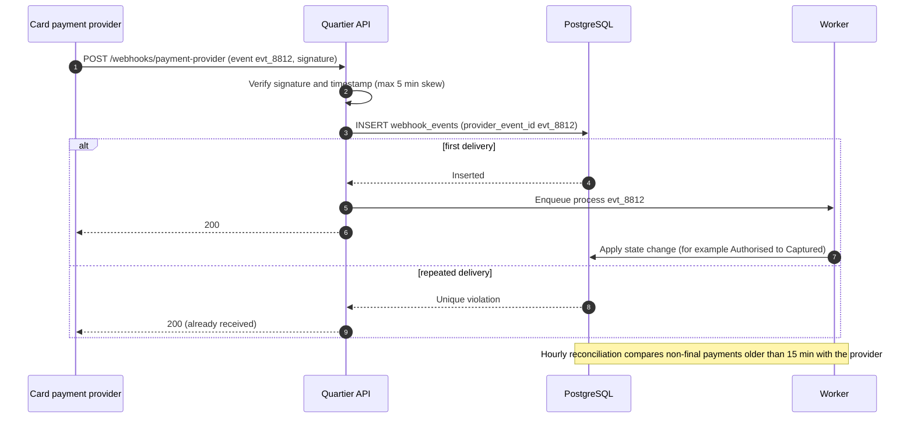
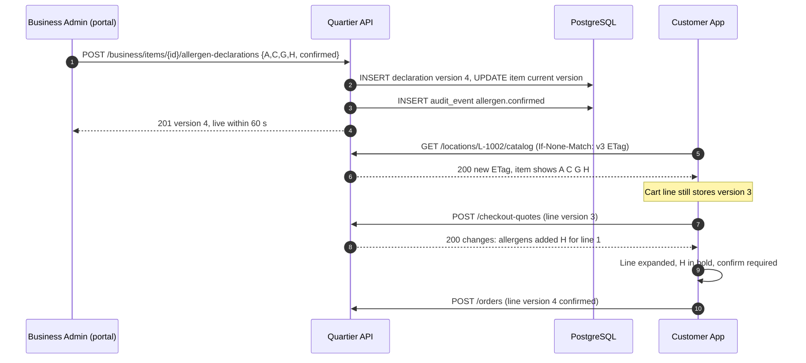
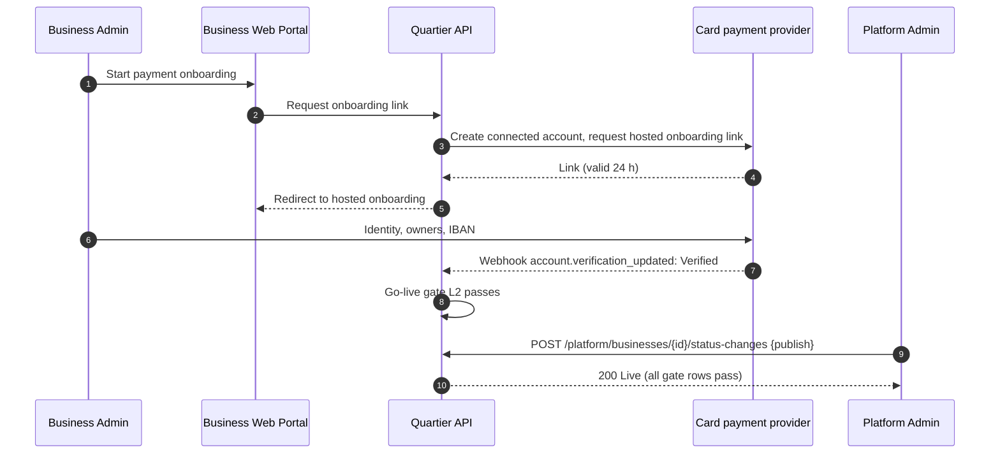

# Sequence Diagrams: Quartier

## Document control

| Field | Value |
|---|---|
| Document ID | QT-DES-SEQ |
| Version | 1.3 |
| Status | Approved |
| Owner | Business Analyst (co-authored with the Engineering Lead) |
| Last updated | 2026-09-25 |
| Reviewers | Engineering Lead; QA Lead; Finance Lead |

**Purpose and scope.** The runtime interactions behind the rules that involve time, concurrency or money. Each diagram names the rules it implements so QA can test the same path. Participant names match the containers in the [system architecture](../architecture/system-architecture.md).

## SD-1 Checkout with slot hold, 3-D Secure and re-check (R1.1)

Implements BR-019, BR-020, BR-033, FR-ORD-03, FR-ORD-12 and FR-PAY-01. The timings are those of the example in business rules table 3.3.

If no alternative is chosen in 3 minutes, the API voids the authorization and the app shows "Reservierung aufgehoben, es wurde nichts abgebucht".

## SD-2 Order board: accept, capture and live status

Implements BR-021, BR-022, BR-033, FR-POS-01, FR-POS-02 and FR-ORD-06.

## SD-3 Appointment hold and confirmation with a database conflict

Implements BR-026 to BR-028, FR-APT-03 and FR-APT-04. Two customers try to book Lena Auer at 09:30 on 2026-10-13.

The hold did not stop customer B's request, because B sent no hold. The constraint did. In production, a request without a hold that overlaps someone else's active hold is rejected before the insert (table 3.5 check E6). The diagram shows the last line of defense.

## SD-4 Card payment provider webhook, processed once

Implements BR-033, FR-PAY-09 and FR-ONB-03.

## SD-5 Allergen declaration published and seen by the customer (after CR-005)

Implements BR-011, BR-013, FR-CAT-04, FR-ORD-12 and NFR-DAT-02.

## SD-6 Business payment onboarding (food)

Implements BR-043, FR-ONB-03 and FR-ONB-04.

## Related documents

- [Process flows](process-flows.md)
- [State machines](state-machines.md)
- [ADR-002 Slot holds](../architecture/adr/ADR-002-slot-holds-redis-database-guard.md)
- [ADR-003 Marketplace payments](../architecture/adr/ADR-003-marketplace-payments-authorize-capture.md)
- [Realtime events](../../04-api/realtime-events.md)
- [OpenAPI specification](../../04-api/openapi.yaml)
