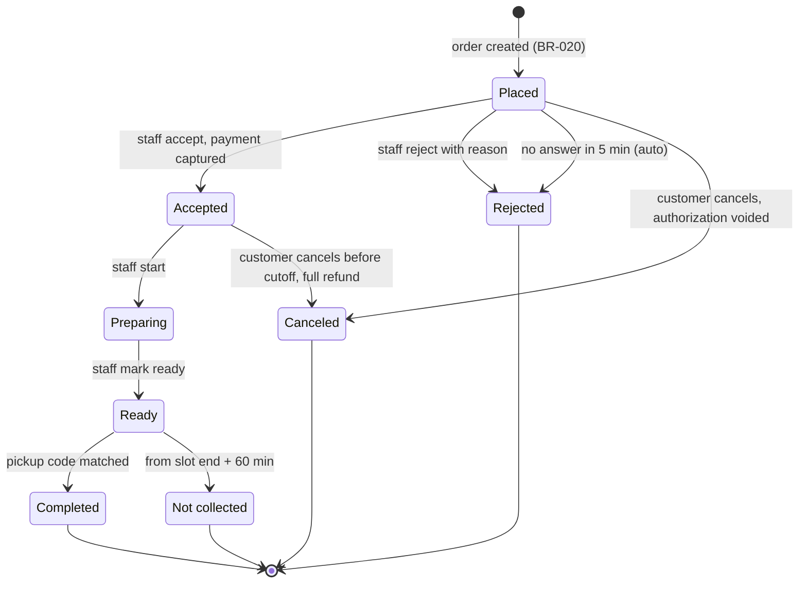
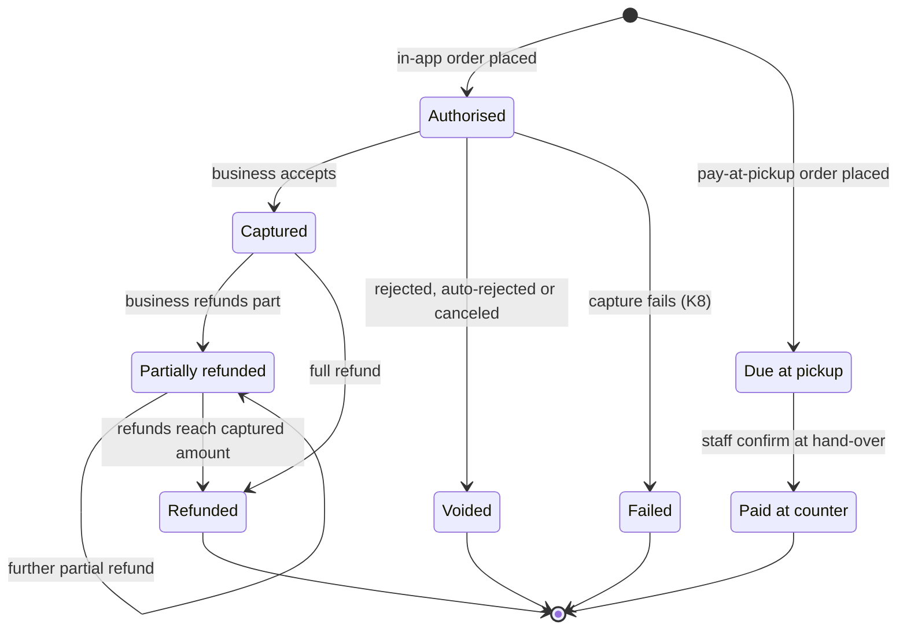
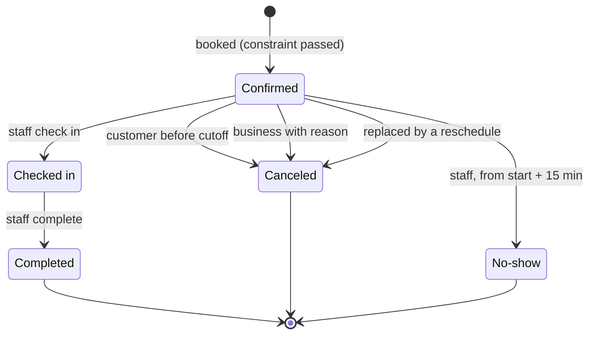
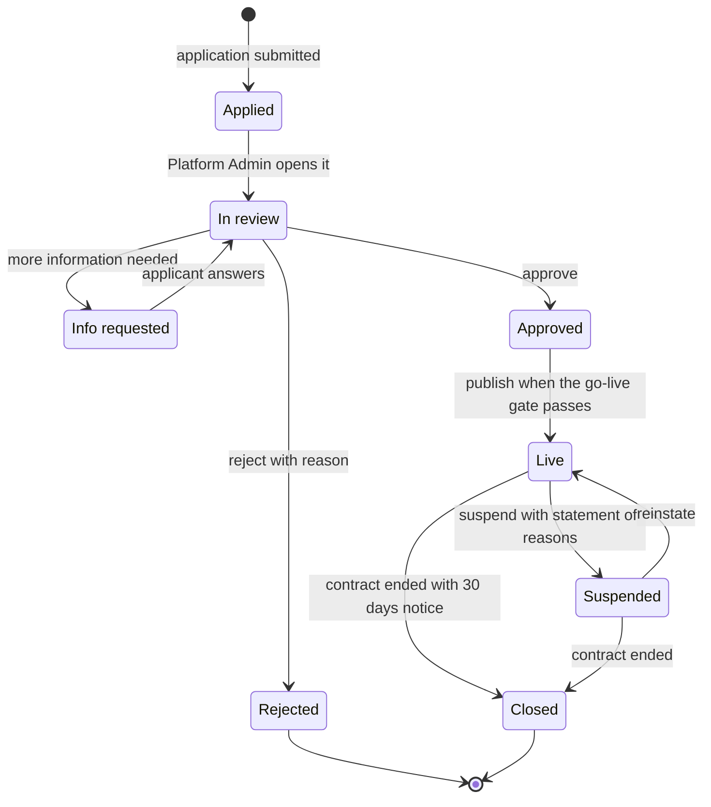
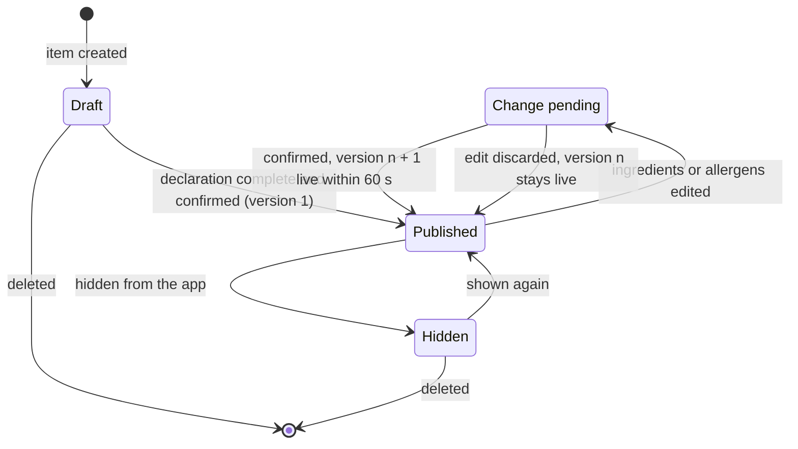
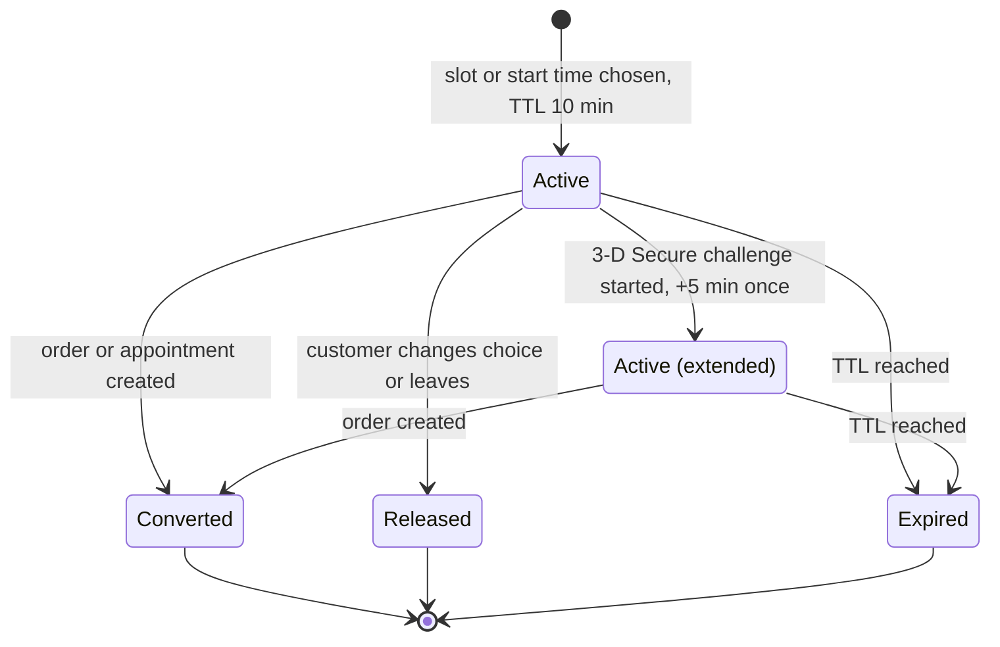

# State Machines: Quartier

## Document control

| Field | Value |
|---|---|
| Document ID | QT-DES-SM |
| Version | 1.3 |
| Status | Approved |
| Owner | Business Analyst |
| Last updated | 2026-09-25 |
| Reviewers | Engineering Lead; QA Lead; Partner Operations Lead |

**Purpose and scope.** The lifecycles of the six entities whose status drives behavior. Every transition names its trigger and the rule that allows it. A transition that is not drawn is not allowed, and the API returns `409 INVALID_TRANSITION` for it. QA derives state-transition test cases from these diagrams.

## SM-1 Order status (BR-021 to BR-024)

A delay (+10, +15, +30 minutes) does not change the status; it changes the ready time and notifies the customer. The app never moves an order forward; only staff actions and the acceptance timeout do.

## SM-2 Payment state (BR-032 to BR-034, table 3.7)

## SM-3 Appointment status (BR-029 to BR-031)

## SM-4 Business lifecycle (BR-042 to BR-044)

## SM-5 Item publication and allergen declaration (BR-011, BR-013)

While an item is in Change pending, customers keep seeing the last confirmed version. Unconfirmed edits are never shown in the app.

## SM-6 Hold (BR-019, BR-028)

An Expired hold does not stop the order. The re-check at authorization decides (BR-020, SD-1).

## Related documents

- [Process flows](process-flows.md)
- [Sequence diagrams](sequence-diagrams.md)
- [Business rules](../../02-requirements/business-rules.md)
- [Data dictionary](../data/data-dictionary.md)
- [Test cases](../../06-quality/test-cases.md)
