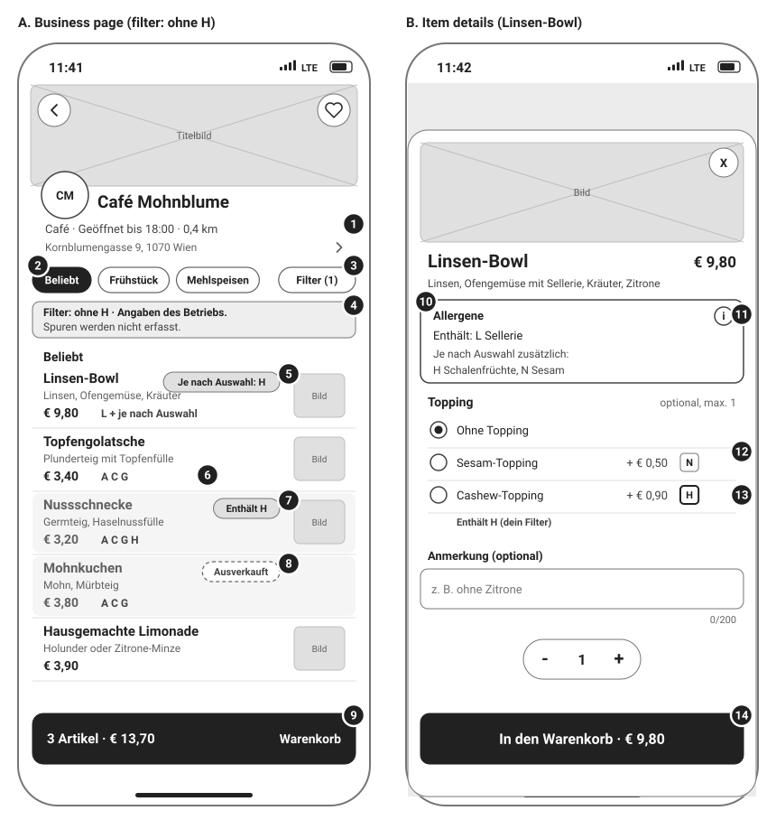
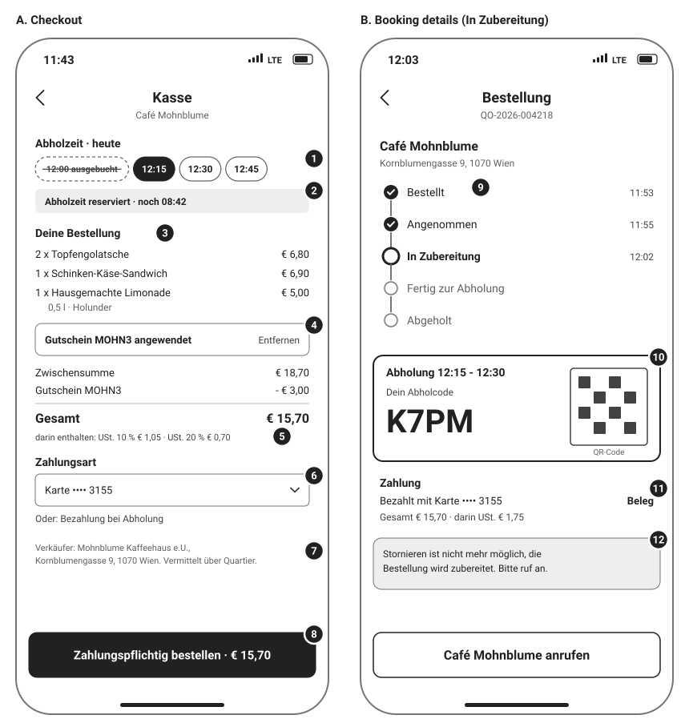
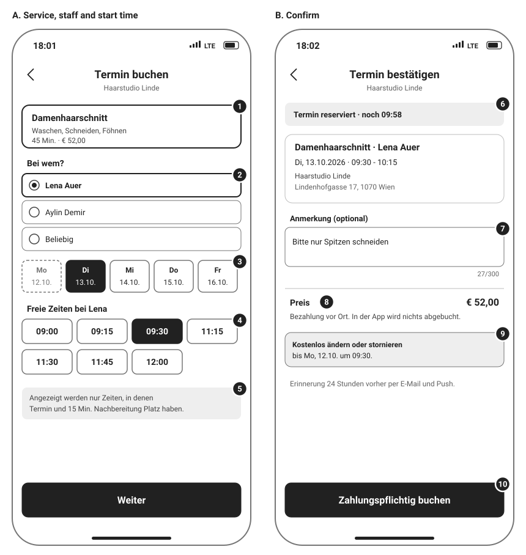
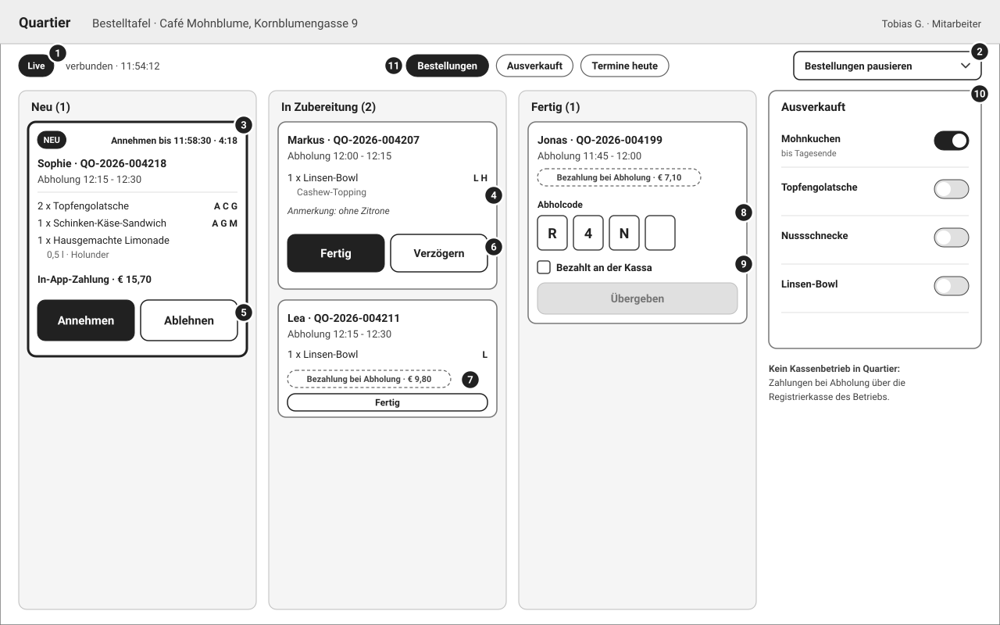
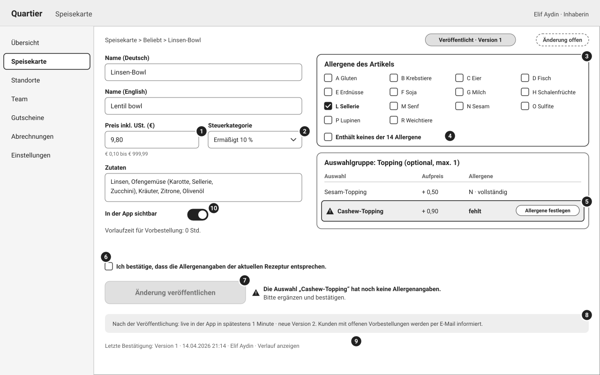

# Wireframes (Low Fidelity)

## Document control

| Field | Value |
|---|---|
| Document ID | LC-UX-01 |
| Version | 1.3 |
| Status | Approved |
| Owner | Business Analyst (with the UX Designer) |
| Last updated | 2026-09-25 |
| Reviewers | UX Designer, Product Owner, Compliance Lead, QA Lead, Partner Success Lead |

| Version | Date | Change |
|---|---|---|
| 1.0 | 2026-03-02 | Baseline wireframes for SRS v1.0 walkthroughs |
| 1.2 | 2026-06-19 | UAT feedback: repeating new-order alert, auto-pause note, "Bezahlt an der Kassa" tick box, free-cancellation cutoff on the confirmation |
| 1.3 | 2026-09-25 | "Live in der App in spätestens 1 Minute · Version n" on the item editor (CR-005); hold countdown wording (CR-006) |

### Purpose and scope

Five low-fidelity wireframes cover the screens where requirements are most sensitive to interaction design:
- allergen display and the allergen filter;
- checkout with VAT and the order button wording;
- appointment start times;
- the POS order board;
- the allergen declaration editor.

They are grayscale by design, so that reviewers judge structure and rules rather than styling. Status is always carried by words, letters or patterns, never by color.

Each wireframe has numbered callouts that match the annotation table under it (callout, element, behavior, FR/BR reference). Visual design and final copy are owned by the UX Designer. UI text is German, as in the product; English is a full translation (NFR-I18N-01).

Sample data comes from the shared [synthetic test data](../../06-quality/test-data/README.md). The canonical worked examples appear on m-02 (VAT basket) and m-03 (salon start times). All names and data are changed.

| Wireframe | App and frame | Persona | Business | Stories |
|---|---|---|---|---|
| m-01 Menu and item details | Customer Mobile App, two 390 x 844 frames | PER-02 Daniela Costa (filter H) | Café Mohnblume | US-009, US-010, US-011 |
| m-02 Checkout and order status | Customer Mobile App, two 390 x 844 frames | PER-01 Sophie Wallner | Café Mohnblume | US-012 to US-016, US-019 |
| m-03 Appointment start times | Customer Mobile App, two 390 x 844 frames | PER-01 Sophie Wallner | Haarstudio Linde | US-021 to US-024 |
| w-01 POS order board | Business Web Portal, 1280 x 800 | PER-04 Tobias Gruber (Staff) | Café Mohnblume | US-026 to US-028 |
| w-02 Item editor with allergens | Business Web Portal, 1280 x 800 | PER-03 Elif Aydin (Business Admin) | Café Mohnblume | US-029, US-030 |

## m-01 Menu and item details

Daniela has set the allergen filter to H (tree nuts) and opens Café Mohnblume at 11:41.

| # | Element | Behavior | FR/BR ref |
|---|---|---|---|
| 1 | Business header | Logo or initials, type, open state in words with today's closing time, distance with decimal comma, address opening the maps app. | FR-DSC-05, BR-007 |
| 2 | Category chips | The business's own categories in its own order; the row stays pinned at the top during scrolling. | FR-DSC-05 |
| 3 | Filter chip | "Filter (n)" opens the allergen sheet; one tap clears it. The selection stays on the phone. | FR-DSC-09, SPEC-FR-012 |
| 4 | Filter banner | Names the filtered letters, the business as the source and that traces are not recorded. | BR-012, SPEC-FR-005 |
| 5 | "Je nach Auswahl: H" | Row M2: the item itself is fine, a choice adds H. The row is not dimmed. | BR-012, table 3.1b |
| 6 | Allergen letters | Every row shows its letters next to the VAT-inclusive price; "L + je nach Auswahl" when choices add allergens. | FR-DSC-06, BR-010, BR-015 |
| 7 | "Enthält H" | Row M1: dimmed and labeled, still openable. The filter never says "safe". | BR-012, SPEC-FR-004 |
| 8 | Sold out | Dimmed with "Ausverkauft" and no add action. | BR-014 |
| 9 | Cart bar | Item count and running total for this location's cart. | FR-ORD-01, BR-016 |
| 10 | Allergen box | Above the options and never collapsed: the item's own allergens, then what choices may add. | FR-DSC-07, BR-011 |
| 11 | Information control | Opens the sheet of all 14 allergens with the traces sentence. | FR-DSC-07 |
| 12 | Choice letters | Each choice shows its price change and its allergen letters. | FR-CAT-05, BR-012 |
| 13 | Filter-marked choice | Letter in bold and "Enthält H (dein Filter)"; still selectable (C-04). | SPEC-FR-006 |
| 14 | Add button | Label carries the running total, updated on every choice and quantity change. Guests see "Melde dich an, um zu bestellen". | FR-DSC-07, BR-001 |

## m-02 Checkout and order status

Frame A is the canonical basket at 11:43 (VAT worked example). Frame B shows the same order at 12:03 while it is being prepared.

| # | Element | Behavior | FR/BR ref |
|---|---|---|---|
| 1 | Pickup slots | 15-minute slots from the first boundary after the lead time; a full slot is shown as "ausgebucht" and cannot be chosen. | FR-ORD-02, BR-017, BR-018 |
| 2 | Hold countdown | The chosen slot is held for 10 minutes, extended once by 5 minutes if the bank challenge starts. | FR-ORD-03, BR-019 |
| 3 | Order lines | Lines with choices; quantities and gross amounts. | FR-ORD-04 |
| 4 | Voucher | One code per order; the effect is shown before ordering; rejection messages per table 3.4a. | FR-PAY-06, BR-036 |
| 5 | Totals and VAT | Subtotal € 18,70, voucher − € 3,00, total € 15,70; "darin enthalten" USt. 10 % € 1,05 and USt. 20 % € 0,70. | FR-PAY-05, BR-035 |
| 6 | Payment method | Card or wallet through the card payment provider's hosted components; pay at pickup where the business offers it. | FR-PAY-01, FR-PAY-03, BR-032 |
| 7 | Seller identity | The business is the seller; "Vermittelt über die Plattform". | FR-ORD-04, BR-038 |
| 8 | Order button | "Zahlungspflichtig bestellen · € 15,70" (FAGG section 8). | FR-ORD-04 |
| 9 | Status timeline | Updates live; only the business or a timeout moves it. | FR-ORD-06, BR-021 |
| 10 | Pickup code | 4 characters and a QR code, matched by staff at hand-over. | FR-ORD-05, BR-024 |
| 11 | Payment line | "Bezahlt mit Karte •••• 3155" after capture at acceptance; receipt link. | FR-PAY-02, FR-PAY-07, BR-033 |
| 12 | Cancellation state | In preparation the app cannot cancel; the business's phone is offered instead. | FR-ORD-08, BR-023 |

## m-03 Appointment start times

Sophie books a Damenhaarschnitt with Lena Auer on Monday 2026-10-12 at 18:01 for Tuesday 2026-10-13 (salon worked example).

| # | Element | Behavior | FR/BR ref |
|---|---|---|---|
| 1 | Service card | Name, duration and VAT-inclusive price (or "ab" price). | FR-APT-01, BR-015 |
| 2 | Staff choice | Only qualified staff, plus "Beliebig". | FR-APT-02, BR-027 |
| 3 | Date strip | Days within the booking horizon; today is grayed when the minimum notice leaves nothing. | BR-026 |
| 4 | Start times | Only the 7 times at which 45 minutes plus 15 minutes buffer fit Lena's 09:00 to 13:00 around the 10:30 appointment; 12:15 is not offered. | FR-APT-02, BR-026 |
| 5 | Buffer hint | Explains why some times are missing. | BR-026, NFR-USE-02 |
| 6 | Hold countdown | The time is held for 10 minutes. | FR-APT-03, BR-028 |
| 7 | Note | Optional, up to 300 characters, shown to the salon. | FR-APT-08 |
| 8 | Price and payment | "€ 52,00", paid at the venue; nothing charged in the app. | FR-APT-09, BR-032 |
| 9 | Free cancellation cutoff | States the exact time until which the customer can change or cancel in the app. | FR-APT-06, BR-029 |
| 10 | Confirm button | "Zahlungspflichtig buchen"; confirmation is re-validated in the database. | FR-APT-04, BR-028 |

## w-01 POS order board

Tobias at the Café Mohnblume counter at 11:54:12, signed in as Staff.

| # | Element | Behavior | FR/BR ref |
|---|---|---|---|
| 1 | Live status | Shows the live connection; falls back to polling with "Live-Verbindung unterbrochen" when it drops. | NFR-AVL-03, BR-040 |
| 2 | Pause | 15, 30 or 60 minutes or until resumed; no slots are offered meanwhile. | FR-POS-05, BR-040 |
| 3 | New ticket | Thick border, "NEU", repeating sound until acted on, countdown to auto-rejection (4:18 left of the 5 minutes). | FR-POS-01, BR-022, BR-040 |
| 4 | Configured allergens | Each line shows the allergens of its configuration (Linsen-Bowl with Cashew-Topping: L H). | FR-POS-09, BR-012 |
| 5 | Accept and reject | Accept captures the payment; reject requires a reason that the customer sees. | FR-POS-02, BR-022, BR-033 |
| 6 | Delay | +10, +15 or +30 minutes, at most 60 in total; the customer is notified. | FR-POS-03 |
| 7 | Pay-at-pickup marker | Tells staff to take payment on their own register. | FR-PAY-03, BR-024 |
| 8 | Pickup code | Hand-over only with the matching code; 5 wrong codes lock hand-over for 5 minutes. | FR-POS-03, BR-024 |
| 9 | "Bezahlt an der Kassa" | Required for pay-at-pickup orders; a status only, with no amount or method recorded (CR-003 rejected). | BR-024 |
| 10 | Sold-out toggles | "bis Tagesende" resets at the next opening; customers see it within 60 seconds. | FR-POS-04, BR-014 |
| 11 | Staff navigation | Only the POS functions; no catalog, refunds, statements or settings. | FR-POS-07, BR-039 |

## w-02 Item editor with allergens

Elif edits the published Linsen-Bowl (version 1) at night and adds a Cashew-Topping without declaring its allergens.

| # | Element | Behavior | FR/BR ref |
|---|---|---|---|
| 1 | Price including VAT | € 0,10 to € 999,99 with range message. | FR-CAT-03, BR-015 |
| 2 | Tax category | Ermäßigt 10 %, Normal 20 %, or Befreit 0 % for small-business exempt businesses. | FR-CAT-03, BR-015 |
| 3 | Allergen grid | The 14 allergens with Austrian letters; the declaration of the item itself. | FR-CAT-04, BR-010 |
| 4 | "Enthält keines der 14 Allergene" | A declaration in its own right; ticking it clears and disables the grid. | BR-011 |
| 5 | Choice without declaration | Flagged; publishing is blocked until every choice is declared. | FR-CAT-05, BR-011, BR-012 |
| 6 | Confirmation tick box | Required on every publish that changes allergens or ingredients. | FR-CAT-04, BR-013 |
| 7 | Disabled publish with reason | States what is missing, in the user's words. | NFR-USE-02 |
| 8 | Live within 1 minute | Shows the new version number and that open pre-order customers are emailed (CR-005). | BR-013, NFR-DAT-02 |
| 9 | Last confirmation | Version, time and confirming user, with the full history in the audit trail. | BR-045, FR-ONB-07 |
| 10 | Visibility | Hide from the app without deleting; hidden items stay available for the business's own counter. | BR-014 |

## Design notes: accessibility and states

**Targets and text.** Every tappable element in the customer app is at least 44 x 44 pt. POS buttons are at least 48 px high and spaced 8 px or more for use with busy hands. Layouts reflow at 200% text: menu rows grow vertically, and labels wrap under the price instead of truncating.

**Contrast.** Text uses #212121 to #757575 on white (16.1:1 to 4.6:1). A business's brand color is accepted only at 4.5:1 or more against white (FR-CAT-01).

**Status without color.** Open state, order and appointment status, sold out and allergen matches always carry words or letters. Screen readers announce, for example, "Nussschnecke, 3 Euro 20, enthält Schalenfrüchte, entspricht deinem Filter".

**Language.** The customer app uses "du", the portals "Sie". Amounts and times use Austrian formats. Allergen letters are the same in both languages.

## Related documents

- [Software Requirements Specification](../../02-requirements/SRS.md)
- [Business rules](../../02-requirements/business-rules.md)
- [Personas](../../01-discovery/personas.md)
- [EP-02 stories](../../05-delivery/user-stories/EP-02-discovery-menus-allergens.md)
- [EP-03 stories](../../05-delivery/user-stories/EP-03-ordering-pickup-payments.md)
- [EP-04 stories](../../05-delivery/user-stories/EP-04-appointment-booking.md)
- [EP-05 stories](../../05-delivery/user-stories/EP-05-business-portal-pos.md)
- [Allergen filter spec](../../08-ai-assisted-ba/specs/001-allergen-filter-on-menus/spec.md)
