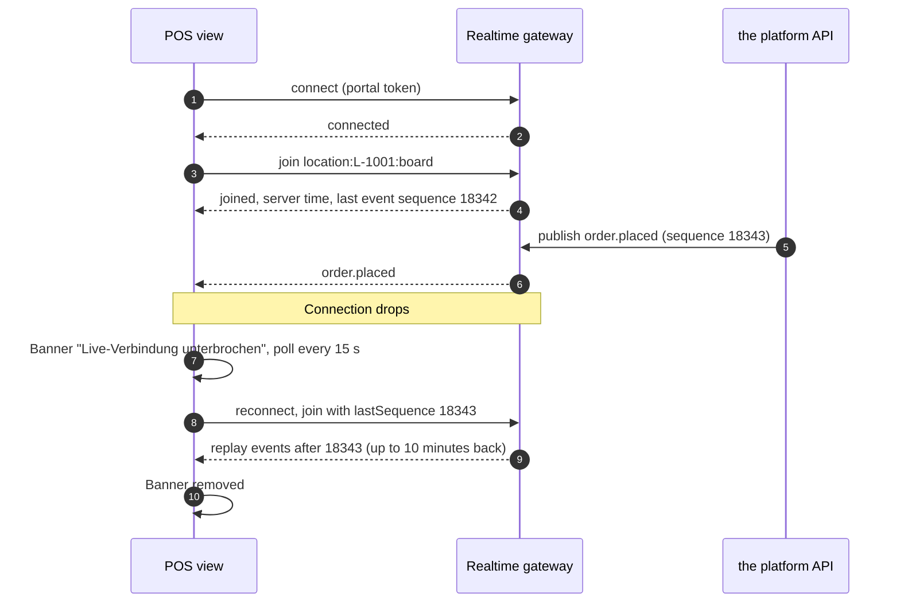

# Realtime Events: Local Commerce & Booking Platform

## Document control

| Field | Value |
|---|---|
| Document ID | QT-API-RT |
| Version | 1.3 |
| Status | Approved |
| Owner | Engineering Lead (co-authored with the Business Analyst) |
| Last updated | 2026-09-25 |
| Reviewers | Web developer; mobile developers; QA Lead |

**Purpose and scope.** The live updates that drive the POS order board and the customer's Booking Details. They are delivered by the realtime gateway (Socket.IO over WebSocket) described in the [system architecture](../03-design/architecture/system-architecture.md). Push notifications to the phone are separate and follow BR-041.

## 1. Connection and channels

| Channel | Who can join | Joined when | Events |
|---|---|---|---|
| `location:{locationId}:board` | Staff and Business Admins of that location (portal token) | The order board or appointment day view opens | `order.placed`, `order.updated`, `order.accept_warning`, `item.availability_changed`, `location.pause_changed`, `appointment.created`, `appointment.updated` |
| `customer:{customerId}` | That customer (customer token) | Booking Details, or Home's Ongoing card, is on screen | `booking.updated` |

The gateway authenticates the socket with the same token as the API and re-checks channel rights on every join. A Staff user can join only locations listed in the token (FR-POS-07).



## 2. Delivery guarantees

- **At least once, in order per channel.** Every event carries a monotonically increasing `sequence` per location. Clients ignore events with a sequence they have already applied.
- **Replay.** On reconnect the client sends its last sequence, and the gateway replays up to 10 minutes of events. A client that was away longer reloads the board with `listBoardOrders`.
- **Not the system of record.** Events tell the client to update; the API is the truth. If a client receives `order.updated` for an order it does not know, it fetches the order.
- **Fallback.** If the socket is down for more than 10 seconds, the board polls `listBoardOrders` every 15 seconds and shows the banner (NFR-AVL-03). If no board session is connected for a location for 2 minutes while it accepts orders, ordering pauses automatically and the Business Admin is emailed (BR-040).

## 3. Events

| Event | Channel | Trigger | Payload (main fields) | Requirement |
|---|---|---|---|---|
| `order.placed` | board | Order created in Placed | `orderId`, `orderRef`, `slotStart`, `acceptDeadline`, `customerFirstName`, `lines` (with allergens), `note`, `paymentMode`, `totalCents` | FR-POS-01, FR-POS-09 |
| `order.accept_warning` | board | 60 seconds before the accept deadline | `orderId`, `secondsLeft` | BR-022 |
| `order.updated` | board | Any status change, delay or hand-over | `orderId`, `status`, `readyEstimate`, `delayMinTotal`, `actor` | BR-021 |
| `item.availability_changed` | board | Sold out set or reset, including the automatic reset at opening | `itemId`, `soldOut` | BR-014 |
| `location.pause_changed` | board | Manual or automatic pause or resume | `pausedUntil`, `reason` | BR-040 |
| `appointment.created`, `appointment.updated` | board | Booking, reschedule, cancellation, check-in, completion, no-show | `appointmentId`, `staffId`, `start`, `status`, `note` | FR-POS-06 |
| `booking.updated` | customer | Status change of the customer's order or appointment | `bookingId`, `kind`, `status`, `statusLabel`, `readyEstimate` | FR-ORD-06 |

Example `order.placed` payload for the canonical basket:

```json
{
  "event": "order.placed",
  "sequence": 18343,
  "locationId": "6f1c2a7e-0d4b-4c51-9a8e-2b7d1c0e1001",
  "orderId": "a9e3c1d2-5b6f-4e7a-8c9d-0e1f2a3b4c5d",
  "orderRef": "QO-2026-004218",
  "slotStart": "2026-09-17T12:15:00+02:00",
  "acceptDeadline": "2026-09-17T11:58:30+02:00",
  "customerFirstName": "Sophie",
  "paymentMode": "in_app",
  "totalCents": 1570,
  "note": null,
  "lines": [
    { "name": "Topfengolatsche", "quantity": 2, "choices": [], "allergens": ["A", "C", "G"] },
    { "name": "Schinken-Käse-Sandwich", "quantity": 1, "choices": [], "allergens": ["A", "G", "M"] },
    { "name": "Hausgemachte Limonade", "quantity": 1, "choices": ["0,5 l", "Holunder"], "allergens": [] }
  ]
}
```

## 4. Privacy

Board events carry the customer's first name only. The phone number is fetched from the API when staff open an order (D9 in the [compliance mapping](../02-requirements/compliance-mapping.md)). `booking.updated` carries no line details. Event payloads are never sent to error monitoring (NFR-OBS-01).

## Related documents

- [API guidelines](api-guidelines.md)
- [OpenAPI specification](openapi.yaml)
- [Sequence diagrams](../03-design/diagrams/sequence-diagrams.md)
- [Non-functional requirements](../02-requirements/non-functional-requirements.md)
