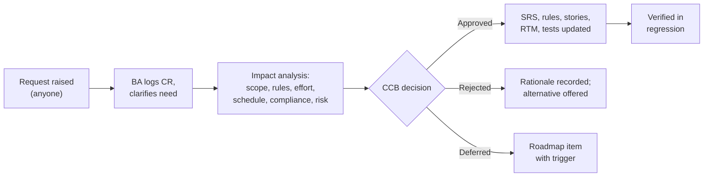

# Change Request Log: Local Commerce & Booking Platform

## Document control

| Field | Value |
|---|---|
| Document ID | LC-DEL-CR |
| Version | 1.5 |
| Status | Active |
| Owner | Business Analyst (impact analysis); Product Owner (chair of the change control board) |
| Last updated | 2026-09-25 |
| Reviewers | Engineering Lead; QA Lead; Compliance Lead; Finance Lead |

**Purpose and scope.** Every change to baselined scope or requirements after SRS v1.0 (2026-03-02). Each request gets an impact analysis by the Business Analyst before the change control board (CCB) decides. Approved changes update the SRS, business rules, stories, the [traceability matrix](../02-requirements/requirements-traceability-matrix.md) and the tests in the same pull request. 7 requests have been raised and 3 were rejected.

## 1. Process

Emergency CRs that follow a SEV-1 or SEV-2 incident are decided by the Product Owner and Engineering Lead within 2 business days and ratified at the next CCB.

## 2. Summary

| CR | Title | Origin | Raised | Decision | Decided | SRS version | Effort (points) |
|---|---|---|---|---|---|---|---|
| CR-001 | Pre-orders with item lead time | Pilot bakeries | 2026-03-26 | Approved | 2026-04-09 | v1.1 | 8 |
| CR-002 | Move spa classes and events to R2 | Product Owner | 2026-04-08 | Approved | 2026-04-09 | v1.1 | -34 (scope removed) |
| CR-003 | Take cash and card payments at the counter in the POS view | Two pilot cafés | 2026-05-06 | **Rejected** | 2026-05-13 | n/a | 89 or more (estimate) |
| CR-004 | Charge an automatic no-show fee to a saved card | Haarstudio Linde, Partner Success | 2026-06-18 | **Rejected** for R1 | 2026-06-24 | n/a | 34 (estimate) |
| CR-005 | Allergen declaration versions, freshness and re-confirmation at checkout | INC-2026-006 | 2026-08-17 | Approved (emergency) | 2026-08-20 | v1.3 | 13 |
| CR-006 | Re-check slot capacity at payment authorization; hold extension during 3-D Secure | INC-2026-011 | 2026-09-09 | Approved (emergency) | 2026-09-11 | v1.3 | 8 |
| CR-007 | Public star ratings on business cards | Marketing Lead | 2026-09-16 | **Rejected** | 2026-09-23 | n/a | 21 (estimate) |

## 3. Change requests

### CR-001 Pre-orders with item lead time

| Field | Value |
|---|---|
| Requested by | Konditorei Pomeranze and Café Mohnblume, through the Partner Success Lead, at the S2 sprint review |
| Need | Whole cakes need 48 hours. Today customers order them by phone days ahead; same-day-only pickup would push the bakeries' most valuable orders back to the phone. |
| Change | Item lead time 0 to 72 hours; carts with lead-time items offer slots from now plus the largest lead time up to 7 days ahead; pre-orders placed while closed are accepted within 30 minutes of the next opening. |
| Requirements affected | New FR-ORD-11; changed BR-017, BR-022, FR-CAT-03; new US-018; API `listPickupSlots` parameter `maxItemLeadTimeHours`; TC-ORD-007, TC-ORD-012 |
| Effort and schedule | 8 points (5 story, 3 enabler) in S5; absorbed by moving FR-ORD-10 rebook polish to S5 and keeping it Should |
| Payment impact | Capture at acceptance still happens within hours, so card authorizations do not expire (ADR-003) |
| Risk | Overnight orders waiting for acceptance; mitigated by the 30-minute-after-opening deadline |
| Decision | **Approved** 2026-04-09. SRS v1.1. |

### CR-002 Move spa classes and events to R2

| Field | Value |
|---|---|
| Requested by | Product Owner after S2 estimation |
| Need | Classes need group capacity, waitlists and different cancellation rules; only 2 of the 14 discovery businesses run classes. |
| Change | Remove classes and events from R1; spa treatments stay bookable as services. |
| Requirements affected | BRD BN-04 wording; out-of-scope table; no FR removed (none had been baselined for classes) |
| Effort and schedule | Frees about 34 points, used for CR-001 and the allergen work in S3 |
| Decision | **Approved** 2026-04-09. BRD v1.1. Roadmap item for R2. |

### CR-003 Take cash and card payments at the counter in the POS view (rejected)

| Field | Value |
|---|---|
| Requested by | Two pilot cafés through the Partner Success Lead |
| Need | One screen at the counter for app orders and walk-in sales. |
| Impact analysis | Recording counter sales would make the platform a cash register under the Austrian cash register obligation (BAO section 131b) and the cash register security regulation. That brings: a signature creation unit per business through a certified provider; the data collection protocol and its export; registration of each register with the tax authority; start, monthly and annual receipts; receipt QR codes; outage procedures. Also card terminal integration. Estimate 89 points or more plus certification, and permanent liability for the businesses' tax compliance. Every pilot business already has a certified register. |
| Alternatives considered | (a) Integration with existing certified registers: later phase, per vendor. (b) Status-only confirmation "Bezahlt an der Kassa" for pay-at-pickup orders, already in R1 (BR-024). |
| Decision | **Rejected** 2026-05-13. Rationale: high cost and regulatory risk for little gain; it would turn the platform into a product the team cannot support in R1. Decision DEC-11. |
| Follow-up | Partner Success explained the decision to both cafés in person; neither left the pilot. |

### CR-004 Charge an automatic no-show fee to a saved card (rejected for R1)

| Field | Value |
|---|---|
| Requested by | Martina Leitner (Haarstudio Linde) and the Partner Success Lead during UAT |
| Need | No-shows cost the salon an empty slot; a fee would deter them. |
| Impact analysis | Requires the customer's card to be saved with a strongly authenticated set-up. Later fees are merchant-initiated transactions that rely on that mandate. A cancellation and no-show policy must be accepted per booking and shown before the button. Disputes and refunds need handling. Salons would need payment onboarding, which they skip in R1 (BR-043 L2), and that would lengthen their onboarding against OBJ-05. Estimate 34 points plus legal review. |
| Evidence | Discovery diary audit: 107 of the 175 no-shows (61%) were customers who later said they had forgotten, which a reminder addresses without a fee. Since then the pilot has confirmed it: 4.6% no-shows from July to September against a 9.5% baseline (BRD OBJ-02). |
| Decision | **Rejected for R1** 2026-06-24. Rationale: the objective is being met without fees; the change would add friction and compliance work. Trigger to reopen: no-show rate above 5% over Q4 2026, or the R2 decision on online payment for appointments. |

### CR-005 Allergen declaration versions, freshness and re-confirmation at checkout

| Field | Value |
|---|---|
| Origin | [INC-2026-006](../07-operations/incidents/INC-2026-006-stale-allergen-information.md), SEV-1 near miss on 2026-08-14 |
| Need | Allergen information shown to the customer must be the current confirmed declaration, and a customer must never pay for an item whose allergens changed without seeing the change. |
| Change | Declaration versions; confirmed changes live within 60 seconds; no shared cache above 60 seconds for menu data; ETag per version; cart lines carry the version; checkout re-confirmation; email to customers with open pre-orders; audit of every confirmation. |
| Requirements affected | BR-013 (rewritten), new NFR-DAT-02, NFR-OBS-02 extended, FR-CAT-04 and FR-ORD-12, US-010-AC6, US-020-AC1 and AC2, US-029-AC4 and AC5, TBD-12 closed; API caching rules and `ITEM_CHANGED` |
| Effort and schedule | 13 points. Server-side hotfix 2026-08-21 (cache headers, ETag, server rejects outdated versions with a generic message). App re-confirmation UI in R1.1 (S13). |
| Decision | **Approved** 2026-08-20 by the Product Owner and Engineering Lead; ratified by the CCB on 2026-08-26. SRS v1.3. |

### CR-006 Re-check slot capacity at payment authorization; hold extension during 3-D Secure

| Field | Value |
|---|---|
| Origin | [INC-2026-011](../07-operations/incidents/INC-2026-011-pickup-slots-over-capacity.md), SEV-2 on 2026-09-08 |
| Need | No order may be created in a full pickup slot, whatever happens to the hold during a slow bank challenge. |
| Change | One 5-minute hold extension when a challenge starts; capacity re-checked in the authorization transaction; if full, the next 3 free slots are offered for 3 minutes, keeping the authorization; otherwise void. |
| Requirements affected | BR-019 (changed), new BR-020, FR-ORD-12, US-020-AC3 to AC5, ADR-002 v1.1, NFR-OBS-02 extended; API `SLOT_FULL_AT_AUTHORISATION` with `alternatives` |
| Effort and schedule | 8 points. Server-side re-check (void if full) as a hotfix on 2026-09-10; alternatives UI and extension in R1.1. |
| Decision | **Approved** 2026-09-11 by the Product Owner and Engineering Lead; ratified by the CCB on 2026-09-16. SRS v1.3. |

### CR-007 Public star ratings on business cards (rejected)

| Field | Value |
|---|---|
| Requested by | Marketing Lead, for growth after the Vienna launch |
| Need | Ratings help new customers choose. |
| Impact analysis | Contradicts the neutral-ranking principle agreed in discovery (BR-008, DEC-05). Publishing reviews would oblige the platform to say whether and how it verifies that reviews come from real customers (Omnibus Directive). It would need moderation and an abuse process, and businesses would contest reviews through the P2B complaint channel. Pilot businesses were strongly against it in the discovery survey (11 of 14). Estimate 21 points plus ongoing moderation. |
| Alternatives considered | Private feedback remains (FR-ONB-08) and is used by Partner Operations to coach businesses. Editorial "neu bei the platform" collections were proposed and also declined, to keep ranking neutral. |
| Decision | **Rejected** 2026-09-23. Rationale: product principle and compliance cost; no evidence that ratings are needed to meet OBJ-01 to OBJ-06. |

## Related documents

- [Business Requirements Document](../02-requirements/BRD.md)
- [Software Requirements Specification](../02-requirements/SRS.md)
- [Business rules](../02-requirements/business-rules.md)
- [Decision log](decision-log.md)
- [Incident management process](../07-operations/incident-management-process.md)
- [Requirements traceability matrix](../02-requirements/requirements-traceability-matrix.md)
