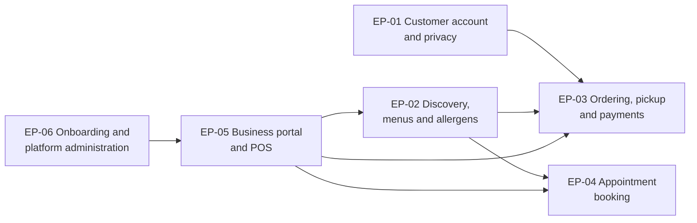

# Epics: Platform release 1

## Document control

| Field | Value |
|---|---|
| Document ID | QT-DEL-EP |
| Version | 1.3 |
| Status | Baselined |
| Owner | Business Analyst |
| Last updated | 2026-09-25 |
| Reviewers | Product Owner; Engineering Lead; QA Lead |

**Purpose and scope.** The 6 epics of Release 1, each mapped to one business need in the [BRD](../02-requirements/BRD.md#7-business-needs). For each epic this document gives scope boundaries, the rules that carry the most risk, and its acceptance at epic level. The stories, with Gherkin acceptance criteria, are in [user-stories/](user-stories/). The Jira import is [jira-import.csv](jira-import.csv).

## 1. Overview

| Epic | Name | Need | Objectives | FRs | Stories | Count | Points | File |
|---|---|---|---|---|---|---|---|---|
| EP-01 | Customer Account & Privacy | BN-01 | OBJ-01, OBJ-02 | 9 | US-001 to US-005 | 5 | 21 | [EP-01-customer-account-privacy.md](user-stories/EP-01-customer-account-privacy.md) |
| EP-02 | Discovery, Menus & Allergens | BN-02 | OBJ-03, OBJ-04 | 9 | US-006 to US-010 | 5 | 24 | [EP-02-discovery-menus-allergens.md](user-stories/EP-02-discovery-menus-allergens.md) |
| EP-03 | Ordering, Pickup & Payments | BN-03 | OBJ-01, OBJ-06 | 21 | US-011 to US-020 | 10 | 48 | [EP-03-ordering-pickup-payments.md](user-stories/EP-03-ordering-pickup-payments.md) |
| EP-04 | Appointment Booking | BN-04 | OBJ-02, OBJ-03 | 10 | US-021 to US-025 | 5 | 26 | [EP-04-appointment-booking.md](user-stories/EP-04-appointment-booking.md) |
| EP-05 | Business Portal & POS | BN-05 | OBJ-04, OBJ-06 | 18 | US-026 to US-032 | 7 | 40 | [EP-05-business-portal-pos.md](user-stories/EP-05-business-portal-pos.md) |
| EP-06 | Business Onboarding & Platform Administration | BN-06 | OBJ-05 | 9 | US-033 to US-038 | 6 | 26 | [EP-06-onboarding-platform-admin.md](user-stories/EP-06-onboarding-platform-admin.md) |
| **Total** |  |  |  | **76** |  | **38** | **185** |  |

Priorities follow MoSCoW. All epics are Must for R1. Within them, FR-ACC-06, FR-ACC-09, FR-DSC-09, FR-ORD-11, FR-PAY-03, FR-APT-08, FR-CAT-09, FR-POS-08, FR-ONB-08 and FR-ONB-09 are Should.

Supply comes first: no business can be discovered until it is onboarded (EP-06) and has a catalog with allergen declarations (EP-05).

## 2. Epic details

### EP-01 Customer Account & Privacy

- **In scope:** guest browsing; sign-up with the BR-002 data set; email, Google and Apple sign-in; reset by code; profile, language, push preference; consents; deletion; data export by a Platform Admin.
- **Out of scope:** phone-number sign-in; customer addresses (pickup only); loyalty profiles.
- **Riskiest rules:** BR-002 (minimum data and age 14), BR-003 (consent), BR-005 (erasure versus retention).
- **Epic acceptance:** a new customer signs up in under 60 seconds in usability testing; the Compliance Lead signs off the consent records and the deletion run.

### EP-02 Discovery, Menus & Allergens

- **In scope:** Home, search, category listing, business page with legal information, menu rows, Item Details with allergens, saved locations, allergen filter on the device.
- **Out of scope:** ratings and reviews (CR-007 rejected); paid placement; walking-distance sorting; traces.
- **Riskiest rules:** BR-008 (neutral ranking), BR-010 to BR-013 (allergens), NFR-DAT-02 (freshness).
- **Epic acceptance:** a business page within 2 taps (NFR-USE-01); every published food item shows a complete declaration (OBJ-04a).

### EP-03 Ordering, Pickup & Payments

- **In scope:** cart, pickup slots, holds, checkout with vouchers, card and wallet payment with 3-D Secure, pay at pickup, order status, cancellation and refund, rebook, pre-orders (CR-001), receipts, the R1.1 re-check (CR-005, CR-006).
- **Out of scope:** delivery; multi-business carts; gift cards; tips.
- **Riskiest rules:** BR-018 to BR-020 (capacity under concurrency), BR-033 (payment timing), BR-035 (VAT).
- **Epic acceptance:** the canonical VAT basket reproduces exactly (TC-PAY-003); no slot ever exceeds its capacity (NFR-OBS-02 alert silent for 30 days).

### EP-04 Appointment Booking

- **In scope:** services, staff choice and "Beliebig", start times with buffers, holds, confirmation with calendar file, reminders, cancellation and reschedule, the business side of the day.
- **Out of scope:** classes and events (CR-002); online payment, deposits and fees (CR-004 rejected); split services with processing gaps.
- **Riskiest rules:** BR-026 (start-time computation), BR-028 (no double booking), BR-031 (schedule changes).
- **Epic acceptance:** the canonical start-time example reproduces exactly (TC-APT-002); two concurrent bookings never both succeed (TC-APT-005).

### EP-05 Business Portal & POS

- **In scope:** order board and POS view, hand-over, sold out, pause, appointment day view; catalog, allergen declarations, option groups, services, staff, working hours, location settings, refunds, statements, business vouchers.
- **Out of scope:** counter payments and cash register functions (CR-003 rejected); stock management; analytics dashboards.
- **Riskiest rules:** BR-011 and BR-013 (declaration gate and versions), BR-039 (role separation), BR-040 (alerts and auto-pause).
- **Epic acceptance:** pilot counter staff accept a new order in a median of 60 seconds or less during UAT lunch simulation (UAT-05).

### EP-06 Business Onboarding & Platform Administration

- **In scope:** public application, verification queue with UID check, payment onboarding, go-live gate, suspension and reinstatement with reasons, VAT rates, platform vouchers, private feedback, audit trail.
- **Out of scope:** automated register lookups (manual check in R1); businesses outside Vienna.
- **Riskiest rules:** BR-043 (go-live gate), BR-044 (statement of reasons), BR-045 (audit).
- **Epic acceptance:** median 5 business days or fewer from application to Live for the September cohort (OBJ-05).

## Related documents

- [Business Requirements Document](../02-requirements/BRD.md)
- [Software Requirements Specification](../02-requirements/SRS.md)
- [Release and sprint plan](release-and-sprint-plan.md)
- [Jira import](jira-import.csv)
- [Definition of ready and done](definition-of-ready-and-done.md)
- [Requirements traceability matrix](../02-requirements/requirements-traceability-matrix.md)
