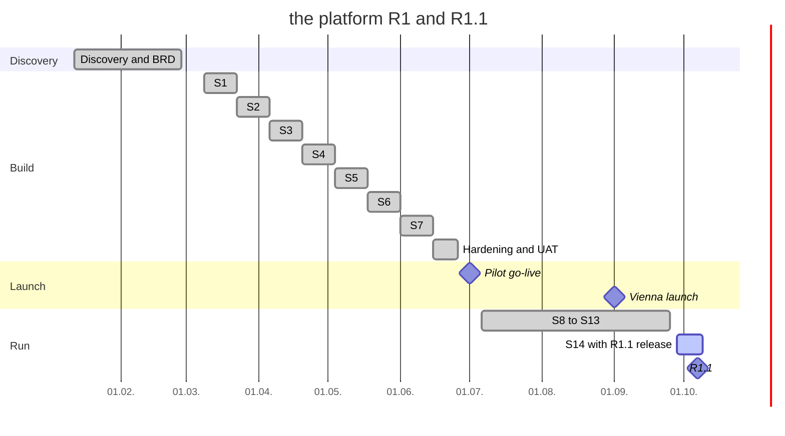

# Release and Sprint Plan: Local Commerce & Booking Platform

## Document control

| Field | Value |
|---|---|
| Document ID | LC-DEL-PLAN |
| Version | 1.4 |
| Status | Active |
| Owner | Product Owner (maintained with the Business Analyst) |
| Last updated | 2026-10-02 |
| Reviewers | Engineering Lead; QA Lead; Managing Director |

**Purpose and scope.** Milestones, sprint goals, team ceremonies and the roadmap beyond R1. Scope per release is in the [BRD](../02-requirements/BRD.md#52-release-split). Story-level allocation comes from the backlog and the [Jira import](jira-import.csv).

## 1. Milestones

| Milestone | Date | Exit criteria | Status |
|---|---|---|---|
| Discovery complete, BRD v1.0 | 2026-02-27 | Objectives with baselines; scope agreed | Done |
| SRS v1.0 baseline | 2026-03-02 | All Must FRs with acceptance criteria; open issues logged | Done |
| Build complete (end of S7) | 2026-06-12 | All Must stories Done; rule coverage gate green | Done |
| UAT sign-off | 2026-06-26 | UAT-01 to UAT-10 passed; no open Critical or High defect | Done (signed 2026-06-26) |
| Pilot go-live, 38 businesses | 2026-07-01 | Go-live checklist; on-call rota; pilot support desk | Done |
| Vienna launch | 2026-09-01 | Pilot KPIs reviewed; load test NFR-CAP-01 passed | Done |
| R1.1 release | 2026-10-07 | CR-005 and CR-006 verified; regression green | Scheduled |
| Q4 KPI review | 2027-01-15 | OBJ-01 to OBJ-06 measured over Q4 2026 | Planned |

## 2. Team and capacity

One cross-functional team: Product Owner, Business Analyst, Engineering Lead, 2 backend developers, 2 Flutter developers, 1 web developer, QA Lead, 1 QA engineer, UX Designer. Planned velocity is 38 points per sprint, including enabler work (environments, the card payment provider integration, load and accessibility testing). Austrian public holidays in the build period reduced capacity: Easter Monday (06.04.), Staatsfeiertag (01.05.), Ascension Day (14.05.), Whit Monday (25.05.) and Corpus Christi (04.06.).

## 3. Sprint goals

| Sprint | Dates | Goal | Story points | Enabler points |
|---|---|---|---|---|
| S1 | 09.03. to 20.03. | A customer can sign up and sign in; a business can apply. Environments, CI and the auth skeleton run. | 18 | 20 |
| S2 | 23.03. to 03.04. | Discovery and a menu are visible; a Platform Admin can verify; a business can maintain its menu. | 26 | 12 |
| S3 | 06.04. to 17.04. | Allergen declarations are enforced; allergens show before adding; cart and pickup slots with holds work. | 35 | 3 |
| S4 | 20.04. to 01.05. | Payment end to end in the sandbox; the order board takes live orders; salon services and staff exist. | 39 | 0 |
| S5 | 04.05. to 15.05. | Appointments can be booked and changed; cancellation, rebook, pre-orders and receipts; allergen filter. | 38 | 2 |
| S6 | 18.05. to 29.05. | Profile and deletion; refunds and statements; go-live gate and suspension; load test. | 21 | 16 |
| S7 | 01.06. to 12.06. | Hardening: penetration-test fixes, accessibility audit fixes, performance; VAT rates and audit trail. | 3 | 34 |

Story allocation by sprint (generated from the backlog):

| Sprint | Stories | Points |
|---|---|---|
| S1 | US-001, US-002, US-003, US-033 | 18 |
| S2 | US-004, US-006, US-008, US-009, US-030, US-034 | 26 |
| S3 | US-007, US-010, US-011, US-012, US-029, US-035 | 35 |
| S4 | US-013, US-014, US-015, US-021, US-026, US-031 | 39 |
| S5 | US-016, US-017, US-018, US-019, US-022, US-023, US-024, US-027, US-028 | 38 |
| S6 | US-005, US-025, US-032, US-036, US-037 | 21 |
| S7 | US-038 | 3 |
| S13 | US-020 | 5 |

US-020 (R1.1, CR-005 and CR-006) was built in S13. The server-side half of CR-005 shipped as a hotfix on 2026-08-21, and the server-side capacity re-check of CR-006 shipped as a hotfix on 2026-09-10.

## 4. Ceremonies

| Ceremony | When | Length | Participants | BA role |
|---|---|---|---|---|
| Sprint planning | Monday, sprint start | 2 h | Whole team | Presents ready stories; answers rule questions |
| Daily stand-up | Daily 09:15 | 15 min | Whole team | Flags blocked clarifications |
| Backlog refinement | Wednesday, weekly | 1.5 h | PO, BA, Engineering Lead, QA Lead, UX | Brings stories to the Definition of Ready; writes boundary rows with QA |
| Rule clinic | Thursday, weekly in S2 to S5 | 45 min | BA, Compliance Lead or Finance Lead, QA Lead | Settles allergen, VAT and payment rule wording |
| Sprint review | Friday, sprint end | 1 h | Team plus 2 pilot business owners | Demonstrates against acceptance criteria |
| Retrospective | Friday, sprint end | 1 h | Team | Records process actions |
| Change control board | As needed, at least fortnightly | 30 min | PO (chair), BA, Engineering Lead, QA Lead, Finance or Compliance Lead as relevant | Prepares the impact analysis ([CR log](change-request-log.md)) |

## 5. Release readiness checklist (used for pilot, Vienna launch and R1.1)

- All Must stories in scope meet the [Definition of Done](definition-of-ready-and-done.md).
- The traceability matrix shows no Must FR without a passing test; open items have accepted defects.
- No open Critical or High defect; penetration test clean (NFR-SEC-01).
- Both worked examples reproduce exactly in staging (TC-PAY-003, TC-APT-002).
- On-call rota, runbooks and NFR-OBS-02 alerts are live.
- Pilot businesses and Partner Success have release notes in German.

## 6. Roadmap after R1.1

| Horizon | Item | Driver |
|---|---|---|
| Now (Q4 2026) | Measure OBJ-01 to OBJ-06; DEF-118 cold-start fix; DEF-121 duplicate pause email | BRD section 4 |
| Next (R2, 2027 H1) | Spa classes and events (CR-002); online payment for appointments; table reservations; allergen filter saved to the account with explicit consent (TBD-07) | Deferred scope |
| Later | Delivery; integrations with existing cash registers; cities outside Vienna; walking-distance sorting | BRD section 5.3 |

## Related documents

- [Epics](epics.md)
- [Change request log](change-request-log.md)
- [Decision log](decision-log.md)
- [RAID log](raid-log.md)
- [Definition of ready and done](definition-of-ready-and-done.md)
- [Test strategy and plan](../06-quality/test-strategy-and-plan.md)
