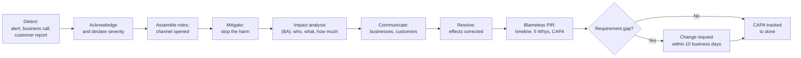

# Incident Management Process: Quartier

## Document control

| Field | Value |
|---|---|
| Document ID | QT-OPS-IM |
| Version | 1.2 |
| Status | Approved |
| Owner | Engineering Lead (process); Business Analyst (post-incident reviews and requirement follow-up) |
| Last updated | 2026-09-16 |
| Reviewers | Product Owner; Partner Success Lead; Compliance Lead |

| Version | Date | Change |
|---|---|---|
| 1.0 | 2026-06-26 | Process for the pilot |
| 1.1 | 2026-08-24 | After INC-2026-006: customer-safety incidents are SEV-1 even without harm; Compliance Lead joins every SEV-1; customer contact rule for allergen incidents |
| 1.2 | 2026-09-16 | After INC-2026-011: business anomaly alerts (NFR-OBS-02) as a detection source; Partner Success playbook for over-capacity orders |

**Purpose and scope.** How Quartier detects, responds to, communicates about and learns from production incidents in the three apps and the backend. It covers severity, roles, response targets, communication with businesses and customers, post-incident reviews (PIRs) and how incidents turn into change requests.

## 1. Severity

| Severity | Definition | Examples | Acknowledge | Mitigate target | PIR |
|---|---|---|---|---|---|
| SEV-1 | Risk to a customer's health, money taken wrongly, personal data exposed, or the platform down at lunch or dinner time | Wrong allergen information shown; double charges; data leak | 15 min, 24/7 | 2 h | Required within 5 business days |
| SEV-2 | A core flow degraded for many users or several businesses; a promise to businesses broken | Slots over capacity; order board not updating; payouts late | 30 min during trading hours (06:00 to 23:00) | 4 h | Required within 10 business days |
| SEV-3 | Limited impact with a workaround | Push delays; one business affected; cosmetic errors | Next business day | Next release | Optional |

When in doubt, the higher severity is declared and lowered later. A near miss on customer safety is SEV-1 (since version 1.1).

## 2. Roles

| Role | Who | Responsibility |
|---|---|---|
| Incident Commander (IC) | Engineering Lead or on-call senior developer | Declares severity, coordinates, decides mitigation |
| Technical Lead | On-call developer | Diagnosis and fix |
| Communications Lead | Partner Success Lead | Businesses, customers, status updates in German and English |
| Impact analyst | Business Analyst | Scope of affected businesses, customers, orders and money; requirement-gap classification |
| Compliance Lead | Compliance Lead | Joins every SEV-1; decides on customer and authority notifications (GDPR Art. 33 within 72 hours where personal data is breached) |

## 3. Lifecycle

**Detection sources.** Business anomaly alerts (NFR-OBS-02, since 1.2); error monitoring (NFR-OBS-01); the Partner Success hotline for businesses (07:00 to 22:00); the in-app support address; synthetic probes (NFR-PERF-04, NFR-DAT-02).

**Mitigation first.** Feature flags and configuration changes are preferred over code changes during an incident. Examples: purge a cache, lengthen a hold, pause ordering for a location, stop automatic actions.

## 4. Communication

| Audience | SEV-1 | SEV-2 | Channel | Language |
|---|---|---|---|---|
| Affected businesses | Phone within 60 min of declaration, then email | Email within 2 h | Partner Success | German |
| Affected customers | Direct email (and phone where safety is involved) once the impact list is confirmed | In-app message if their order was affected | Support | Customer's app language |
| All businesses | Portal banner if the platform is degraded | Portal banner | Business Web Portal | German |
| Management | IC update every 60 min | At mitigation and resolution | Incident channel | English |

Allergen incidents (since 1.1): every customer who may have received wrong allergen information is contacted individually with the correct information, whatever the outcome of their order.

## 5. Post-incident review

- **Blameless.** The review asks how the system allowed the error, not who made it. Names of individuals are not used in findings.
- **Content.** Summary; impact; timeline; detection and response analysis; 5 Whys; contributing factors; requirement-gap classification; CAPA with owner and due date; requirement and documentation changes; lessons. The two 2026 PIRs follow this structure.
- **Requirement follow-up.** When a cause is a requirement gap, the BA raises a change request within 10 business days. The CR updates the SRS, the business rules, the stories, the traceability matrix and the tests together.

## 6. Incident register 2026

| Incident | Date | Severity | Summary | PIR | Change |
|---|---|---|---|---|---|
| INC-2026-002 | 2026-07-09 | SEV-3 | Push notifications delayed up to 12 minutes on Android | Not required | Retry configuration |
| INC-2026-006 | 2026-08-14 | SEV-1 | Outdated allergen information shown after a menu change (near miss) | [PIR](incidents/INC-2026-006-stale-allergen-information.md) | CR-005 |
| INC-2026-008 | 2026-08-27 | SEV-3 | Geocoding provider timeouts during new location set-up | Not required | Retry and manual fallback |
| INC-2026-011 | 2026-09-08 | SEV-2 | Pickup slots over capacity during a slow 3-D Secure service | [PIR](incidents/INC-2026-011-pickup-slots-over-capacity.md) | CR-006 |

## Related documents

- [INC-2026-006 Stale allergen information](incidents/INC-2026-006-stale-allergen-information.md)
- [INC-2026-011 Pickup slots over capacity](incidents/INC-2026-011-pickup-slots-over-capacity.md)
- [Change request log](../05-delivery/change-request-log.md)
- [Non-functional requirements](../02-requirements/non-functional-requirements.md)
- [Definition of ready and done](../05-delivery/definition-of-ready-and-done.md)
