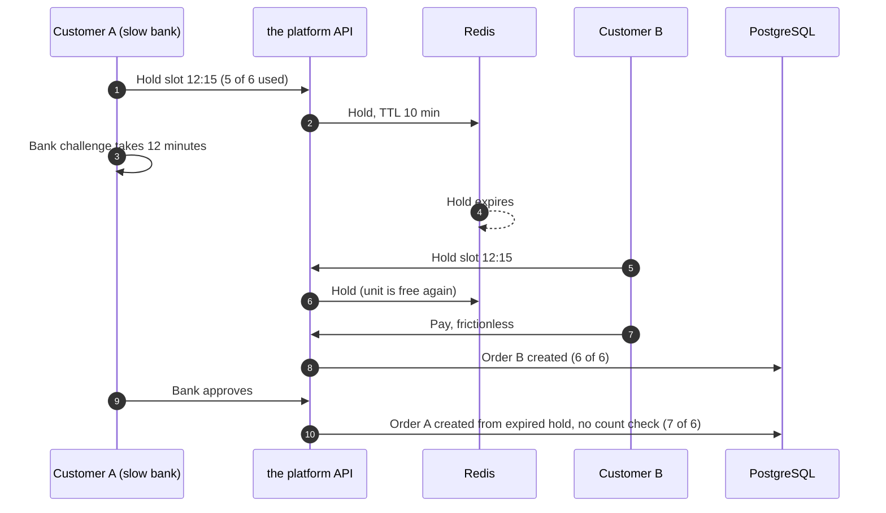

# Post-Incident Review: INC-2026-011 Pickup Slots Over Capacity

## Document control

| Field | Value |
|---|---|
| Document ID | PIR-2026-011 |
| Version | 1.1 |
| Status | Approved |
| Owner | Business Analyst |
| Last updated | 2026-09-25 |
| Reviewers | Engineering Lead (Incident Commander), backend developer (Technical Lead), Partner Success Lead (Communications Lead), Finance Lead, Product Owner, QA Lead |

| Version | Date | Change |
|---|---|---|
| 1.0 | 2026-09-15 | Approved at the review meeting |
| 1.1 | 2026-09-25 | Requirement changes baselined in SRS v1.3 (CR-006) |

## Incident summary

| Field | Value |
|---|---|
| Incident ID | INC-2026-011 |
| Title | Pickup slots over capacity during a slow 3-D Secure service |
| Severity | SEV-2 |
| Status | Closed (CAPA-011-03 ships with R1.1 on 2026-10-07) |
| Incident date | Tuesday 2026-09-08 |
| Trigger | 11:38 CEST, one card issuer's 3-D Secure service slows down |
| Start (first order in a full slot) | 11:52 |
| Detected | 12:06 (business call) |
| Mitigated | 12:31 |
| Resolved | 13:20 (all affected businesses contacted) |
| Incident Commander | Engineering Lead |
| PIR author | Business Analyst |
| Related CR | CR-006 |
| Related ADR / requirements | ADR-002 v1.1, BR-019, BR-020, FR-ORD-12, NFR-OBS-02 |

## 1. Executive summary

At lunchtime on 2026-09-08, the 3-D Secure service of one card issuer slowed down, and customers waited a median of 9 minutes for their bank to confirm a payment. Pickup slot holds last 10 minutes. 63 holds expired while the customer was still in the bank's challenge, and other customers took the freed capacity.

When the delayed payments were finally authorized, the order was created without re-checking the slot: the design trusted the hold it had issued. 23 orders landed in slots that were already full, across 9 locations. The worst was Nudelbar Sesam Mariahilf, with 10 orders for a 6-order slot at 12:15. 15 orders were handed over more than 15 minutes late, and 6 customers left without their food and were refunded.

The team raised the hold time to 20 minutes by configuration 25 minutes after detection. A server hotfix two days later re-checked capacity at authorization. CR-006 turned this into requirements: BR-020, a one-time hold extension when a challenge starts, and alternative slots for the customer.

## 2. Customer and business impact

| Dimension | Impact |
|---|---|
| Orders over capacity | 23 at 9 locations, in 14 slots |
| Worst slot | Nudelbar Sesam Mariahilf, 12:15: 10 orders, capacity 6 |
| Late hand-over | 15 orders handed over more than 15 minutes after their slot |
| Customers who left | 6; refunded by the businesses, EUR 87.60 in total |
| Holds expired during a challenge | 63 (of which 41 still completed payment and created an order; 23 of those in a full slot) |
| Money | No double charges. The platform waived its commission on the 23 orders and the 6 refunded orders. |
| Businesses | Nudelbar Sesam paused ordering for 30 minutes; two cafés reported staff stress at peak |

## 3. Timeline

All times CEST on 2026-09-08.

| Time | Event | Actor (role) |
|---|---|---|
| 11:38 | One issuer's 3-D Secure challenge times rise: median 9 minutes, p90 13 minutes (normally 48 seconds) | External |
| 11:40 to 12:31 | 63 holds expire while their payment challenge is still open | System |
| **11:52** | **Start:** the first authorization after an expired hold creates an order in a full slot (Nudelbar Sesam Mariahilf, 12:15) | System |
| 12:06 | **Detected:** Nudelbar Sesam staff call Partner Success: "10 orders for 12:15, we set 6" | Staff (BIZ-STF) |
| 12:09 | Nudelbar Sesam pauses ordering for 30 minutes | Staff |
| 12:14 | Partner Success pages on-call | Partner Success |
| **12:19** | **SEV-2 declared**; IC Engineering Lead; BA joins for impact | IC |
| 12:24 | Payment events show long challenges; code path found: the authorization webhook creates the order from the hold without counting the slot | Technical Lead |
| **12:31** | **Mitigated:** hold time raised from 10 to 20 minutes by configuration; no further over-capacity order after 12:31 | Technical Lead |
| 12:41 | Issuer's challenge times back to normal | External |
| 12:55 | BA impact query: 41 orders created after hold expiry, 23 in full slots, 14 slots, 9 locations | Business Analyst |
| **13:20** | **Resolved:** all 9 locations called; delay function used for remaining orders; commission waiver agreed | Communications Lead, Finance Lead |
| 2026-09-09 | CR-006 raised | Business Analyst |
| 2026-09-10 | Hotfix: capacity re-checked in the authorization transaction, authorization voided if full; hold time back to 10 minutes | Engineering |
| 2026-09-11 | CR-006 approved (emergency) | Product Owner, Engineering Lead |
| 2026-09-14 | ADR-002 v1.1 accepted; anomaly alerts live | Engineering Lead |
| 2026-09-15 | PIR review meeting; sandbox slow-challenge card available (I-01) | Business Analyst |

### How the overflow happened

## 4. Detection analysis

The first over-capacity order was created at 11:52 and a business reported it at 12:06, 14 minutes later.
- The order board showed the overflow, but staff assumed a busy day until the tickets for one slot passed 8.
- No alert existed on slots over capacity, on 3-D Secure duration or on holds expiring during payment. Technical monitoring was green; no request failed.
- **With today's controls** (CAPA-011-04), the over-capacity alert would have fired at 11:52 and the challenge-duration alert at about 11:45.

## 5. Response analysis

| Measure | Target (SEV-2) | Actual | Met? |
|---|---|---|---|
| Acknowledge | 30 min | 8 min (12:06 to 12:14) | Yes |
| Mitigate | 4 h | 25 min after detection | Yes |
| Business contact | 2 h | All 9 by 13:20 | Yes |

Raising the hold time was a safe interim step because it changed no logic: it only made holds outlive the slow challenges. The real fix needed code and came two days later.

## 6. Root cause analysis

### 6.1 Five whys

1. **Why were slots over capacity?** Because orders were created in slots that were already full.
2. **Why were they created there?** Because the order creation path, triggered by the authorization webhook, trusted the customer's hold and did not count the slot again.
3. **Why did the hold not protect the slot?** Because it had expired during a 3-D Secure challenge that lasted longer than 10 minutes, and another customer had taken the freed unit.
4. **Why did the design trust an expired hold?** Because BR-019 (v1.2) said the hold "reserves one unit for 10 minutes" but nothing about payments that complete after it expires. ADR-002 v1.0 protected appointments with a database constraint, but pickup capacity was checked only when the hold was created.
5. **Why was it not caught before production?** Because tests covered a hold expiring before payment (TC-ORD-005) but not during payment. The sandbox could not simulate a slow challenge, and no alert watched slot counts.

**Root cause statement:** Pickup capacity was enforced when a hold was created instead of when an order was created. No requirement covered a payment that completes after its hold has expired.

### 6.2 Contributing factors

| Category | Factor |
|---|---|
| Requirements | BR-019 silent on expiry during payment; no rule for what the customer sees if the slot is gone |
| Technology | Webhook path converted holds to orders without a database count; appointment and pickup paths designed differently |
| Process | Payment provider sandbox lacked slow-challenge simulation (I-01); no business anomaly alerts |
| External | One issuer covering about a fifth of the pilot's cards degraded for an hour at peak |

### 6.3 Requirement-gap classification

| Cause | Classification | Evidence |
|---|---|---|
| Hold treated as a guarantee | Requirements gap and design defect | BR-019 v1.2; ADR-002 v1.0 |
| No customer path when the slot fills during payment | Requirements gap | FR-ORD-03 v1.2 |
| No over-capacity detection | Requirements gap | NFR-OBS-02 v1.2 |
| Untested slow-challenge path | Test gap | Test cases v1.2 |

## 7. What went well, what went poorly, where we got lucky

| What went well | What went poorly | Where we got lucky |
|---|---|---|
| The configuration change stopped new overflow in 25 minutes | A business found it before we did | Only one issuer degraded, for about an hour |
| The delay function let staff reset customer expectations | 6 customers left without their food | It was a Tuesday, not a Friday lunch |
| No customer was charged twice | Pickup and appointment capacity had been designed with different guarantees | The issuer recovered before the 12:30 peak |

## 8. Corrective and preventive actions

| ID | Action | Type | Owner (role) | Due | Status | Tracking |
|---|---|---|---|---|---|---|
| CAPA-011-01 | Raise the hold time to 20 minutes by configuration (interim) | Mitigate | Engineering Lead | 2026-09-08 | Done (reverted 2026-09-10) | Configuration log |
| CAPA-011-02 | Count the slot in the authorization transaction; void if full | Prevent | Engineering Lead | 2026-09-10 | Done (hotfix) | BR-020; ADR-002 v1.1 |
| CAPA-011-03 | One 5-minute hold extension when a challenge starts; next 3 free slots offered to the customer | Prevent | Product Owner | 2026-10-07 | In progress (R1.1) | US-020-AC3 to AC5 |
| CAPA-011-04 | Alerts: slot over capacity; challenge p90 above 5 minutes; holds expiring during payment above 5% in 15 minutes | Detect | Engineering Lead | 2026-09-14 | Done | NFR-OBS-02; TC-NFR-013 |
| CAPA-011-05 | Sandbox slow-challenge card and regression case | Detect | QA Lead | 2026-09-15 | Done | TC-ORD-010 |
| CAPA-011-06 | Definition of Done: capacity and money rules need a database enforcement point, a concurrency test and an anomaly alert | Process | Business Analyst | 2026-09-16 | Done | [DoR and DoD](../../05-delivery/definition-of-ready-and-done.md) |
| CAPA-011-07 | Partner Success playbook for over-capacity orders: delay, call, refund guidance | Mitigate | Partner Success Lead | 2026-09-16 | Done | Incident process v1.2 |

## 9. Requirement and documentation changes

| Artifact | Change | Baselined in |
|---|---|---|
| BR-019 | One 5-minute extension when a 3-D Secure challenge starts | SRS v1.3 (CR-006) |
| BR-020 | New: re-check at authorization; never create an order in a full slot; 3 alternatives for 3 minutes | SRS v1.3 |
| FR-ORD-12 | Re-check and alternatives | SRS v1.3 |
| ADR-002 | v1.1: a hold is a courtesy, the database decides for pickup as for appointments | ADR-002 v1.1 |
| NFR-OBS-02 | Three new alerts | SRS v1.3 |
| US-020 | AC3 to AC5 | Stories v1.3 |
| Business rules table 3.3 | New decision table for the authorization re-check | Business rules v1.3 |

## 10. Lessons learned

1. **A reservation with a timer is not a guarantee.** Wherever capacity is sold, the final count belongs in the database at the moment of creation.
2. **Design external waits into the requirements.** Strong customer authentication makes the bank part of the checkout, and the bank's speed is outside our control.
3. **Similar problems deserve the same guarantee.** Appointments and pickup slots are both capacity; only one was protected by the database.
4. **Watch business outcomes, not only systems.** "Orders per slot above capacity" is a one-line query that would have paged us at 11:52.

## Approval

| Role | Decision | Date |
|---|---|---|
| Incident Commander (Engineering Lead) | Approved | 2026-09-15 |
| Product Owner | Approved | 2026-09-15 |
| Finance Lead | Approved (commission waiver) | 2026-09-15 |
| Business Analyst (author) | Prepared | 2026-09-12 |

## Related documents

- [Incident management process](../incident-management-process.md)
- [Change request log (CR-006)](../../05-delivery/change-request-log.md)
- [ADR-002 Slot holds](../../03-design/architecture/adr/ADR-002-slot-holds-redis-database-guard.md)
- [Business rules table 3.3](../../02-requirements/business-rules.md)
- [Sequence diagrams (SD-1)](../../03-design/diagrams/sequence-diagrams.md)
- [Test cases](../../06-quality/test-cases.md)
