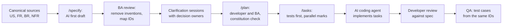

# AI-Assisted Business Analysis

## Document control

| Field | Value |
|---|---|
| Document ID | LC-AI-01 |
| Version | 1.2 |
| Status | Active |
| Owner | Business Analyst |
| Last updated | 2026-09-25 |
| Reviewers | Engineering Lead; Compliance Lead; Product Owner |

**Purpose and scope.** How AI assistants were used in the Business Analysis work on the platform, where they were not used, and the guardrails that kept the output trustworthy. It includes one complete spec-driven feature pack in the GitHub Spec Kit style. The BA writes and owns the specification, and AI coding agents implement from it: [001 Allergen filter on menus](specs/001-allergen-filter-on-menus/spec.md).

## 1. Where AI helped and where it did not

| Activity | AI use | Human ownership |
|---|---|---|
| First drafts of feature specs, from a short input that names the canonical sources | `/specify` drafted the structure, scenarios and an initial list of `[NEEDS CLARIFICATION]` markers | BA edits every line, removes invented requirements and maps every SPEC-FR to a canonical ID |
| Boundary-value rows for Gherkin examples | Suggested candidate boundaries from the rule text | BA and QA choose the rows; expected values are computed by hand or by a reviewed script |
| Consistency checks across documents | Listed IDs that appear in one file and not another | The generator and the verification script are the real control |
| German UI copy | Proposed translations of English drafts | Reviewed by the UX Designer and a pilot business owner; "du" and "Sie" register fixed by rule |
| Implementation of approved tasks | AI coding agents implemented tasks from tasks.md in pull requests | Developers review every pull request against the spec |
| **Not used** | Deciding compliance questions (allergens, VAT, GDPR, cash register rules); setting KPI baselines; worked-example numbers; incident root causes; anything with real customer or business data | BA, Compliance Lead, Finance Lead, incident participants |

## 2. Guardrails

1. **No real data in prompts.** Only the synthetic test data in this repository is used. Personal data, real business data and incident transcripts never go into an AI tool.
2. **Canonical sources only.** Every prompt names the requirement IDs it may draw on. Anything else must come back as `[NEEDS CLARIFICATION]`, never as an invented rule.
3. **No new IDs from AI.** AI output may reference FR, BR, NFR and US IDs but never create them. New requirements go through the BA and, after baseline, the change request process.
4. **Compliance is human.** Any statement about law, health or money is either quoted from the compliance mapping or marked for the Compliance Lead or Finance Lead.
5. **Numbers are computed, not generated.** Worked examples come from a script that the BA reviews, and from a hand calculation recorded in the business rules.
6. **Review is line by line.** Corrections to AI drafts are recorded (section 4), so the team learns where the tools are weak.

## 3. Workflow



**Prompt pattern used for `/specify`** (shortened):

```text
Feature: allergen filter for the Customer Mobile App.
Sources you may use: US-010, FR-DSC-07, FR-DSC-09, BR-010, BR-011, BR-012, NFR-PRIV-01, NFR-ACC-01
(text pasted below). Synthetic data: menu-items.csv rows IT-1001, IT-1003, IT-1005, IT-1006.
Write the spec in the Spec Kit template. Do not create requirement IDs. Mark every decision the
sources do not answer as [NEEDS CLARIFICATION: question]. Do not make legal or health claims.
```

## 4. What the review caught in spec 001

| # | AI draft said | Problem | Correction |
|---|---|---|---|
| 1 | Label matching items "allergenfrei" (allergen-free) | A safety claim the platform cannot make; the business declares, traces are unknown | Removed; became C-03 and SPEC-FR-004, with a test for forbidden words |
| 2 | Sync the filter to the account "for convenience" | Health-related data on the server without explicit consent | Rejected; C-01 and DEC-10 |
| 3 | Track "filter_used" in analytics to measure adoption | Even a flag reveals an allergy | Rejected; C-08 and SPEC-FR-016 |
| 4 | Hide items that contain the allergen | Hides information and prevents ordering for others | Changed to dim and label; C-05 |
| 5 | A fifteenth allergen ("nuts including pine nuts") | Invented; pine nuts are not in Annex II as tree nuts | Removed; the list comes only from BR-010 |

**What the review missed, and what we learned.** Neither the draft nor the review asked how fresh the menu data had to be. The filter worked exactly as specified on data that was hours out of date, which is part of what happened in [INC-2026-006](../07-operations/incidents/INC-2026-006-stale-allergen-information.md). The AI could not raise a question that the sources did not hint at, and the sources had no freshness requirement. Since then:
- the `/specify` prompt asks explicitly about data age and caching for any feature that displays safety or money data;
- the Definition of Done has a matching item.

## 5. Effect on effort

| Measure | Spec 001 |
|---|---|
| Time to a reviewable first draft | About 40 minutes, against about 4 hours for a comparable spec written by hand in S2 |
| Clarification markers raised by the draft | 12 (10 kept, 2 answered by sources) |
| Draft statements removed or changed in review | 5 (section 4) |
| Agent pull requests for tasks T001 to T024 | 9; 2 needed changes in review (telemetry guard placement; semantics label wording) |

The saving is in drafting and in finding questions early. Reviewing and deciding take as long as before, and they should.

## Related documents

- [Spec 001: Allergen filter on menus](specs/001-allergen-filter-on-menus/spec.md)
- [Plan](specs/001-allergen-filter-on-menus/plan.md)
- [Tasks](specs/001-allergen-filter-on-menus/tasks.md)
- [EP-02 stories (US-010)](../05-delivery/user-stories/EP-02-discovery-menus-allergens.md)
- [Compliance mapping](../02-requirements/compliance-mapping.md)
- [Definition of ready and done](../05-delivery/definition-of-ready-and-done.md)
