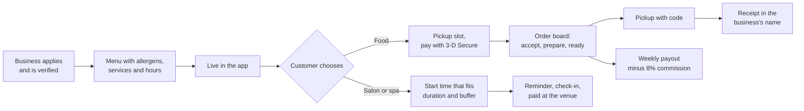

# Local Commerce & Booking Platform: Business Analysis Case Study for a Local Commerce Platform

**An end-to-end, traceable Business Analysis portfolio for a multi-business local commerce platform in Vienna.** It runs from discovery to production incident reviews.

> **Case study of a real project.** Client details are withheld, and names, figures and records in this repository are changed or synthetic. Compliance content is written to show how requirements support regulations; it is not legal or tax advice.

> **Read it in the browser.** The [case study page](https://ayushsingh0456.github.io/case-studies/local-commerce.html) walks through the work, and the [document library](https://ayushsingh0456.github.io/library.html?project=commerce) opens every file here with diagrams rendered. Formatted PDFs: [BRD](https://ayushsingh0456.github.io/assets/docs/local-commerce-BRD.pdf) · [SRS](https://ayushsingh0456.github.io/assets/docs/local-commerce-SRS.pdf).

---

## The product in one paragraph

The platform lets independent local businesses in Vienna run their day on one platform, and lets their neighbors order and book through one mobile app. The businesses are restaurants, cafés and bakeries; hair, beauty and nail salons; and massage, wellness and spa studios. Customers order food for **pickup in a slot the kitchen can handle**, paid in the app with bank confirmation (3-D Secure), or book **salon and spa appointments around the clock** at times that really fit a stylist's day. Businesses work from a portal with a staff **POS view**. The platform's partner operations team onboards and verifies businesses in a **Platform Admin portal**. The product is German-first, prices include VAT, and allergens follow the 14 EU allergens with Austrian letter codes. The hard parts are where a BA earns their keep:
- allergen information must be complete and current before anything can be bought;
- capacity must hold while a bank takes minutes to confirm a payment;
- one basket can carry two VAT rates and a voucher, and every cent must reconcile;
- the staff screen must not turn into a cash register.



## At a glance

| Artifact | Count | Where |
|---|---|---|
| Business objectives with baseline and target | 6 | [BRD](02-requirements/BRD.md) |
| Functional requirements (ISO/IEC/IEEE 29148 SRS, field-level validation in German and English) | 76 | [SRS](02-requirements/SRS.md) |
| Business rules, with 9 decision-table sections | 45 | [Business rules](02-requirements/business-rules.md) |
| Non-functional requirements (ISO/IEC 25010) | 27 | [NFRs](02-requirements/non-functional-requirements.md) |
| Epics / user stories / Gherkin acceptance criteria | 6 / 38 / 166 | [Epics](05-delivery/epics.md), [Jira CSV](05-delivery/jira-import.csv) |
| Mermaid diagrams (C4, swimlanes, sequence, state, ERD, Gantt) | 36 | [03-design](03-design/diagrams/process-flows.md) and throughout |
| Low-fidelity wireframes (annotated SVG) | 5 | [Wireframes](03-design/wireframes/README.md) |
| API operations (OpenAPI 3.1, validated) | 42 | [openapi.yaml](04-api/openapi.yaml) |
| Test cases / UAT scripts | 98 / 10 | [Test cases](06-quality/test-cases.md), [UAT](06-quality/uat-plan-and-scripts.md) |
| Change requests (3 rejected with rationale) | 7 | [CR log](05-delivery/change-request-log.md) |
| Architecture decision records | 3 | [ADRs](03-design/architecture/system-architecture.md) |
| Post-incident reviews (blameless, with 5 Whys and CAPA) | 2 | [Incidents](07-operations/incident-management-process.md) |
| Files in this repository | 59 | Repository map below |

Every FR traces to an objective, business rules, stories and acceptance criteria, API operations and test cases. The [traceability matrix](02-requirements/requirements-traceability-matrix.md) is **generated** from those sources, not maintained by hand.

---

## Start here: a 10-minute tour

1. **[BRD: executive summary and objectives](02-requirements/BRD.md).** The problem in numbers, six objectives with baselines and targets, and what was left out and why.
2. **[SRS: checkout validation and the worked examples](02-requirements/SRS.md).** Section 3.2.3 has field-level rules with German and English messages. Appendix B works through a VAT basket (10% food, 20% drinks, one voucher) and a salon's start times with buffers.
3. **[Business rules: decision tables](02-requirements/business-rules.md).** Allergen display and filter (3.1), the re-check at payment authorization (3.3), VAT and discount allocation (3.4), appointment start times (3.5).
4. **[User stories: EP-03 ordering, pickup and payments](05-delivery/user-stories/EP-03-ordering-pickup-payments.md).** US-014 carries the VAT example; US-020 is the change two incidents produced.
5. **[Sequence diagrams](03-design/diagrams/sequence-diagrams.md)** and **[state machines](03-design/diagrams/state-machines.md).** A slot hold surviving a slow bank challenge; payment authorized at placement and captured at acceptance.
6. **[Wireframes](03-design/wireframes/README.md).** The checkout with VAT lines, the start-time picker and the counter's order board.
7. **[Post-incident review: stale allergen information](07-operations/incidents/INC-2026-006-stale-allergen-information.md).** A near miss that turned a cache setting into a requirement (CR-005).
8. **[Change request log](05-delivery/change-request-log.md).** Includes why "take payments at the counter" (CR-003) and "charge no-show fees" (CR-004) were **rejected**.
9. **[AI-assisted BA](08-ai-assisted-ba/README.md).** A Spec Kit feature pack for the allergen filter, and what the review caught in the AI draft.

---

## Repository map

```
01-discovery/        Charter, stakeholders and RACI, personas, AS-IS / TO-BE, market and competitor scan
02-requirements/     BRD, SRS, business rules, NFRs, compliance mapping, glossary, RTM (md + csv)
03-design/
  architecture/      C4 context and containers, tech stack, ADR-001..003
  data/              ERD, data dictionary
  diagrams/          Swimlane process flows, sequence diagrams, state machines
  wireframes/        5 annotated low-fidelity SVG wireframes (3 mobile, 2 web)
04-api/              OpenAPI 3.1 spec, API guidelines and error catalog, realtime events
05-delivery/         Epics, 6 user-story files, Jira import CSV, release and sprint plan,
                     change requests, decision log, RAID log, DoR/DoD
06-quality/          Test strategy and plan, test cases (md + csv), UAT plan and scripts,
                     synthetic test data
07-operations/       Incident management process, 2 post-incident reviews
08-ai-assisted-ba/   AI guardrails and lessons, plus a GitHub Spec Kit feature pack
                     (spec.md / plan.md / tasks.md) for the allergen filter
```

---

## What this demonstrates

| BA capability | Evidence in this repo |
|---|---|
| Elicitation and discovery | [Current vs future state](01-discovery/current-vs-future-state.md) with measured pain points; [personas](01-discovery/personas.md); [market scan](01-discovery/market-and-competitor-scan.md) |
| Stakeholder management | [Register, influence and interest map, RACI](01-discovery/stakeholder-register-raci.md) |
| Business requirements | [BRD](02-requirements/BRD.md) with objectives, scope, business model and sign-off |
| Requirements specification | [SRS](02-requirements/SRS.md): 29148 structure, interfaces, German and English validation messages, open issues with owners |
| Business rules and decision modeling | [Business rules](02-requirements/business-rules.md) with DMN-style tables and worked examples |
| Non-functional requirements | [NFRs](02-requirements/non-functional-requirements.md) mapped to ISO/IEC 25010 with a load profile |
| Process and system modeling | [Process flows](03-design/diagrams/process-flows.md), [sequences](03-design/diagrams/sequence-diagrams.md), [state machines](03-design/diagrams/state-machines.md), [architecture](03-design/architecture/system-architecture.md) |
| Data analysis | [ERD](03-design/data/erd.md), [data dictionary](03-design/data/data-dictionary.md) with classification and retention |
| API and integration analysis | [OpenAPI 3.1](04-api/openapi.yaml), [error catalog](04-api/api-guidelines.md), [realtime events](04-api/realtime-events.md) |
| Agile delivery | [Epics](05-delivery/epics.md), [stories with Gherkin](05-delivery/user-stories/EP-04-appointment-booking.md), [sprint plan](05-delivery/release-and-sprint-plan.md), [DoR and DoD](05-delivery/definition-of-ready-and-done.md) |
| Change control and governance | [Change requests with impact analysis](05-delivery/change-request-log.md), [decision log](05-delivery/decision-log.md), [RAID log](05-delivery/raid-log.md) |
| Quality and UAT | [Test strategy (29119-3)](06-quality/test-strategy-and-plan.md), [test cases](06-quality/test-cases.md), [UAT scripts and sign-off](06-quality/uat-plan-and-scripts.md), [test data](06-quality/test-data/README.md) |
| Production support | [Incident process](07-operations/incident-management-process.md) and two PIRs with 5 Whys, CAPA and the change request each produced |
| Regulated-domain awareness | [Compliance mapping](02-requirements/compliance-mapping.md): EU food information (allergens), GDPR and the Austrian age of consent, PSD2 strong customer authentication, Austrian VAT and invoices, distance selling, platform-to-business rules, accessibility |
| AI-assisted analysis | [Guardrails and lessons](08-ai-assisted-ba/README.md), [spec-driven feature pack](08-ai-assisted-ba/specs/001-allergen-filter-on-menus/spec.md) |

---

## Judgment calls worth discussing

- **Allergens are a publishing gate, not a disclaimer.** Discovery suggested showing "information not available, ask the business". Instead, no food item can be ordered without a complete, confirmed declaration, and each change creates a new version (BR-011, BR-013, DEC-03).
- **The POS view is not a cash register.** Taking counter payments would have made the platform subject to Austrian cash register rules, and every pilot business already had a certified register. CR-003 was rejected; staff only confirm "Bezahlt an der Kassa" (BR-024).
- **Capture at acceptance.** Payments are authorized when the customer orders and captured only when the business accepts, so a rejected order costs nobody anything ([ADR-003](03-design/architecture/adr/ADR-003-marketplace-payments-authorize-capture.md)).
- **A hold is a courtesy; the database decides.** After slow bank challenges let a pickup slot take 10 orders against a capacity of 6, capacity is re-checked when payment is authorized, and the customer is offered the next free slots (INC-2026-011, CR-006, BR-020).
- **No fees for no-shows, yet.** Automatic no-show fees (CR-004) were rejected for R1. Reminders and free self-service cancellation cut no-shows from 9.5% to 4.6% in the pilot.
- **Health data stays on the phone.** The allergen filter never reaches the server. The AI draft wanted to sync it and to label items "allergenfrei"; both were removed in review ([spec 001](08-ai-assisted-ba/specs/001-allergen-filter-on-menus/spec.md)).
- **Neutral ranking.** No public ratings or paid placement (CR-007 rejected); lists sort by distance or name, as disclosed in the business terms.

---

## Standards and techniques used

ISO/IEC/IEEE 29148 (requirements) · ISO/IEC 25010 (quality model) · ISO/IEC/IEEE 29119-3 (test documentation) · BABOK v3 techniques · INVEST and Gherkin (Given/When/Then) · MoSCoW · C4 model · BPMN-style swimlanes · UML state and sequence diagrams · DMN-style decision tables · OpenAPI 3.1 and RFC 9457 problem details · MADR architecture decision records · blameless post-incident reviews with 5 Whys and CAPA · Regulation (EU) No 1169/2011 · GDPR and Austrian DSG section 4 · PSD2 and the SCA technical standards · Austrian UStG sections 10 and 11 · FAGG section 8 · Regulation (EU) 2019/1150 · WCAG 2.2 AA · OWASP ASVS · GitHub Spec Kit.

## Using the files

- **Diagrams** render directly on GitHub (Mermaid). To edit one, paste the block into [mermaid.live](https://mermaid.live).
- **Jira:** import [`jira-import.csv`](05-delivery/jira-import.csv) through *System > External system import > CSV*. It contains 6 epics and 38 stories with acceptance criteria, points, sprints and labels.
- **API:** open [`openapi.yaml`](04-api/openapi.yaml) in Swagger Editor or Redocly; each operation lists the requirements it serves in `x-requirements`.
- **Test data:** see the [test-data README](06-quality/test-data/README.md); the expected results for both worked examples are listed there.

---

## About the author

**Ayush Kumar Singh** is a Business Analyst working on SaaS and platform products. His work covers:
- requirements and SRS authoring;
- user stories and acceptance criteria;
- process and data modeling;
- UAT;
- incident documentation and change control.

LinkedIn: [linkedin.com/in/ayush-singh-914495189](https://www.linkedin.com/in/ayush-singh-914495189/)

This case study is based on a project I worked on as Business Analyst. Client and employer details are withheld to protect confidentiality.
